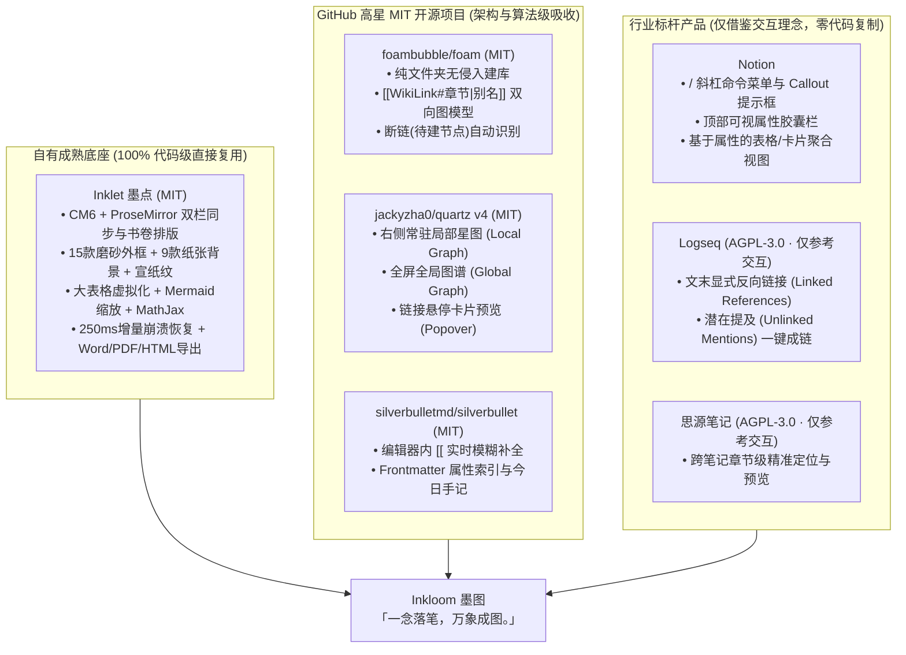

# Inkloom 墨图 · 产品创作札记与顶层设计蓝图

> **产品名称**：Inkloom 墨图  
> **品牌标语（Slogan）**：一念落笔，万象成图。  
> **产品定位**：本地优先、相对轻量、可自由组合的个人知识与创作工作台  
> **创作者**：达芬奇Vincent  
> **撰稿日期**：2026-10-21
> **最新方向确认**：2026-10-22，独立产品定位与长期扩展路线
>
> **记录口径**：前五章是早期创意，第六章是 0.2.0 迭代记录，第七章是最新产品方向。已做、未做、依赖和验收条件统一以 [开发与扩展路线](ROADMAP.md) 为准，当前功能见 [README.md](README.md)。早期“5 MB 内、150ms 启动、60fps、80%/100% 复用、工业级导出”等表述未经完整基准验证，不作为产品承诺；现有项目的优劣也不能仅凭架构或许可证推断。Notion、Obsidian 是体验参考，不应统称为开源项目。

---

## 3.1.0 迭代记录：全库正则 / 跨文件受控预览查找替换工作台与标准 `.ics`（RFC 5545）日程双向同步（`MAJOR-310`，2026-11-14）

1. **全库正则表达式 / 跨文件受控预览查找替换与 YAML 属性批量改名（`previewVaultSearchAndReplace` · `core/vault-doctor.mjs`）**：遵循「表层极简 · 菜单收纳」原则，在笔记顶栏 `#note-tools-menu`（`#note-vault-replace-button`）、页内查找栏 `#open-vault-replace-from-search`、文件菜单与 `Ctrl+K` 命令中心提供 `#vault-replace-dialog`；支持正则表达式分组（`$1`）、目录范围限定、跳过代码块、保护 `[[双链]]` 目标路径、YAML 属性键名重命名，先展示逐行红绿 Diff 预览再写入，并内置内存安全回退点支持一键整批无损撤销。
2. **标准 RFC 5545 `.ics`（iCalendar）日程双向导出与导入（`exportTasksToIcsCalendar` / `parseIcsCalendarToTasks` / `compileImportedIcsNoteMarkdown` · `core/workspace-model.mjs`）**：在工作台总览 `#home-periodic-menu-panel` 中集成 `.ics` 导出与外部日历文件/文本导入，双向无损映射 `DTSTART`、`PRIORITY`、`STATUS` 与 `RRULE` 重复规则。

## 3.0.0 迭代记录：全库便携归档（`.inkloom-vault.zip` 含 SHA-256 验签还原）及跨笔记 `![[块/章节]]` 动态内嵌巡检对比台（`MAJOR-300`，2026-11-14）

1. **全库便携归档与 FIPS 180-4 SHA-256 完整性验签还原（`compileVaultPortableArchiveBytes` / `inspectAndVerifyVaultPortableArchive` · `core/vault-snapshot.mjs`）**：遵循「表层极简 · 菜单收纳」原则，在活动栏底部 `#special-tools-menu`、文件菜单 `#file-menu` 与 `Ctrl+K` 命令中心提供 `#vault-archive-dialog`，支持将全库多级目录笔记与 64 位 SHA-256 签名清单导出为 `.inkloom-vault.zip`，并对导入归档包执行逐文件哈希校验（任何篡改或缺失硬性拦截）与 BOM/CRLF 无损差异还原。
2. **跨笔记块引用与章节内嵌巡检对比台（`inspectVaultEmbedReferences` / `repairBrokenNoteEmbedInSource` / `batchRepairNoteEmbedsInSource` · `core/note-embeds.mjs`）**：在笔记顶栏 `#note-tools-menu`（`#note-embed-inspector-button`）与「智识 → 格式与断链体检 → `🧬 Dataview与多源迁移 ▾`」（`#ai-embed-audit-btn`）中提供跨笔记 `![[笔记#章节]]` / `![[笔记#^block-id]]` 实时预览、原位跳源、源章节改名模糊匹配与一键批量对齐修复。

## 2.9.0 迭代记录：笔记知识金句与分享卡片离线渲染器（SVG / PNG）及写作目标字数热力冲刺与里程碑统计（`MAJOR-290`，2026-11-14）

1. **笔记知识金句与分享卡片离线渲染器（`extractNoteKnowledgeCardPayload` / `renderKnowledgeShareCardSvg` · `core/publication-presenter.mjs`）**：遵循「表层极简 · 菜单收纳」原则，在笔记顶栏 `#note-tools-menu`（`#note-share-card-button`）、正文划词浮栏 `#selection-tools`（`#selection-share-card-btn`）与 `Ctrl+K` 命令中心中提供离线知识卡片生成器（`#share-card-dialog`），支持 `书卷清透 / 暗夜黑金 / 莫兰迪青瓷 / 苍穹靛青` 四款主题版式、自动净化 `[[双链]]`、自定义署名印章，并支持一键复制矢量 SVG、下载 `.svg` 或离线渲染 2x 高清 `.png` 图片。
2. **写作目标字数热力冲刺与里程碑统计（`computeWritingSprintStats` / `compileWritingSprintReportMarkdown` · `core/workspace-model.mjs`）**：在工作台总览 `#home-periodic-menu-panel` 中集成每日目标字数、全库/长稿总目标字数、连续创作天数（Streak）与四大创作里程碑追踪，支持一键生成存入 `journals/sprints/` 的近 7 日写作热力复盘报告。

## 2.8.0 迭代记录：周期性手记日/周/月/季模板中心与 SM-2 记忆闪卡 Anki（`.apkg` / TSV）双向同步工作台（`MAJOR-280`，2026-11-14）

1. **周期性手记日/周/月/季模板中心（`computePeriodicNoteSpec` / `compilePeriodicNoteMarkdown` · `core/workspace-model.mjs`）**：遵循「表层极简 · 菜单收纳」原则，在工作台总览新增 `#home-periodic-menu`（`📅 周期手记 ▾`），并在活动栏「今日手记」挂载悬停/右键直达菜单与 `Ctrl+K` 命令，支持按 ISO 周（`journals/weekly/YYYY-Www.md`）、自然月（`journals/monthly/YYYY-MM.md`）与季度（`journals/quarterly/YYYY-Qn.md`）自动聚合周期内活跃笔记 `[[双链]]`、已完成/待推进任务与待复习闪卡负荷。
2. **SM-2 记忆闪卡 Anki（`.apkg` / TSV）双向同步工作台（`exportFlashcardsToAnkiTsv` / `exportFlashcardsToAnkiDeckPackageBytes` / `parseAnkiFlashcardsImport` · `#ai-sr-deck-menu`）**：在「智识 → 闪卡温习 → `牌组与制卡 ▾`」弹出菜单中支持一键导出标准 Anki TSV 与离线 `.apkg` 压缩牌组包，并支持从 `.apkg`（含 `deck-manifest.json`、`cards.tsv` 及 SQLite `collection.anki21` `\x1f` 字段回退解析）或 `.tsv` 文本无损导入闪卡、自动去重并保留 SM-2 进度参数。

## 2.7.0 迭代记录：EPUB 3.0 电子书离线打包出版引擎与多维视图 CSV / Markdown 汇总表双向批处理工作台（`MAJOR-270`，2026-11-11）

1. **标准 EPUB 3.0 电子书离线打包出版引擎（`compileEpub3PackageBytes` · `core/publication-presenter.mjs`）**：在顶栏导出弹窗（`#export-format`）与「研究 → 长稿 → 出版定稿」（`#manuscript-export-epub-btn`）中支持将单篇长文、多章长稿或目录笔记一键编译为标准 EPUB 3.0 归档（`mimetype`、`META-INF/container.xml`、`OEBPS/content.opf`、`nav.xhtml`、`toc.ncx`、`chapter-*.xhtml`），并支持与内置 `raw/` EPUB 阅读器双向无损往返。
2. **多维属性视图 CSV / Markdown 汇总表导出与 CSV 批量属性同步（`exportDatabaseRowsToCsv` / `exportDatabaseRowsToMarkdownTable` / `parseDatabaseCsvPropertyUpdates` · `#database-view-manage-menu`）**：在「笔记视图 → `视图管理 ▾`」弹出菜单中集成当前视图 CSV 导出、存为带 `[[双链]]` 的 Markdown 汇总笔记与粘贴 CSV 批量同步笔记 YAML 属性。

## 2.6.0 迭代记录：多级目录长稿章节编排总控台（Folder Manuscript Binder）与跨章节人物·概念·时间线追踪矩阵（`MAJOR-260`，2026-11-09）

1. **多级目录长稿章节编排总控台（`compileFolderManuscriptBinder` · `core/research-notes.mjs`）**：在「研究 → `+ 新建与导入 ▾`」弹出菜单（`#research-folder-binder-toggle`）与左侧目录树右键菜单（`[data-tree-cmd="bind-folder-manuscript"]`）中支持直接将任意多级嵌套目录递归映射为包含分卷进度汇总、章节字数状态表与内嵌章节结构的长稿总控台（`manuscripts/`）。
2. **跨目录/跨章节人物·概念·时间线追踪矩阵（`buildCrossChapterEntityTimelineMatrix` · `#ai-consistency-matrix-menu`）**：在「智识 → 长稿前后核查」的 `🧭 设定与时间线矩阵 ▾` 弹出菜单中支持按指定多级目录或全库扫描 `【实体·属性】：值` 与时间锚点，输出跨章设定演进矩阵与时间线序列表。

## 2.5.0 迭代记录：多级目录树递归展开至最底层 / 选中目录一键收起与交互式知识大纲思维导图（`MAJOR-250`，2026-11-08）

1. **多级目录树递归展开至最底层 / 选中文件夹一键收起引擎（`collectDescendantFolderPaths` / `isFolderRecursivelyExpanded` / `applyRecursiveFolderExpansion` · `core/vault-tree.mjs`）**：在左侧 `#vault-tree-list` 中为每个文件夹配备主题一致的 `FolderOpen` / `FolderClosed` 状态图标与行尾 `ChevronsUpDown` / `ChevronsDownUp` 递归展开/收起徽标，在 `.vault-bar-actions` 顶栏新增 `#vault-expand-deep-btn`（全部展开至最底层）与 `#vault-collapse-all-btn`（全部收起），并在 `#vault-tree-context-menu` 右键菜单同步支持递归展开/收起。
2. **交互式知识大纲与多级目录层级思维导图（`buildNoteHeadingMindmapTree` / `buildFolderHierarchyMindmapTree` / `renderMindmapTreeSvg` / `collectBlockReferenceBacklinks` · `#mindmap-presenter-dialog`）**：遵循「表层极简 · 菜单收纳」原则，在笔记顶栏 `#note-tools-menu` 与目录树右键菜单中提供交互式 SVG 思维导图，支持切换「当前笔记章节双链导图」与「选中多级目录结构导图」、一键展开至最底层/收起子分支与复制高清矢量 SVG。

## 2.4.0 迭代记录：Obsidian JSON Canvas (`.canvas` 1.0) 双向无损互通与星图路径投射空间白板（`MAJOR-240`，2026-11-08）

1. **Obsidian JSON Canvas (`.canvas` 1.0) 双向无损互通引擎（`convertJsonCanvasToWhiteboardScene` / `exportWhiteboardSceneToJsonCanvas` · `core/spatial-canvas-graph.mjs`）**：在 `plugins/whiteboard/main.js` 与 `canvas-view.js` 中扩展支持导入/导出 `.canvas` 标准文件，实现 `file`（绑定 `[[笔记]]` 双链卡片）、`text`、`group`、`link` 节点与 `edges` 有向连线的双向无损映射。
2. **知识星图路径 / 社区子图一键投射生成空间白板（`buildWhiteboardSceneFromGraphSubgraph` · `#graph-project-whiteboard-btn`）**：在「万象知识星图 → `🧭 图谱寻路 ▾`」弹出菜单中新增 `🎨 投射为空间白板`，支持将最短路径传导链路或核心社区子图一键合成为 Excalidraw 空间白板存入 `whiteboards/`。

## 2.3.0 迭代记录：Obsidian Dataview DQL 实时查询引擎与 Notion / Logseq 多源无损迁移工作台（`MAJOR-230`，2026-11-08）

1. **Obsidian Dataview DQL 实时查询解析与执行引擎（`parseDataviewQuery` / `executeDataviewQuery` · `#ai-doctor-tools-menu`）**：在 `core/vault-doctor.mjs` 与 `#ai-panel-doctor` 的 `🧬 Dataview与多源迁移 ▾` 菜单中实现 `TABLE / LIST / TASK` 查询语法解析，支持按 `FROM "目录" / #标签`、`WHERE` 条件、`SORT ASC/DESC` 与 `LIMIT` 实时检索全库笔记并渲染带 `[[双链]]` 的 Markdown 汇总表与任务清单。
2. **Notion 导出与 Logseq 大纲多源无损迁移净化（`convertExternalVaultNoteToInkloom`）**：自动剥离 Notion 导出文件名及内部链接的 32 位十六进制 UUID 后缀、提取顶部属性行生成标准 YAML Frontmatter；自动提取 Logseq `key:: value` 属性、剥离内部块 `id::` 并将 `- # 标题` 与 `TODO / DOING / DONE` 转换为标准 Markdown 标题与任务复选框（100% 保留 UTF-8 BOM 与 CRLF）。

## 2.2.0 迭代记录：端到端加密（E2EE）零知识增量同步仓与跨平台可移植构建自检（`MAJOR-220`，2026-11-07）

1. **零知识端到端加密（E2EE）增量同步仓（`buildZeroKnowledgeE2eeSyncEnvelope` / `decryptAndVerifyE2eeSyncEnvelope` · `#ai-sync-e2ee-menu`）**：在「智识 → 多端目录增量同步」操作栏收纳 `🔐 零知识E2EE与跨平台 ▾` 弹出菜单，支持使用 `PBKDF2-HMAC-SHA256 (100,000 次迭代) + AES-256-GCM` 将全库或指定目录增量推送至内容寻址的零知识密文仓（未变笔记自动复用已有密文块，清单本身亦经 AES-256-GCM 加密，远端不暴露任何明文路径、标题或正文），并支持口令解密与 64 位 SHA-256 完整性还原核验（完整保留 UTF-8 BOM 与 CRLF）。
2. **跨平台可移植性与三端桌面宿主自检（`evaluateCrossPlatformPortability` · `RELEASE-002`）**：自动检测全库在 Windows (`NTFS`)、macOS (`APFS` 大小写冲突与 NFC/NFD 归一化) 与 Linux (`ext4`) 下的路径兼容性与盘符硬编码引用，输出三端宿主构建就绪度矩阵，并如实区分已实机验收的 Windows x64 原生宿主与需在目标系统实机编译验收的 macOS/Linux 可移植包。

## 2.1.1 迭代记录：Markdown 书籍朗读与中文防拆词韵律管线移植（2026-11-07）

1. **防拆词韵律前端、分段抽取与隐私安全门禁（`cleanSpeechText` / `splitSpeechSentences` / `extractSpeechSegments` / `assertSpeechAllowed` · `app/src/speech-reader.js`）**：从 Inklet `0.11.9` 同步中文有声书韵律预处理管线（剥离括号拼音注音、解除短词强调引号、规整章节前导零、跳过 YAML/注释/Mermaid/代码块），并与 Inkloom 三态隐私隔离（`PRIV-001`）深度联动——内控（`local-only`）与机密（`confidential`）笔记仅允许本机离线语音，严禁向在线语音服务发送。
2. **极简菜单化朗读入口、同窗折叠偏好与原生多引擎语音合成（`mountSpeechReader` · `app/src/speech-panel.js` & `native/SpeechService.cs`）**：遵循「表层极简 · 菜单收纳」原则，将「书籍朗读」放入笔记顶栏 `#note-tools-menu` 及划词浮栏 `#selection-tools`；在「设置 → 阅读与排版 → 书籍朗读」中提供本机离线语音、16 款 Edge 自然音色（含中英混读多语种模型）、4 档语调、`0.75x ~ 2.0x` 语速、按章/定时停止与 OpenAI 兼容语音接口（DPAPI 加密存储密钥），切篇或编辑正文时自动中止待播音频流。

## 2.1.0 迭代记录：桌面 OneNote COM 全保真手写墨迹还原与外部 MCP 权限审计台（`MAJOR-210`，2026-11-06）

1. **OneNote `<one:InkDrawing>` 手写墨迹离线 SVG 矢量还原与四维全保真校验（`renderOneNoteInkDrawingToSvg` / `auditOneNoteMigrationFidelity` · `core/onenote-importer.mjs`）**：支持将 OneNote 页面中的 `<one:InkDrawing>` / `<one:Stroke>` 手写笔迹矢量还原为离线 SVG（`assets/onenote/*-ink-*.svg`），并在迁入核对页输出二维坐标重排、原图字节、手写墨迹 SVG 与随页附件字节四维全保真核验摘要。
2. **外部 MCP 工具级权限开关、目录白名单与 JSON-RPC 2.0 审计账本（`evaluateMcpSecurityPolicy` / `formatMcpAuditLedgerMarkdown` · `#ai-mcp-security-menu`）**：在「外部 AI 接入」控制栏收纳 `🛡️ 权限与审计 ▾` 弹出菜单，支持一键切换「🔒 仅开放只读工具 / 🔓 开放全部工具」、按工具独立启停、设置允许访问的目录白名单，并实时记录与展示每次 JSON-RPC 2.0 调用的放行/拦截审计账本。

## 2.0.0 迭代记录：多模态 `raw/` 离线 OCR 摄取与可选本地 GGUF Embedding 向量索引（`MAJOR-200`，2026-11-06）

1. **多模态扫描件/长图离线 OCR 提取与表格还原（`parseMultimodalOcrDocument` / `reconstructMarkdownFromOcrBoxes` · `#ai-compiler-raw-menu`）**：在 `core/raw-document-ingestor.mjs` 与 `native/VaultStore.cs` 扩展支持 `.png / .jpg / .jpeg / .webp / .svg` 与扫描版 PDF，按空间坐标行聚类与列对齐自动还原章节段落与 Markdown 数据表，并将导入与 OCR 入口统一收纳在 Karpathy 编译器的 `+ 导入与OCR ▾` 弹出菜单中。
2. **可选本地 GGUF Embedding 语义向量索引与平滑模型版本重建（`buildPersistentEmbeddingIndex` / `checkEmbeddingIndexMigration` · `#ai-embedding-index-menu`）**：在模型配置页操作栏收纳 `🧬 向量索引管理 ▾` 弹出菜单，支持 `fnv1a-128d-v1`、`local-gguf-embed-v1`（256 维）与 `hybrid-rrf-v2`（384 维）三档向量索引的 SHA-256 增量复用与跨模型版本平滑重建。

## 1.9.0 迭代记录：跨原生窗口多屏协同与页签拖拽拆窗（`MAJOR-190`，2026-11-05）

1. **跨原生窗口多屏协同与拖拽拆窗（`validateSecondaryWindowSpec` / `detectTabTearOffGesture` · `InkloomApplication.OpenWindow`）**：在 `native/InkloomApp.cs` 中扩展 `InkloomApplication` 管理多实例 `InkloomWindow` 生命周期，共享同一个 `VaultStore`、`WorkspaceStore` 与 `CoreWebView2Environment`；前端在 `#note-tools-menu`、`#file-menu`、`#vault-tree-context-menu`、`#graph-pathfinder-menu`、`#reader-tools-menu` 及顶部水泡页签拖拽手势中支持一键将笔记、星图、白板或原件阅读器拆出为独立副窗口（表层零平铺按钮）。
2. **跨窗口事件总线与未保存草稿保护（`createSyncEnvelope` / `reconcileCrossWindowNoteUpdate` · `#multi-window-dialog`）**：通过宿主 `BroadcastEvent("crossWindowSync")` 与 `BroadcastChannel` 实时同步跨窗保存与双链跳转；若另一窗口对同一笔记有未保存草稿，则触发 `conflict-preserve-draft` 提醒，绝不静默覆盖草稿。

## 1.8.0 迭代记录：PDF 原生版面渲染与画布级框选批注工作台 + 全站极简菜单化 UI 统一收敛（`MAJOR-180`，2026-11-05）

1. **PDF 原生版面渲染画布、双页并排、缩放与画布级框选区域批注（`computePageLayoutBlocks` / `extractTextFromPageRegion` / `renderPageRegionSvgThumbnail` · `#reader-canvas-stage`）**：在「研究 → 原件精读」中提供 `原生版面` 与 `书卷流式` 切换、双页并排对照视图（`#reader-spread-toggle`）、版面缩放调节以及画布级框选区域批注（`#reader-box-annotate-toggle` + `.reader-page-overlay` 指针拖拽），自动提取框选区文本、生成离线 SVG 区域快照缩略图并双向写入 `excerpts/` 的 `source_bbox` 与 `#inkloom-reader?...&bbox=` 锚点。
2. **全站「表层极简 · 菜单收纳」UI 统一化（`.ux-popover-menu`）**：确立未来所有功能均以表层 UI 极简为主、次级功能通过菜单隐藏而非平铺在界面上的设计铁律；统一重构笔记顶栏 `#note-tools-menu`、多维视图 `#database-view-manage-menu`、研究工作台 `#research-actions-menu`、原件阅读器 `#reader-tools-menu`、知识星图 `#graph-pathfinder-menu` 与记忆闪卡 `#ai-sr-deck-menu`。

## 1.7.9 迭代记录：SM-2 记忆闪卡牌组分类、难点错题本、右侧栏微复习卡与 1.7 系列手册同步（`ITER-179`，2026-11-05）

1. **SM-2 闪卡牌组分类与难点错题本筛选（`filterFlashcardsDeck` / `isHardFlashcard` · `#ai-sr-deck-filter-bar`）**：在 `extractFlashcardsFromNotes` 中提取每张闪卡所属的 `folder`、`tags` 与 `isHardCard` 状态，并在 `#ai-panel-flashcards` 顶部提供 `#ai-sr-folder-filter`、`#ai-sr-tag-filter` 与 `#ai-sr-hard-only-btn`（「🔥 难点错题本」），支持按目录、标签或难点错题精准过滤复习队列。
2. **右侧关联栏可折叠「🧠 今日到期微闪卡」小组件（`selectDueMicroFlashcards` · `#context-micro-flashcards`）**：在右侧关联栏底部挂载可折叠的今日 3 张到期微闪卡抽屉，优先排列难点到期卡，支持原位翻转答案并一键执行「重来 / 掌握」SM-2 回写与来源跳转。
3. **1.7 系列焦点环加固与手册同步**：加固全站交互控件 `:focus-visible` 焦点环，并同步更新 `docs/USER-MANUAL.md`、`F1` 交互式手册（`app/src/user-guide.js`）与 `Inkloom使用方法/` 沙盒教程。

## 1.7.8 迭代记录：书卷专注禅模式（Zen Focus）与表格/图表微交互精修（`ITER-178`，2026-11-05）

1. **书卷专注禅模式（`Ctrl+Shift+F` & `#zen-focus-button`）**：在笔记顶栏提供专注模式快捷按钮并绑定 `Ctrl+Shift+F` 快捷键，一键隐藏外置活动栏、左右侧栏、右侧水泡条与底部反向链接抽屉，联动当前活跃段落聚光灯（`updateActiveParagraphForZenFocus`）与柔和页边距。
2. **Markdown 表格列对齐切换与单列快速复制（`alignMarkdownTableColumnInSource` & `extractMarkdownTableColumnFromSource`）**：在 `#table-tools` 悬浮条新增左对齐（`:---`）、居中对齐（`:---:`）、右对齐（`---:`）与复制当前列数据按钮。
3. **Mermaid 图表与代码块一键复制（`.code-block-copy-btn` / `#diagram-copy-image-btn` / `#diagram-copy-source-btn`）**：为每个代码块工具栏挂载一键「复制源码」按钮，并在图表预览窗提供一键复制高清矢量图（SVG）与图表源码。

## 1.7.7 迭代记录：全域键盘流进阶与 `Ctrl+K` 最近访问栈 / 批量整理动作（`ITER-177`，2026-11-05）

1. **`Ctrl+K` 最近访问笔记与原件栈（`recordMruVisit` · `[data-qs-mru="true"]`）**：在 `openVaultNoteById`、`openRawDocumentInReferencePane` 与 PDF/EPUB 原件阅读器翻页时自动维护最近访问栈（MRU Stack）；当用户打开 `Ctrl+K` 未输入关键词时，默认置顶展示最近访问的笔记、章节锚点以及 PDF 页码 / EPUB CFI 位置，支持一键直达。
2. **左侧目录树与多维表格 `Shift/Ctrl` 批量多选整理（`computeBatchTagPatch` / `resolveShiftRangeIds` · `#vault-batch-bar` / `#database-batch-bar`）**：在左侧目录树与「笔记视图」多维表格中支持 `Shift` 范围多选与 `Ctrl` 多选，提供「批量添加/移除 `#标签`、批量修改 `status`、批量移入目标目录（自动重写全库双链）」一体化动作栏。

## 1.7.6 迭代记录：多维属性视图「常驻视图预设页签（Saved View Tabs）+ 组合筛选」（`ITER-176`，2026-11-05）

1. **常驻视图预设页签与组合筛选还原（`normalizeSavedDatabaseViews` / `saveDatabaseViewPreset` · `#database-saved-views-bar`）**：在「笔记视图」顶栏提供轻薄视图页签条，默认内置「全部笔记 · 进行中项目 · 待读文献」三枚预设，支持将当前表格/看板模式、目录/标签/状态筛选、分组字段、派生公式/关联汇总列与排序方向一键保存为常驻视图页签。
2. **自定义视图重命名、删除与拖拽排序（`renameDatabaseViewPreset` / `deleteDatabaseViewPreset` / `reorderDatabaseViewPresets`）**：支持在顶栏原位重命名、删除自定义视图页签或通过鼠标拖拽调整页签顺序，并通过插件设置持久化。

## 1.7.5 迭代记录：学术文献引文引擎（BibTeX / RIS 导入与 GB/T 7714 / APA 格式化 · `ITER-175`，2026-11-05）

1. **BibTeX (`.bib`) 与 RIS (`.ris`) 真实元数据解析与入库（`parseBibtexEntries` / `parseRisEntries` / `parseAcademicReferences`）**：在「研究 → 资料」中新增 `#research-import-bib-toggle` 导入栏，支持粘贴文本或选择 `.bib` / `.ris` 文件批量解析文献条目并写入 `sources/` 目录；严格遵循引用可追溯铁律，仅提取源文件中的真实字段（作者、年份、标题、期刊/出版社、卷期页码、DOI/URL），缺失字段保持留空，绝不伪造。
2. **引文栏四档学术格式切换（`formatResearchCitation` · `#research-citation-style-bar`）**：支持在 `双链引文`、`GB/T 7714-2015`、`APA 7th` 与 `BibTeX` 四种格式间原位切换并自动复制。
3. **长稿出版联排标准参考文献索引（`compilePublicationManuscript` · `#manuscript-citation-style-select`）**：长稿出版定稿预览与保存支持按所选学术格式自动生成 `## 参考文献与关联索引`。

## 1.7.4 迭代记录：全新默认主题「墨图云灰 · 炭黑微浮雕按钮条」与原件同屏联动引文（2026-11-04）

1. **默认主题重构（「墨图云灰 · 炭黑微浮雕按钮条」· `neutral` + `--charcoal-bar-*`）**：针对此前五颜六色图标按钮与工作区主题割裂、浅底线条图标辨识度不足的问题，将默认主题切换为温润的银灰石雕色系（`墨图云灰` `#e5e7eb / #dadde2` + `浅灰` `#f3f4f6` 纸面），并将左侧活动栏胶囊、顶栏操作条、知识库工具条、笔记脉络工具条与格式工具条重塑为微凸起的深色炭黑胶囊条（`--charcoal-bar-bg`），配以纯白线条图标（`--charcoal-bar-ink`）与烟灰微浮雕选中态，侧栏选中项采用珠光白浮雕胶囊（`--sculpted-pill-bg`）。
2. **右侧分屏对照栏 PDF/EPUB 按页/按章阅读与同屏联动引文（`ITER-174` · `#reference-pane` & `formatSplitReaderCitationBlock`）**：在分屏对照栏直接复用 PDF 按页 / EPUB 按章阅读器（支持从「研究 → 原件精读」点击 `#reader-open-split-pane-btn`「分屏对照写笔记」直达），支持翻页、目录跳章与一键将 `[《书名 · 第 N 页》](<#inkloom-reader?...>)` 可溯源引文块插入当前笔记光标处。
3. **原件 SHA-256 变更预警与一键核对同步（`detectDocumentHashDrift` & `syncDocumentSourceHashInMarkdown`）**：当 `raw/` 原件更新导致 SHA-256 变化时，在摘录列表、精读摘录卡片与分屏对照栏顶部展示温和的琥珀色「原件版本已更新 · 一键核对同步」提示条，点击即可无损更新 `source_hash` 与 `#inkloom-reader?...` 哈希。

## 1.5.0 迭代记录：Karpathy `raw/ → wiki/` 知识编译器、上下有序单列《认知演进史》、三态隐私加密护盾与七大物理知识算法（2026-10-28）

按照路线图第 9.3 章，1.5.0 一次性完成 `KPKM-001`..`003`、`PRIV-001`..`002`、`ALGO-001`..`007` 与 `CHRON-001`..`003` 的工程落地（[core/karpathy-wiki-chronicle.mjs](core/karpathy-wiki-chronicle.mjs)）：
1. **Karpathy LLM Wiki 写时知识编译体系（`KPKM-001`..`003` · `#ai-panel-compiler`）**：借鉴 GitHub 上 Karpathy LLM Wiki 的主流工程实践，实现 `raw/` 原文只读留存与 `wiki/` 概念晶体编译分离；内置 `wiki/RULES.md` 交互式编译宪章、`wiki/index.md` L0 路由总目录与 `wiki/log.md` 审计账本；通过 `ALGO-002` 朗道渗流相变序参量 $\Phi(C) = M(C)\cdot\rho(C)\cdot H(C) \ge 0.62$ 自动识别达到结晶临界点的概念簇，结合 `ALGO-005` 施密特正交残差压缩与 `ALGO-004` Burt-Fiedler 结构洞盲区探测，提供全富文本所见即所得预览与一键编译入库。
2. **上下有序单列《认知演进史》（`CHRON-001`..`003` · `#ai-panel-chronicle`）**：严格执行「与主界面一致的清爽简约风格 + 上下有序全宽单列纵向排布（严禁左右分栏或堆叠）」——**上层（`CHRON-001`）**：全宽横向时间刻度与 `ALGO-003` Hodge 知识能级 $h \in [1.0, 3.0]$ 折线坐标轴（含启明立卡、认知拐点、相变晶体、体系产出四类星点）；**中层（`CHRON-002`）**：全宽单列《认知纪传》双链卡片流（能级跃迁 + 贝叶斯惊奇度 $\mathcal{S}_k$ + 轨迹曲率 $\kappa_k$ + 【昔日旧知】$\to$【今日新知】对照 + 双链溯源簇）；**下层（`CHRON-003`）**：全宽单列 AI 认知演进三段式评注（`✓ 卓越之处` / `! 盲区诊断` / `→ 下一阶段提升建议` 及一键跨界搭桥）。
3. **三态 AI 隐私隔离胶囊与 AES-256-GCM 认证加密护盾（`PRIV-001`..`002` · `#inline-privacy-pill` / `#inline-privacy-popover`）**：在笔记顶栏提供 `🟢 公开知识` / `🟡 仅限本机AI` / `🔴 机密隔绝AI` 一键切换，检索层对 `confidential` 与加密笔记执行 100% 物理剥离；机密笔记支持 WebCrypto `PBKDF2-HMAC-SHA256 (100,000 次迭代) + AES-256-GCM (128-bit 认证标签)` 加密落盘与会话级无损解密。
4. **右侧栏「🔥 热力学跨期共振唤醒（`ALGO-001` · `#thermodynamic-awakening-list`）」**：在右侧「灵感」面板集成多通道图拉普拉斯热扩散与 ACT-R 反相工作记忆冷却门控，实时唤醒沉睡的高共鸣旧卡片并展示热源通道归因占比。

## 1.4.0 迭代记录：受控本地 MCP Agent 工具箱与双目录 SHA-256 增量同步（2026-10-26）

按照路线图第 9.2 章第四优先级，1.4.0 一次性交付 `AIA-005` 与 `SYNC-001` 两大受控智能体与本地多端同步能力（[core/local-agent-sync.mjs](core/local-agent-sync.mjs)）：
1. **本地受控 MCP 工具注册表与多步推理轨迹（`AIA-005` · `#ai-mcp-run-btn` / `#ai-mcp-approve-btn`）**：开放 `search_notes`（跨库混合检索）、`read_section`（章节原文精读）、`find_knowledge_gaps`（知识盲区诊断）、`summarize_project`（项目进展汇总）、`propose_note`（草拟原子新卡提案）、`batch_tag_update`（批量标签整理提案）六大受控本地工具；以彩色语义胶囊逐步展示 Agent 任务规划与工具调用轨迹，所有写操作均强制输出 Diff 预览并须经用户点击批准后才真正写盘。
2. **本地双目录 SHA-256 增量同步与三方冲突合并台（`SYNC-001` · `#ai-sync-scan-btn` / `#ai-sync-apply-btn`）**：面向坚果云、OneDrive、局域网共享目录或加密 U 盘备份仓，基于 64 位 SHA-256 摘要逐文件分类「一致 / 待推送镜像 / 待拉取入库 / 双端冲突」，提供「智能合并双端段落 / 保留主库版本 / 采用镜像版本」三档无损合并策略（完整保留 UTF-8 BOM 与 CRLF），并在 `Inkloom使用方法/08-受控Agent与多端同步/` 同步新增 `08.1` 实操教程笔记。

## 1.3.0 迭代记录：空间知识画布与高阶图谱寻路分析（2026-10-26）

按照路线图第 9.2 章第三优先级，1.3.0 一次性交付 `CANVAS-001`..`CANVAS-003` 三大空间知识画布与高阶图谱分析能力（[core/spatial-canvas-graph.mjs](core/spatial-canvas-graph.mjs)）：
1. **知识星图最短路径寻路器（`CANVAS-001` · `#graph-path-find` / `#graph-path-result-bar`）**：在万象知识星图分析条提供起点与终点笔记选择器，基于双向广度优先搜索（Bidirectional BFS）计算两节点间的最短知识桥梁链路，在星图画布上以琥珀金双环与加粗高亮连线呈现传导路径，并提供可点击的跳数路径条一键直达中间桥梁笔记。
2. **PageRank 枢纽识别与标签传播社区聚类着色（`CANVAS-002` · `#graph-community-pills`）**：通过幂迭代计算全库笔记的 PageRank 权威度（融合进星图节点半径），结合确定性标签传播（Label Propagation）算法自动划分紧密知识社区簇与跨簇桥梁节点，提供彩色社区胶囊一键聚光灯聚焦对应知识群落。
3. **Excalidraw 白板混排真实笔记卡片（`CANVAS-003` · `#whiteboard-insert-note-card` / `#whiteboard-note-cards-bar`）**：在白板画布顶栏新增笔记卡片选择器与「📌 插入笔记卡」按钮，将真实 Markdown 笔记作为带标题、标签与正文摘要的手绘知识卡片挂载入 Excalidraw 画布（多张卡片间自动生成手绘连线箭头），并在顶栏下方提供已挂载笔记卡片栏一键跳回 Markdown 原文，同步在 `Inkloom使用方法/07-空间画布与图谱寻路/` 新增 `07.1` 实操教程笔记。

## 1.2.0 迭代记录：多维演示幻灯片、单文件离线知识微站发布与逐行历史 Diff 局部回滚（2026-10-26）

按照路线图第 9.2 章第二优先级，1.2.0 一次性交付 `PUB-001`..`PUB-003` 三大成果演示、发布与版本保护能力（[core/publication-presenter.mjs](core/publication-presenter.mjs)）：
1. **Markdown 一键全屏幻灯片演示（`PUB-001` · `#slide-presenter-dialog`）**：支持按 `---` 水平分隔符或 `##` 二级标题自动分页，解析 `<!-- note: ... -->` 演讲者备注，提供顶部页码水泡胶囊导航、方向键/空格翻页、明暗主题切换与双链直达。
2. **单文件完全离线知识微站导出（`PUB-002` · `compileSingleFileWikiHtml`）**：在导出窗口新增「单文件离线知识微站 (.html)」，支持按「当前笔记及一跳双链邻居 / 当前目录 / 全库笔记」打包导出单个零外部依赖的 `.html` 离线交互式微站，内置目录树、全文搜索、五色高亮与 Callout 保真及跨篇双链页内跳转。
3. **当前笔记逐行历史 Diff 与段落级局部回滚（`PUB-003` · `#note-diff-dialog`）**：基于 LCS 最长公共子序列算法计算当前草稿与磁盘保存版/初始打开版之间的逐行红绿增删对比（Diff Hunks），支持按单个变更块一键局部还原（保留 UTF-8 BOM 与 CRLF，且支持 `Ctrl+Z` 撤销），并在 `Inkloom使用方法/06-成果演示与微站发布/` 同步新增 `06.1` 实操教程笔记。

## 1.1.0 迭代记录：原位伴随式 AI 副驾驶与零摩擦笔记效率（2026-10-26）

按照路线图第 9.2 章第一优先级，1.1.0 一次性交付 `AIA-001`..`AIA-004` 与 `EFF-001`..`EFF-004` 共 8 项核心能力（[core/in-place-copilot.mjs](core/in-place-copilot.mjs)）：
1. **划词浮条原位 AI 动作胶囊（`AIA-001`）**：在鼠标拖拽划词弹出的 `#selection-tools` 右侧新增「AI 润色 / 精简 / 扩写 / 译英·译中 / 提炼待办 / 转为闪卡」6 枚彩色胶囊，点击弹出 `#inline-ai-popover` 原位预览卡，支持「替换选区 / 插入到下方 / 放弃」。
2. **斜杠菜单 `/ai` 原位续写与结构起草（`AIA-002`）**：在 `/` 斜杠菜单集成 `/ai 续写下文`、`/ai 提炼本章要点`、`/ai 生成正反论点`、`/ai 转为对比表格` 四项指令。
3. **笔记顶栏 `✨ AI 填充属性`（`AIA-003`）**：一键根据正文自动推断并写回 YAML 的 `status`、`tags`、`aliases`、`category` 与百字 `summary` 题要胶囊（`#inline-summary-pill`）。
4. **右侧栏与外置水泡栏「实时语义灵感副驾驶（`AIA-004`）」**：新增「灵感」页签（`#live-smart-connections-panel`），通过 128 维向量 + BM25 实时匹配全库最相关的 3 段历史卡片摘录，支持一键「引用段落」或「插入双链」。
5. **动态变量场景化笔记模板中心（`EFF-001`）**：内置原子概念卡、康奈尔读书笔记、会议纪要与行动项、学术文献精读、项目复盘周报、长稿角色设定卡 6 套模板，支持新建笔记选择与 `/模板` 插入。
6. **全局闪念静默快记（`EFF-002`）**：提供 `#quick-append-dialog`，不打断当前写作即可附带 `[HH:mm]` 时间戳静默追加到《今日手记》或指定笔记（完整保留 BOM 与 CRLF）。
7. **剪贴板表格智能转换与表格列升序/降序排列（`EFF-003`）**：粘贴时优先解析剪贴板中的 `text/html`（`<table>`）与 `text/plain`（TSV/CSV）结构并自动转换为标准 Markdown 表格（避免 Excel / WPS 附带的单元格 PNG 截图抢先按图片粘贴），并提供 `table-sort-asc` / `table-sort-desc` 一键列排序。
8. **智能视图/章节书签、心流番茄钟与内置多层级《Inkloom使用方法》文件夹（`EFF-004`）**：在星标面板顶部提供 `#saved-bookmarks-section` 收藏当前笔记章节或标签视图，在底栏提供 `#pomodoro-pill`（25 分钟心流番茄钟 + 今日净增字数统计）；并在 `StarterVault` 内置多层级 `Inkloom使用方法/` 文件夹（含《00-Inkloom使用方法总目录》与 `01~05` 五大子文件夹共 12 篇带双向双链与实操沙盒的教程笔记）。

## 1.0.2 迭代记录：外置轻薄水泡周界 UI 与最大化中央工作区适配（2026-10-25）

在不改动任何既有功能与数据逻辑的前提下，落地 [外置轻薄水泡周界 UI 原型](docs/sunflower-ui-prototype.html) 的空间架构（`UX-SUNFLOWER-001`）：
1. **顶部多页签水泡与右上边角圆弧折叠页签（`#top-dewdrop-tabs` / `#corner-fold-dewdrop` / `#corner-overflow-menu`）**：将顶部文档身份栏升级为 26px 轻薄水泡页签栏，展示当前笔记与兄弟页签，超出宽度的其余笔记顺着右上角圆弧折叠于 `+N 折叠页签 ▾` 边角水泡菜单中一键切换。
2. **左侧外置圆润水泡活动栏与圆角中央工作框（`#activity-rail` + `.sidebar/.main-area/.context-sidebar`）**：左侧活动栏采用 `30px × 30px` 轻薄水泡按钮悬浮于圆角中央主工作框左外侧，顶部开关与工具按钮统一为 `28px × 28px` 圆润水泡。
3. **右侧脉络外置水泡快切条（`#right-dewdrop-strip`）**：当收起右侧关联栏以 100% 释放中央编辑区宽度时，右外侧自动浮现「入链 / 出链 / 章节 / 提及」竖向轻薄水泡，点击任意水泡即可一键展开并直达对应脉络页签。

## 1.0.0 迭代记录：里程碑正式预览版——全库快照时光机、五色高亮批注中心与长稿多章联排出版（2026-10-25）

遵循 [《Inkloom UX/UI 设计系统与视觉交互规范》](docs/UX-UI-SPECIFICATION.md)，1.0.0 完成三大里程碑能力交付：
1. **知识库全局里程碑快照与时光机对比恢复（`core/vault-snapshot.mjs`、`plugins/ai-assistant/main.js` `#ai-snapshot-section`）**：支持一键打包全库 Markdown 源码、字节数与 64 位 SHA-256 清单签名生成 `.inkloom-vault-snapshot.json` 里程碑快照；支持与当前知识库逐篇对比并展示五维语义胶囊统计（快照总计 / 完全一致 / 已修改可回滚 / 缺失可恢复 / 快照后新增），一键无损回滚已修改或已缺失的笔记，同时安全保留快照后新建的卡片。
2. **全库五色高亮批注与引文聚合中心（`core/research-notes.mjs` `extractVaultHighlights`、`plugins/research-desk/main.js` `[data-research-mode="highlights"]`）**：在研究工作台新增「高亮批注」主胶囊视图，配备与编辑器鼠标划词底色完全一致的「全部批注 (`teal`) · 淡黄高亮 (`amber`) · 浅绿高亮 (`emerald`) · 天蓝高亮 (`blue`) · 浅粉高亮 (`rose`) · 淡橙高亮 (`purple`) · 引文与提示块 (`indigo`)」七枚彩色胶囊筛选栏，不强加固定语义标签，完全尊重用户自由选择的底色，支持点击跳回原文或一键汇编为精读批注笔记（存入 `excerpts/`）。
3. **长稿多章联排出版工作流（`core/research-notes.mjs` `compilePublicationManuscript`）**：在「研究 → 长稿」中新增「生成出版联排成稿」，自动按章节序号联排全部章节、生成带字数统计的 `## 全稿目录 (TOC)`、自动净化正文中的 `[[双链]]` 并在文末汇总生成 `## 参考文献与关联索引`，支持实时预览并一键保存为出版定稿笔记。

## 0.9.0 迭代记录：基于 UX/UI 规范的三大高频工作流升级（2026-10-25）

遵循 [《Inkloom UX/UI 设计系统与视觉交互规范》](docs/UX-UI-SPECIFICATION.md)，0.9.0 落地三大高频交互与记忆体验升级：
1. **编辑器原位交互式属性胶囊条（`#inline-status-pill` / `#inline-add-tag-pill` / `#inline-property-popover`）**：将笔记顶栏只读属性胶囊升级为可原位交互的彩色胶囊按钮；点击状态胶囊或「`+ 标签`」胶囊即可在下方弹出语义胶囊快切浮层，支持一键切换笔记状态（草稿 / 未开始 / 进行中 / 已完成 / 归档）或点击切换/新增 `#标签` 并直接无损写回 YAML Frontmatter（保留 UTF-8 BOM、CRLF 与正文）。
2. **`Ctrl+K` 全域语义胶囊命令与章节跳转中心（`#quick-switcher-dialog`）**：顶部新增「全部 (`teal`) / 笔记 (`blue`) / 章节标题 (`amber`) / 工作台命令 (`indigo`) / 待建主题 (`purple`)」五枚语义彩色胶囊筛选栏，支持点击或按 `Tab` 键循环切换分类，支持跨全库直接搜索并跳转到任意笔记的 `H1~H6` 章节标题，并将全部条目统一升级为 Lucide 矢量图标与右侧语义类型徽章。
3. **记忆闪卡 14 天负荷预测条、五维掌握度胶囊与候选勾选预览（`core/spaced-repetition.mjs`）**：在「智识 → 记忆闪卡」新增五维掌握度胶囊统计（今日待复习 / 新卡片 / 学习中 / 已熟记 / 平均难度系数）、未来 14 天到期负荷柱状预测条（`#ai-sr-forecast-bar`），以及「预览候选闪卡」（`#ai-sr-preview-candidates`）勾选制卡面板。

## 0.8.1 迭代记录：UX/UI 全站视觉诊断重构与《Inkloom UX/UI 设计规范》确立（2026-10-25）

针对用户指出的三项 UX/UI 核心问题，结合 GitHub 四大高星设计工程 Skill（`ui-ux-pro-max` 137k★、`taste-skill` 98k★、`emil-design-eng` 47k★、`web-design-reviewer` 40k★）完成全站 UX/UI 重构并发布 [《Inkloom UX/UI 设计系统与视觉交互规范》](docs/UX-UI-SPECIFICATION.md)：
1. **划重点颜色工具栏（`#selection-tools`）严格绑定鼠标划词意图**：彻底移除程序级选区变更与非编辑视图下的自动弹出逻辑，仅当用户在 `#source-editor` 或 `#rich-editor` 内使用鼠标左键拖拽划词（位移 `>= 4px`）或双击选词时弹出；切换任何插件视图、滚动、按键或点击外部即刻隐藏。
2. **记忆闪卡富文本答案渲染与双链反转义修复**：将闪卡背面从 `.ai-diff-box` 代码框升级为 `.ai-sr-answer-card` 书卷富文本卡片，将 `` `代码` `` 渲染为 `.sr-inline-code`、将 `[[双链]]` 渲染为可点击跳转的 `.sr-wikilink-chip` 胶囊；并在富文本编辑器回写（`origin === 'rich'`）与闪卡提取层内置 `unescapeWikiLinksInMarkdown`，自动修复转义双链 `\[\[...\]\]`。
3. **全站三级语义彩色胶囊体系（Three-Tier Semantic Capsule System）**：将「智识」8 项、「研究」5 项、「笔记视图」2 项、「工作台」收集与任务视图、「星图」4 项筛选、「笔记顶栏」属性胶囊及 `F1` 手册章节统一升级为带 14px Lucide 矢量图标与 8 类语义色阶（`teal / blue / amber / purple / rose / emerald / indigo / slate`）的圆角胶囊系统。

## 0.8.0 迭代记录：分屏对照参考、SM-2记忆闪卡、全库健康与Obsidian兼容迁移（2026-10-24）

用户授权继续下一个大版本迭代，0.8.0将分屏对比阅读、间隔重复记忆闪卡与全库健康/Obsidian兼容迁移（`ECO-003`）一次性合入，完成0.8生态与交付阶段：
1. **分屏对照参考笔记与一键摘录引用（`#reference-pane`）**：在笔记上下文栏与双链悬停卡片新增「分屏对照参考笔记」，支持边查阅参考卡片边撰写当前文稿，点击任意段落的「引用此段」或顶部「插入摘录引用」即可将 `> 摘录内容 — [[参考笔记]]` 插入当前光标处。
2. **SM-2 间隔重复记忆闪卡工作台（`core/spaced-repetition.mjs`）**：自动解析全库 `Q:/A:` 与单行 `概念 :: 定义` 语法，支持从当前笔记一键提炼粗体概念定义对生成闪卡；提供翻转卡片与重来/困难/良好/简单四档评分，按 SM-2 算法计算下次到期日与难度系数并写回原笔记 `@sr(due=...,interval=...,ease=...,reps=...)`。
3. **全库健康度诊断与 Obsidian 语法兼容迁移（`core/vault-doctor.mjs`，完成 `ECO-003`）**：一键输出 `0 ~ 100` 全库健康度评分，排查缺失 YAML Frontmatter、未创建 `[[待建双链]]`、同名冲突及 Obsidian `%%隐藏注释%%` / `==高亮==` 语法，支持一键无损规范化修复。

## 0.7.0 迭代记录：孤岛智能织网、手记周报综述、离线扩展包闭环与全界面图文手册（2026-10-24）

用户授权继续下一个大版本迭代，0.7.0将面向用户体验的三大高价值知识合成能力、0.8离线扩展包生态闭环及此前登记的《全界面从上到下、从左到右图文用户操作手册》一次性落地交付：
1. **孤岛笔记智能织网、周报综述汇编与长文 H2 原子拆卡（`core/knowledge-synthesis.mjs`）**：
   - **孤岛织网（Orphan Weaver）**：自动扫描全库 0 入链且 0 出链的孤岛卡片，基于 128 维特征哈希余弦相似度、共享 `#标签` 与主干节点中心性推荐最佳挂载目标，一键安全写入 `## 关联脉络`（保留 UTF-8 BOM 与 CRLF）。
   - **手记与碎片 Memo 周报汇编（Weekly Digest）**：按近 7 天 / 30 天 / 全周期自动聚合手记、已完成/待办任务与研究摘录，生成全部带 `[[双链]]` 与 `![[#^block]]` 可追溯出处的综述文档并存入 `digests/`。
   - **长文 H2 原子拆卡（Smart Card Splitter）**：将多章节长笔记按 `##` 二级标题自动切分为独立原子卡片存入 `cards/` 并生成 MOC 索引。
2. **离线扩展包安装、升级备份、一键回退与开发模板（`core/plugin-package.mjs`，`SDK-007` / `ECO-001` / `ECO-002`）**：支持一键生成 `.inkloom-plugin.json` 开发模板包，执行清单校验、路径越界拦截、高危权限拒绝与源码 64 位 SHA-256 签名核验，在沙箱 `iframe` 中动态挂载；升级同名扩展时自动备份上一版本，支持一键无损回退或卸载。
3. **《全界面从上到下、从左到右图文用户操作手册》（[docs/USER-MANUAL.md](docs/USER-MANUAL.md) 与内置 `F1` 六章交互手册）**：严格按空间顺序逐区域、逐按钮讲解所有界面功能、扩展语法、使用案例、实机截图与底层技术实现。

## 0.6.1 迭代记录与核心技术机制台账（2026-10-24）

针对用户指出的三项关键改进：
1. **真模型落地（拒绝空壳配置）**：在本机实际下载并部署 `llama.cpp b4500`（`llama-server.exe`）与最小指令微调模型 `smollm2-135m-instruct-q4_0.gguf`（91.7 MB，SHA-256 校验通过），并在模型面板预置 **本地最小模型 SmolLM2-135M**、**在线大模型 Gemini 4（Copilot / OpenAI 兼容网关）**、**本地 Ollama Qwen2.5-0.5B**、**内置离线有据引擎** 四套配置档，提供一键启动本地小模型并实测生成推理的能力。
2. **三模三引擎智能双链系统（`core/smart-wikilinks.mjs`）**：解决手工输入 `[[` 双链繁琐的痛点，提供 **手工 (`manual`) / 半自动提醒 (`semi-auto`) / 全自动补链 (`auto`)** 三档开关，以及 **离线余弦相似度+词法 (`offline-cosine`) / 本地小模型 (`local-llm`) / 在线大模型 (`online-llm`)** 三类识别引擎，支持单条补链、一键批量补链与保存时自动补链。
3. **核心技术架构同步记录与全界面图文手册待办**：
   - **星图技术**：有向图中心性公式 $R(v) = R_0 + \alpha \ln(1 + \deg^+(v) + \deg^-(v))$ + Comlink Worker 后台 `d3-force`（力导向/径向/目录聚类）+ 1~2 跳 BFS 局部子图 + IndexedDB 20 条坐标缓存。
   - **向量与智识检索技术**：Scope 权限硬过滤 → 段落动态分块（保留行号与 `^block`） → 中文二元分词（CJK Bigram）BM25 词法评分 + 128 维 FNV-1a 符号特征哈希向量（$L_2$ 归一化余弦相似度 $\cos(\theta) = \mathbf{u}\cdot\mathbf{v}$）混合排序 → 一跳双链关系扩展。
   - **待办登记**：后续专门安排编写《从上到下、从左到右逐界面图文操作手册》（涵盖每个界面、每个按钮、底层逻辑/语法、真实使用案例与实机截图）。

## 0.6.0 迭代记录（2026-10-24）

用户授权继续下一个大版本并要求将多项功能一次性迭代到位。0.6.0将原路线中0.6 AI基础与0.7创作/Skills的核心工程项（AI-001至AI-006、SKILL-001至SKILL-003）及内置《操作手册与语法速查》（`F1`）一次性合入交付：提供DPAPI凭据隔离、默认零网络的本地有据合成引擎与OpenAI/Ollama可选接口、中文BM25+128维特征向量+双链扩展混合检索、先预览后确认的受控Diff修订、长稿跨章节设定/时间线/断链一致性核查，以及从笔记提炼Skill候选、7项规范评测、来源版本过期检测与脱敏分享导出。

## 0.5.3–0.5.4 迭代记录（2026-10-24）

0.5.3与0.5.4一次性完成0.5*可插拔工作台阶段的全部功能：多维属性分组、自定义属性内联编辑、5项派生公式/关系汇总列与数值统计；工作台模板包导出与导入重建；手绘手帐日期绑定、月历联动与白板嵌入SVG缩略图；行内嵌入预览与重复块标识自动去重；研究台长稿章节追加、序号重排、全文汇编预览与真实引文复制。所有新增数据均以本地Markdown和受控JSON配置保存，复用既有版本化写入与恢复底座。

## 0.5.2 迭代记录（2026-10-24）

本轮将白板、引用与研究资料作为一个相邻功能组。Excalidraw与React只在绘图视图按需载入，不重写绘图、撤销、字体与图片导出引擎。场景保持开放JSON并放入Markdown，现有草稿恢复和版本化保存继续作为唯一写入通路。

资料登记与阅读札记由用户提供来源信息，选段摘录保存原文快照和来源块；没有自动抓取网页或生成书目。块标识是可见文本，复制或删除后可能失效，不声称具有独立块数据库的全自动身份追踪能力。

实际验收发现并修复了普通笔记空白视图、白板快捷键被正文捕获、提前卸载导致打开失败提示丢失、初次规范化误标未保存与缩窗后内容离屏。字体与依赖许可另留本地清单；部分npm归档缺少全文，补充文本的来源不完整处明确记录，不伪造历史提交或称作法务认证。

## 0.5.1 迭代记录（2026-10-24）

用户要求每轮只留最近两个版本的测试和包。新规则取代此前无期限保留旧产物的做法：先验证新包，再按版本清理，正文、源码和Logo不在删除范围。原0.2/0.3测试链接随旧产物退出窗口而删除，不伪造仍可访问的证据。

本次以任务规划作为完整功能组：三态看板、任务编辑、日历改期和重复规则共用原文写入服务。RRule负责日期计算；完成重复任务只生成一次后续，撤销不得删除已经修改的实例。提醒继续为应用运行时的本机提示，不把它包装成后台日程服务。

## 0.5.0 迭代记录（2026-10-23）

用户的新反馈是目录不直观、层级难辨与界面仍偏重。此前UX-001只完成窄活动栏，不等于完成目录树；这次直接加入真实路径层级、空目录、折叠记忆与竖线，并减淡底色/边界。工作台隐藏当前笔记的无关属性和关联栏，但保留返回笔记时的原布局。

下一大迭代以完整本地工作组推进：GridStack负责模块布局，FullCalendar负责月历，markdown-it负责真实任务语法识别。Memo、任务、项目和阅读札记都落在Markdown，布局/草稿在profile。数据保护复用既有版本化服务；不把单篇“勾选任务”扩张成新的私有任务数据库。

本次验收覆盖浏览器与隔离Windows EXE。模板过渡曾短暂遮挡其他模块，已关闭位移动画并补几何检查；配置保存失败必须回退。目录树与工作台有专项报告，性能仍以实际基准为准。白板、正文嵌入、重复任务等剩余项保留在原路线，不以首组交付冒充整个0.5完成。

## 一、 缘起与灵感（早期记录）

在开发并迭代 **Inklet（墨点，「轻快落笔，顺手成文。」）** 的过程中，创作者转述了部分用户的反馈：**轻快、界面清晰、便捷**。这三点成为墨图的设计起点，而不是对所有设备、文档和用户的普遍性能结论。工具应该让记录顺手，让复杂能力在需要时出现。

然而，随着日常沉淀的 Markdown 文档越来越多（从几十篇读书笔记、技术规范、架构手记到上百篇日常思考），「单篇文档写得爽」之外，新的痛点浮现出来：

1. **知识孤岛问题**：散落在文件夹里的 `.md` 文件彼此割裂，几个月前写过的某个概念或某段推导，很难在写新文章时被自然唤醒。
2. **市面双链工具的「两极分化」**：
   - 一端是以 **Logseq / Roam Research** 为代表的「强制大纲流（Outliner）」，每句话都必须挂着圆点，写碎片闪念很爽，但一旦要写结构严密、带复杂合并表格、Mermaid 架构图和数学公式的万字长文，或者要导出成体面的 Word 交付物时，体验便捉襟见肘；

**Notion、思源笔记、AFFiNE** 展示了结构化属性、块引用、数据库与画布的不同价值。墨图选择直接管理 Markdown 文件，不复制它们完整的存储与协作体系；这是取舍，不意味着采用数据库就等于封闭，或某产品在所有版本中都不能离线。

由此诞生了 **Inkloom（墨图）** 的核心构想：

> **能不能以 Inklet 已经验证成熟的「4.5MB 级轻量原生壳 + 双栏书卷编辑器 + 工业级导出」为底座，站在 GitHub 众多高星开源知识库项目与 Notion 的肩膀上，融合出一款「既能专注写好每一篇万字长文，又能让百篇笔记自然连点成图」的纯本地个人知识库？**

早期曾用“墨点连接成墨图”解释技术起点。随着真实反馈进入设计，墨图开始承载笔记组织、工作台、扩展和个人能力沉淀；这个起点保留为创作历史，不再规定它必须是某个 Markdown 编辑器的兄弟版。标语仍是 **“一念落笔，万象成图。”**

---

## 二、 五大核心设计哲学

### 1. 轻快至上，拒绝臃肿（Lightweight & Fast）

- Windows 端采用 WinForms + 系统 WebView2，沿用 Inklet 宿主方案。优先减少随包依赖；体积以每次构建实测为准，系统运行时和缓存另计。
- 长期目标是将双链索引与检索逐步移到后台并增量维护。当前实现尚未达到这个完整目标，不把规划写成“绝不卡顿”的承诺。

### 2. 纯本地 Markdown 零锁定（Local-First & Zero Lock-in）

- **文件夹即知识库（Vault）**：不发明任何封闭私有格式，不强制注册登录，不依赖云端服务器。
- 用户的知识库就是硬盘上一个普通的文件夹，里面全是标准 `.md` 文件。即便未来不再使用本软件，所有笔记、双链与 YAML 属性依然可以用任何文本编辑器无损阅读。

### 3. 功能全面，但界面「有呼吸感」（Powerful yet Serene）

- 借鉴 Notion、Obsidian、Quartz 的强大功能，但绝不把几十个图标同时堆在主界面上。
- 采用**「渐进式呈现（Progressive Disclosure）」**：常用排版一键可达；双链补全在输入 `[[` 时自然浮现；全局命令与瞬时跳转收敛于 `Ctrl+K` 胶囊框；反向链接安静地折叠在文末。

### 4. 长文深度与卡片连接兼得（Long-Form Meets Zettelkasten）

- 不强迫用户在「长文写作器」与「双链卡片盒」之间二选一。
- 在同一套界面里，既拥有 Inklet 全部的长文能力（双栏同步滚动、大表按需虚拟化、章节号自动跳转、Mermaid 缩放查看、公式渲染、阅读位置记忆），又拥有卡片盒笔记的 `[[WikiLink]]`、反向链接、潜在提及与双层知识图谱。

### 5. 书卷与清透玻璃美学（Clear Frosted Glass & Paper Typography）

- 完整继承 Inklet 备受好评的 **4 大色系 15 款清透磨砂外框主题**（玉露绿、纯白、蜜橙、浅蓝、石墨、松墨、烟墨、莓果糖、薄荷糖、柠檬糖、蜜桃糖、灰绿、雾蓝、烟粉、暖灰）与 **9 款独立纸张背景**（纯白、浅灰、天青纸、淡墨水、宣纸白、淡墨纸及三款暗色纸）。
- 图谱节点的配色随当前所选主题色系自动谐振，告别传统知识图谱刺眼的荧光撞色。

---

## 三、 站在巨人肩膀上：开源与标杆产品吸取清单

以下记录设计参考，而非完整源码审计结论。此前核对过 Foam、Quartz、SilverBullet 的根 MIT 许可证，以及 Logseq、思源的根 AGPL-3.0 许可证；实际引入任何第三方代码时仍需固定版本、核对目录与依赖许可。AGPL 允许在履行条件时使用与修改，不是“禁止复制”。当前第二阶段直接复用的是 Inklet 及其既有依赖，其他产品主要提供交互灵感。

### 各标杆项目吸取细节与优化对照表

| 灵感来源 | 吸取的核心闪光点 | 原产品的局限或痛点 | Inkloom 墨图的进化改良 |
| :--- | :--- | :--- | :--- |
| **Inklet 墨点** | 极速启动、清透玻璃与宣纸质感、双栏精准同步、大表格虚拟化、Word/PDF 导出 | 聚焦单篇或散装多文件读写，缺乏跨文档知识网络与图谱 | 作为 Inkloom 的直接内核，所有长文读写与导出能力零损耗继承 |
| **Foam** (`MIT`) | 纯 Markdown 文件夹建库、`[[note#section\|label]]` 解析、内存双向图数据结构 | 依赖 VS Code 插件宿主，对非程序员用户门槛高，缺少独立书卷排版 | 提炼其双向图索引思想为独立 `vault-graph.mjs`，封装进开箱即用的轻量桌面端 |
| **Quartz v4** (`MIT`) | 将图谱分为「常驻局部关系图（1~2 跳）」与「全局图谱」，配合悬停预览卡片 | 仅用于静态网页发布，无法在本地实时边写边看图谱联动 | 在写作区右侧提供实时跟随的「局部星图」，输入双链瞬间节点即刻生长 |
| **SilverBullet** (`MIT`) | CodeMirror 6 下的 `[[` 模糊补全、`#标签` 索引、今日手记（Daily Notes） | 纯源码味道较浓，缺少富文本所见即所得与双栏对照 | 在源码栏与富文本栏同时支持 `[[` 补全与双链点击跳转 |
| **Notion** | 文档属性栏、`/` 快捷插入、多文档数据库视图 | 墨图不复刻其完整协作与数据库平台；离线和导出能力须按具体版本核验 | 用 YAML 驱动本地属性表格与状态看板，让简单状态管理开箱可用 |
| **Logseq** | 文末自动聚合「引用此篇的笔记」与「潜在提及（未加双链但出现同名概念）」 | 强制使用大纲圆点列表，不适合写连续段落长文与正式技术文档 | 在保持自由长文排版的前提下，于阅读区底部挂载非侵入式「反链与潜在提及抽屉」 |

---

## 四、 界面与交互体验蓝图：「呼吸感三栏工作台」

Inkloom 的界面遵循**「左管全局结构、中管沉浸创作、右管局部脉络」**的黄金分割，左右两栏均可随时一键收起或自由拖宽：

### 关键交互设计巧思

1. **「边写边长」的局部星图（Local Graph）**：
   - 许多笔记软件的全局图谱沦为「截图晒朋友圈的摆设」，是因为几百个节点挤在一起难以阅读。
   - Inkloom 将**局部星图**放在右侧面板上半区，只聚焦当前正在写的这篇笔记及其 1~2 跳邻居。当你写下一句 `参见 [[知识图谱与局部星图]]` 时，右侧星图会立刻长出一条新的连线——这种即时正反馈让写作与织网融为一体。
2. **「能干活」的全局万象星图（Global Graph）**：
   - 全局图谱内置四大实用过滤器：
     - **全部节点**：纵览知识库核心枢纽（被引越多节点越大）；
     - **当前目录**：只看当前专题文件夹内的知识结构；
     - **孤岛笔记（Orphans）**：一键揪出没有任何正向或反向链接的零散笔记，提醒自己归档或串联；
     - **待建节点（Ghost Nodes）**：找出文章里已经用 `[[新概念]]` 埋下伏笔、但还没正式动笔创建的主题，点击即可一键建档动笔。
3. **潜在提及（Unlinked Mentions）一键成链**：
   - 写旧笔记时未必想得到给某个词加 `[[双链]]`。当后来新建了一篇同名笔记后，Inkloom 会自动扫描全库，在底部列出所有出现过该词的段落，点击「设为双链」即可自动在原段落补上 `[[...]]`。
4. **导出自动净化（Clean Export）**：
   - 知识库内部用 `[[笔记名#章节|显示文字]]` 自由互链，但在导出为 Word（`.docx`）、PDF 或分享 HTML 时，系统会自动将其净化为干净的正文文字，底部反链抽屉自动隐藏，确保交付给外部读者或客户的文档不带任何私链符号痕迹。

---

## 五、 早期阶段安排（历史）

下表保留最初规划，不再作为当前待办清单。2026-10-22 已将 0.3 调整为坚实底座与 SDK 初版；正文嵌入和跨平台分别转入新台账的 WORK-006、RELEASE-002。Logo 已完成，不重复安排。新的里程碑、状态与依赖见 [开发与扩展路线](ROADMAP.md)。

| 阶段 | 版本里程碑 | 核心交付内容 |
| :--- | :--- | :--- |
| **第一阶段** | **`v0.1.0`（当前阶段：核心骨架与双链成图）** | ① 独立 `output/inkloom` 工程，无缝复用 Inklet 15+9 主题、双栏编辑器、大表虚拟化与导出底座；② 呼吸感三栏工作台：左侧「知识库/标签/星标/大纲」、中间「双栏创作 + 全局万象星图 + 底部反链抽屉」、右侧「局部星图 + 脉络面板」；③ 完整 `[[WikiLink]]` 引擎：支持 `[[笔记#章节\|别名]]`、编辑器 `[[` 模糊补全弹窗、300ms 悬停纸张预览卡片、待建节点点击即创；④ 显式反链（Linked References）+ 潜在提及（Unlinked Mentions 一键转双链）；⑤ 局部星图（1~2 跳）+ 全局万象星图（按目录/标签着色、孤岛/断链过滤、搜索高亮）+ `Ctrl+K` 全局命令/笔记秒搜；⑥ 内置 6 篇互联示例知识库 + 本地文件夹建库（Vault）+ 今日手记（Daily Note）+ 双链导出净化 |
| **第二阶段** | **`v0.2.0`（Notion 式轻巧增强）** | ① `/` 斜杠快捷命令菜单、GitHub/Obsidian 风格 `> [!NOTE]` Callout 提示框；② 顶部可编辑 YAML 属性面板与本地多文档「数据库表格 / 看板视图（Vault Database）」；③ 重命名笔记文件时全库引用自动重写 |
| **第三阶段** | **`v0.3.0`（深度嵌入与品牌定型）** | ① `![[笔记#章节]]` 正文内嵌引用块实时渲染；② 正式版定制透明矢量 Logo 与跨平台发行包强化 |

## 六、 2026-10-21 第二阶段创作记录

### 6.1 原图成为品牌

用户提供了黑白蜻蜓与涟漪图，要求白底透明、深浅主题反色。处理只做去白底、等比裁边与图标尺寸适配，不重新绘制、不改变轮廓。黑色透明版用于浅色主题，深色主题反白；原图和像素处理记录单独保留。图案中的轻盈与扩散，可作为“轻快记录、逐步连接”的视觉联想，不把这种联想冒充用户原本的解释。

### 6.2 功能增加，不增加设置页面

用户明确要求：同类设置折叠，不能额外增加设置界面。因此保留一个设置窗口，以原生 details/summary 分为六组，各组独立展开并记住状态。快捷键也收进同一窗口，移除原来单独的快捷键弹窗。颜色继续使用 Inklet 的主题变量，不另造一套调色系统。

### 6.3 从单篇到一组笔记

Notion 给出的启发不只是“做一张表”，而是同一批笔记可以有不同观察方式。墨图的表格和看板读取相同 YAML 属性；在看板改状态，实际修改的是对应 Markdown 的 status，而不是另存一个无法迁移的私有记录。

属性面板放在当前笔记上方，需要时展开；正文不再重复铺开整张只读 YAML 大表。常用属性可编辑，未识别的字段、注释与正文保留。格式损坏时拒绝写入，避免为了“表单保存成功”而删掉用户的数据。

### 6.4 快捷编辑与连接安全

斜杠菜单在正文空行出现，在代码块、YAML 和输入法组合阶段不抢键。提示块仍使用标准引用语法，不迫使用户接受新的文档格式。

重命名不是全库查找替换。先按目录和实际双链解析引用，再展示涉及篇数与数量，校验磁盘原文，保留备份后提交；同名冲突、越界路径、未保存内容和外部变更均需阻断。多文件写入有恢复日志，但不等同于数据库级断电事务。

### 6.5 验证与后续

第二阶段以实际界面操作、磁盘回读、透明像素、深浅主题截图与窄屏检查作为证据。过程中的失败运行单独保留，不由最终成功覆盖。性能方向仍是轻快，但千篇/万篇库、真实中文输入法全组合、全部 Office 导出样式和故障恢复还需要专项测试。

后续优先级：可重建的增量索引、外部文件变更同步、更多大库性能证据、嵌入正文及完整导出兼容，再考虑扩展平台；不因为增加了表格与看板就宣称已覆盖 Notion 的全部能力。

### 6.6 参考入口

- [Inklet Windows](https://github.com/VincentZhang-code/inklet-windows)：直接复用的编辑器与主题来源。
- [Foam](https://github.com/foambubble/foam)：文件夹笔记、链接及关系组织参考。
- [Quartz](https://github.com/jackyzha0/quartz)：局部与全局图谱、链接预览参考。
- [SilverBullet](https://github.com/silverbulletmd/silverbullet)：快捷编辑与属性索引参考。
- [Logseq](https://github.com/logseq/logseq)：反向引用与关联上下文参考。
- [Notion 帮助中心](https://www.notion.com/help)：属性、数据库视图与块操作的产品参考，不复制其私有代码。

这些链接是可追溯的参考入口，不代表本次重新核验了最新 Star 数、全仓许可证或竞品性能。

## 七、 2026-10-22 从笔记工具走向独立工作台

### 7.1 产品身份的变化

用户将当前界面与实际使用者交流，并听取 Obsidian 深度用户反馈后，提出更完整的产品期待：它应当相对轻量、界面友好、方便快捷，有坚实底座，也能通过主题与插件形成不同的工作方式。

这使墨图的边界从“管理 Markdown”拓展到“组织自己的知识与工作”。Inklet 已有的编辑、排版和存储技术继续复用，但不再作为对外叙事的中心。独立不是切断来源，而是由 Inkloom 自己的用户需求决定优先级、UX 和长期架构。

### 7.2 对界面参考的理解

用户提供的界面参考包含两种不同诉求：一种是窄图标栏、可收起目录与宽阔创作区，另一种是能放入日历、任务、项目、统计和个人内容的可组合首页。手绘手帐又是画布内容，不应与结构化日历数据混为一谈。

墨图将以 Obsidian 的紧凑导航、主题适配和扩展体验作为重点参考，同时吸收多视图、文件式组织、局部关系、快捷编辑等不同项目的长处。主题可多变，布局可定制，但需要稳定的命令语义、阅读对比度和数据边界。既保留新手可发现的文字入口，也允许熟练用户收起辅助区域。

这些访谈是值得验证的方向，而非“所有人都偏好某款软件”的结论。后续应观察用户能否顺利找到功能、组合工作台、回到笔记，以及定制后是否仍然稳定快捷。

### 7.3 可插拔不是继续堆按钮

长期扩展拆为主题包、图标包、功能插件、工作台模板和 AI Skills。它们通过共同约定组合，而不是互相修改私有 DOM 或各自建立一套设置和数据库。设置仍汇入原有单一窗口，用同类折叠保持清晰。

下一步先建立稳定身份、受控文件写入、增量索引、后台任务和插件生命周期；再把已有视图逐步迁入公共 API。停用插件后能释放资源，卸载后资料仍能读取，才是真正服务于长期扩展的底座。

### 7.4 AI 与个人方法的积累

模型连接只是入口，价值在于上下文与方法。全文检索寻找准确原句，双链补充关联语境，可选向量检索寻找语义相近内容；三者互补。所有结果须保留来源、范围和版本，模型不能用不完整检索冒充全稿审查。

写作者可以逐步使用角色、时间线、设定与知情状态检查；阅读研究者可以把有出处的资料提炼为方法、例子和可执行流程。Skill 生成先产出候选，再测试与确认。资料版权、个人隐私和脚本执行权限仍需分别管理，不能因为生成了 Skill 就自动获得新的授权。

### 7.5 逐步扩展的工程方式

任何长期新能力，先从 GitHub 与成熟库寻找可直接集成或适配的实现，核查版本、维护状态、许可和运行成本，再决定少量必要的连接代码。优秀项目提供经验与积累，但不把依赖数量、Star 数或一次截图当作质量证据。

本次将上述内容整理为 [开发与扩展路线](ROADMAP.md)，按核心、SDK、UX、主题、图谱、工作台、AI、Skills、生态与交付登记已有基础和未完成项。后续以单个工程切片推进，完成后回填证据；此次没有开始新功能开发或变更软件版本。

## 八、 2026-10-22 0.3 底座首版

用户随后授权继续下一个阶段。本轮从“每次编辑后全库重算”的实际路径开始，先提取单篇解析并回归，再接入链接反向依赖、Comlink Worker、IndexedDB 缓存和旧响应拒收。潜在提及改为当前笔记查询，不再同时为全库每一篇扫描全部正文。

文档身份与编辑会话分离，身份记录留在 profile，不修改用户 Markdown。真实 EXE 测试覆盖外部创建、更新、改名、删除和未保存冲突。其中外部改名曾暴露恢复回调把旧文件信息写回新会话的问题，已用局部诊断定位并调整重置顺序；失败报告保留，不把首轮失败藏在“全部通过”之后。

最终验收还发现原子保存的通知瞬间被误判为删除。删除身份判定已移到串行扫描，Watcher只使缓存失效，新增真实文件监听加重复原子保存测试。最终17项核心、原生存储、浏览器与真实EXE各13组检查通过；ZIP中263个文件与解压目录逐项哈希一致，生产测试接口关闭。包哈希以 [发行校验](verification/release-results.json) 为准。

界面加入44px活动栏和可选文字入口，沿用现有Logo与主题。设置只增加同窗的“工作台与插件”分类。未关联笔记示例验证公开API和启停回收；隔离示例默认关闭，以不带同源权限的iframe加CSP和宿主能力门禁验证越权拒绝。这仍不是完整插件生态，表格、看板和图谱模块的完整迁移尚未完成。

本轮核对并复用Comlink4.4.2与d3-force3.0.0，后者替换自写二次方斥力计算、放入后台并加布局预算。Inklet0.11.4共享源码固定为297文件快照，自有依赖锁与逐文件哈希避免相邻工程升级隐式改变发行物，没有修改Inklet源工程。

性能使用固定种子和100/1,000/10,000篇合成短笔记，分别记录解析、输入、检索、图谱、JS堆内存与停用成本。万篇图谱可能达到预算并输出近似布局；不以浏览器JS堆冒充EXE总内存，也不把合成短笔记当成真实多媒体库。最新结果见 [性能基线](verification/benchmark-results.json)，实际步骤和未验证范围见 [验证说明](docs/0.3-VERIFICATION.md)。

0.3.0按“底座首版”交付。路线中未达到完整完成条件的项目继续保留“已有基础”，不因版本号推进而将远期项标绿；没有提前加入AI、向量库、主题商店、可组合首页或跨平台包。

## 九、 2026-10-22 0.3.1 紧凑工作台

用户试用后明确指出设置等重复按钮、左右收起位置不一致、图标比例偏大，并授权整体视觉不必继续与Inklet一致。新的基准是更接近Obsidian的紧凑工作台，同时保留墨图已有长文编辑、属性视图、关系和文件保护能力。

本轮把设置集中到活动栏底部；图谱、笔记视图、日记和搜索只保留活动栏入口；顶栏左右开关同高，文件操作进入可键盘访问的菜单。主图标降至15–16px但保留28–32px点击区，40px活动栏与平面侧栏释放正文空间。默认隐藏格式工具条与文末重复反链，潜在提及进入右侧关联栏；用户仍可自行展开。窄屏抽屉互斥且不改桌面偏好。

视觉使用独立shell变量、中性分层背景、细边界和更紧凑的标题栏。核对了Minimal的公开设计说明与MIT许可，参考其密度、可选文字入口和正文可读性原则，没有直接复制与Obsidian DOM绑定的整份CSS。已有Logo和Inklet0.11.4共享源码快照保持不变，技术复用不再约束产品视觉。

其余按路线推进：隔离插件可订阅变更、声明设置和命令，回调通过宿主处理并有超时与卸载清理；设置只能访问本插件已登记项，旧实例失败不会停用新实例。外部插件写盘、联网和进程权限仍不开启。完整表格/看板/图谱模块迁移、主题包和AI继续留在后续台账。

验证保留入口去重、两侧几何、菜单键盘、窄屏、插件条数设置与标题事件联动检查。Edge曾在页面加载前连续退出，浏览器回归明确改用现有Chrome并记录实际环境；不能把它写成Edge通过。真实Windows包与最终结果以 [验证说明](docs/0.3-VERIFICATION.md) 的报告链接为准。

## 十、 2026-10-22 0.3.2 笔记视图插件化

继续迭代从一个明确缺口开始：0.3.1的表格/看板仍由主模块常驻创建，注册活动栏入口不等于完整插件化。本轮先补宿主管理的挂载作用域和清理测试，再把页面、筛选、状态操作、事件与设置移入笔记视图插件，移除旧模块中的第二份实现。

按GitHub优先原则核对并引入TanStack Table Core8.21.3及MIT许可，不引入React。数据查询仍复用本地元数据，返回有限行DTO；表格分页通过成熟库管理，看板明确标出本页/匹配总数。旧表格模式、紧凑行距和活动栏隐藏/排序/固定偏好迁移，已选择的紧凑视觉保持不变。

属性状态更新携带内容SHA-256版本，经同一文件保护入口提交。测试覆盖真实拖动写回与恢复、脏笔记拒写、离开页面清理监听、停用后入口及资源移除。关闭视图不会回滚已提交的保存；这与取消未完成查询是不同边界。

100/1,000/10,000篇合成库基线增加真实分页检查：第一页50行、下一页、切25行、筛选最后一篇返回1/1、关闭后DOM卸载。基线不代表所有真实大库或原生总内存。图谱完整插件化、主题包、AI及完整异常矩阵仍按路线后续推进。

## 十一、 2026-10-22 0.3.3 图谱完整插件化

本轮完成首批视图插件化的最后一项：全局和局部图谱。先修复销毁时画布事件、节点引用和Worker的清理边界，再把页面、筛选、节点操作和局部控件迁入知识图谱插件；主程序不再保留常驻图谱实例。布局继续复用已固定的d3-force与Comlink，不重写算法，也不引入新的图引擎。

右侧局部图谱通过宿主context挂载区运行，右栏隐藏即销毁，重新展开再挂载。停用知识图谱会移除全局入口和局部画布，但不影响反链、出链和笔记数据。图谱只消费无正文的元数据快照，笔记创建是独立写权限；外部插件没有因此获得DOM或文件写权限。

用户在当前插件实例中调整后的节点位置和缩放可以在关闭重开时恢复；未完成布局、关系变化和插件停用不沿用旧状态，位置也不跨应用重启持久化。明确显示计算中、预算内近似和失败状态，避免用图形出现替代完整布局完成的判断。

验收直接检查真实布局Worker数在0/1/2之间变化，停用后为0；筛选、拖动和Canvas节点点击回读笔记标题，重开相同查询后用画面哈希核对视口。首次画面比较暴露测试在搜索延迟完成前采样，已改为等待已应用查询，未删除该严格检查。更广的恢复、长期运行、主题包和安装生态仍按路线后续推进。

## 十二、2026-10-22 0.3.4 索引可靠性加固

本轮集中补后台索引的缓存、取消和跨库运行状态，不新增页面或权限。通信继续复用Comlink，缓存继续使用IndexedDB；将同步过程独立为可测试服务，记录未确认变更，按批次让出线程，并拒收被新请求替代的结果。

一个容易遗漏的情况是用户先改动再撤回：界面原文虽然回到了最后确认版本，Worker可能已经处理了部分改动。如果只比较最新原文与确认版本，就会漏发撤回。现在未确认的变更和删除会随下一请求重传；联测暂停缓存提交后执行撤回，同时核对索引关系和实际缓存，防止只在界面上看起来恢复。

缓存新增版本化封装、SHA-256和结构检查。旧格式或损坏记录会从原文重新解析；缓存不可用时允许降级，计算本身失败则明确告警，不把旧索引当成最新。警告复用已有区域和刷新入口，不增加重复控件。校验和用于发现意外损坏，不宣传为加密或防篡改认证。

14项聚焦测试覆盖取消、跨库、预算、Worker错误、撤回、恢复与缓存差量写回；浏览器直接破坏测试缓存并回读原文，又以生产Worker验证连续请求和同ID跨库缓存。故障注入、原生EXE回归及性能基线分别记录，不相互替代。全量存储异常、原生切库对话框流程、长期运行和超大单篇硬中断仍列为后续范围。

热启动检查发现“零重解析”并不等于足够快：初次实现仍会把全部有效缓存再次写回。本机合成万篇因此重载约11秒。区分内存恢复与持久化变更后，有效缓存不再重复写回；同一基准热启动约3.94秒，冷启动约4.36秒。批量读取和校验保留，未关闭校验换速度。这些是本机合成数据的页面就绪时间，不是原生总内存或任意真实知识库的性能承诺。

## 十三、2026-10-22 0.3.5 写入与回滚保护

用户再次确认Obsidian式工作台、Memo和Todo的安排。它们已分别登记为WORK-001/002/003，批次为0.5，继续沿既有顺序实现，不创建重复条目，也不把现有今日手记说成完整Memo工作台。

本轮推进CORE-002。文件占用回归先复现了一个终态问题：原文件已完整回滚，日志却没有ROLLED_BACK，界面仍提示待恢复。现在每一步回滚独立尝试，回读文件名、正文和高亮，并检查身份回滚步骤；全部成功才写终态。某个文件被占用不阻断其他恢复；发现外部改动则保留，不以旧备份覆盖。未完成时保留诊断和原始备份。

同时将原文版本检查与输出构造改为同一字节快照，关闭两次独立读取之间可能漏掉外部修改的窗口。测试在原文校验后模拟外部写入，单篇更新与改名均拒绝覆盖。最后一次比较到系统替换之间的竞争仍存在，没有把这项改动宣传为跨程序事务锁。

新增七个原生场景分别覆盖引用占用、高亮占用、身份迁移后失败、回滚独占文件、外部修改以及两类快照竞态。故障点只存在于测试编译中，生产程序集通过反射检查其缺失。不改冻结Inklet文件层、Logo或用户Vault；跨卷、断电、全部权限矩阵与一键恢复管理仍列为后续范围。

## 十四、2026-10-22 0.3.6 知识库管理功能组

用户希望每轮推进更多。本轮从单点加固调整为完整功能组：安全切库、受控恢复和扫描诊断一起交付，界面仍收在现有设置窗口，不增加重复设置中心。Memo与Todo没有遗忘，也没有为了扩大批量提前混入未规划的功能。

切库先验证目标目录、身份登记与选择状态保存，失败恢复原库和缓存；前后台均阻止未保存笔记被关闭。成功后关闭旧的干净会话，读取目标笔记；空库显示空白。原生流程使用路径输入和Enter接受端到端验证，浏览器选择器取消单独模拟，二者不混称为原生目录弹窗自动化。

恢复建立在原生文件层与现有哈希工具上，没有再造文件引擎。新日志记录原文字节和预期输出校验值，先展示文件状态，再以预览凭据确认恢复。外部改动、坏备份、跨库或越界均阻止覆盖；旧日志证据不足，只提供查看备份。部分恢复可重新预览再继续，原始备份不删，终态仅在回读通过后写入。

扫描警告从摘要扩为同窗逐项列表，支持修正后重新扫描。恢复记录按25条分页，待恢复过滤在分页前执行。管理面板复用Lucide和既有样式，窄窗口采用换行与滚动，不为运维操作增加装饰卡片。原生仍用项目现有C#编译器，失败后的异步文档加载放在catch之外。

本轮恢复演练以测试profile内移除COMMITTED构造中断状态，不宣称已经执行真实断电或进程崩溃。实际ACL、Watcher溢出、跨卷与长期运行矩阵仍保留；新增管理界面不授予第三方插件文件恢复权限。

## 十五、2026-10-22 0.3.7 最近知识库与启动恢复

按用户要求，在0.3.6完成验收和独立打包后继续下一轮。此次补足日常重新打开的连续性：最近知识库、每库启动偏好、上次笔记和失效回退一起实现，继续复用现有设置分组、身份登记与文件服务，不新增存储引擎。

启动选择绑定永久笔记ID而非易变文件名。指定笔记或上次笔记失效时告警并寻找可用笔记；空白模式明确打开空白，不遗留旧正文。保留现有未保存会话的优先恢复分支，不以启动偏好替代恢复资料。最近列表最多12条，移除只影响入口，不删除内容。

除原生持久化、改名跟随、写入失败回退和缺失路径测试外，还通过设置保存三种模式并执行三次正常关闭/重新启动，核对真正的新进程打开结果。测试只接触隔离profile；不把正常重启等同于崩溃或断电恢复，也不声称恢复全部标签页和工作台布局。

## 十六、2026-10-23 0.3 功能集中收口

按用户“一次性写完0.3”的要求，不再逐个小补丁延长阶段。此次将剩余功能集中实现：基于现有Comlink的统一有界查询队列、SDK1.4生命周期读取、显式身份清单迁移、缓存结构修复和任务资源状态。同步query保留为兼容快照，内置及隔离读取进入新后台通路；写入仍有独立版本和脏状态门禁。

扫描测试复现了等长同mtime外部修改被缓存隐藏，改为验证内容哈希。异步查询接入后暴露看板拖动时重建卡片的竞争，现拖动期间延迟刷新。身份迁移不靠猜测复制文件身份，而是按清单和实际字节复核，在明确确认后导入ID，不搬运或修改Markdown。

故障验收从模拟进一步推进到真实系统行为：C→D跨卷、测试文件/目录ACL拒写、两个阶段测试子进程实际终止、Watcher实际缓冲区溢出。只改测试目录权限，finally恢复；不触碰用户进程或正式库。资源验收包含50轮视图与25轮插件启停、宿主和WebView2内存快照、3000段中文及本地图片。

阶段状态明确区分功能完成与持续质量：真实IME、物理断电、隔夜运行、任意第三方安全和全量Office逐页往返不能由当前自动化冒充通过。0.4主题和0.5工作台不提前混入，本轮不改用户Logo、冻结快照或相邻Inklet。

## 十七、2026-10-23 0.4 多变外观

按用户“继续0.4”的授权，将主题、图标、Banner和图谱外观作为一组实现。保留紧凑的Obsidian式工作区与同窗设置，不重新设计用户Logo，不自动改掉已有配色。

先从包契约与隔离边界开始。主题为带作者/许可的JSON，三套内置主题各含深浅变体，预览与保存分开。PostCSS解析正文白名单片段，拒绝全局选择器、外链、脚本和布局遮挡；工作区变量不覆盖宿主弹窗。保存失败同时回退实际外观和面板草稿。

图标继续用Lucide，同时允许经DOMPurify净化的简单SVG包。规则绑定笔记ID、目录或属性，未知图标回退。本地Banner压缩为外观资源，支持焦点、目录继承、笔记覆盖和独立导出开关；不修改Markdown，清除规则后回收无引用资源。它不是在线素材服务或视频背景。

图谱继续使用d3-force，增加环形和目录分组约束、三种节点表现及大小/间距/连线参数。位置和视口按库与视图存入有上限的IndexedDB缓存，节点集合或布局键不符就重算。缓存拒写时保持图谱可用并提示。插件停用使用缓存过的设置值，避免在销毁阶段调用已失效API而阻断Worker释放。

验收发现小数设置默认步长会阻止设置窗口关闭，已修复；桌面异步保存期间统一禁用可编辑控件，防止下一次输入被保存回显覆盖。浏览器验证实际主题JSON下载/重导入和Banner HTML开关，桌面验证真正进程重启后的图谱恢复，另比对笔记原始字节。保留失败现场，不把页面刷新当作桌面重启。
