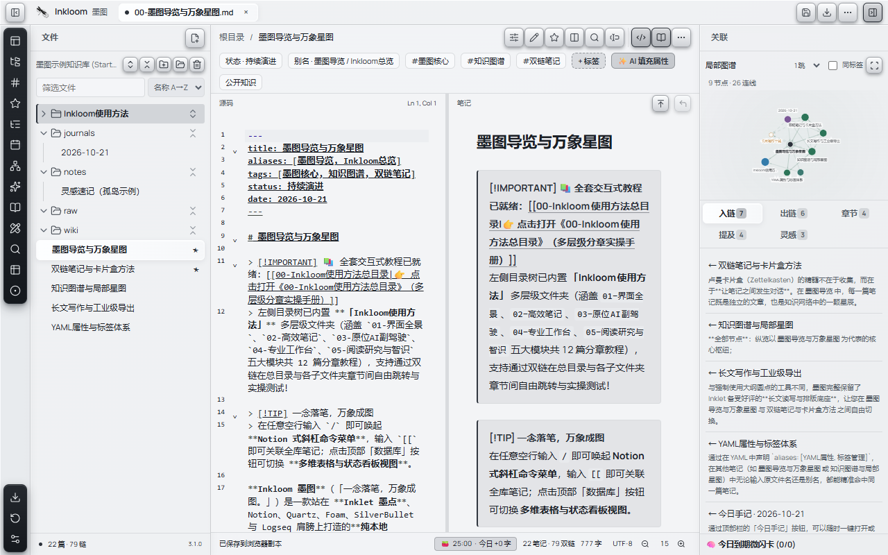
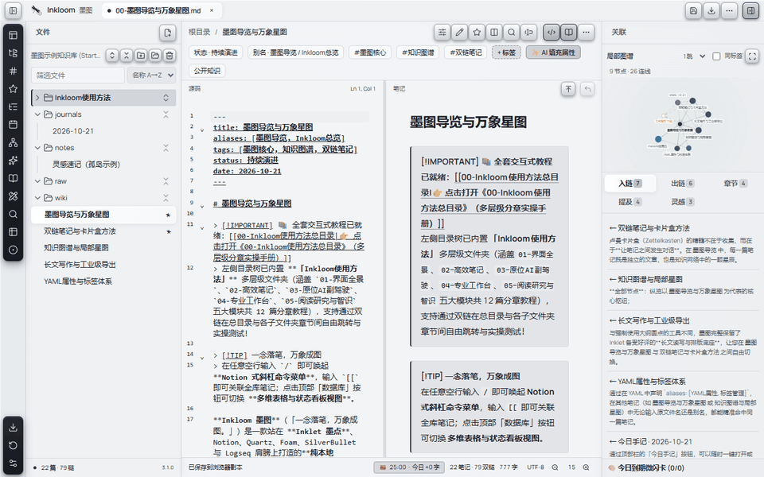
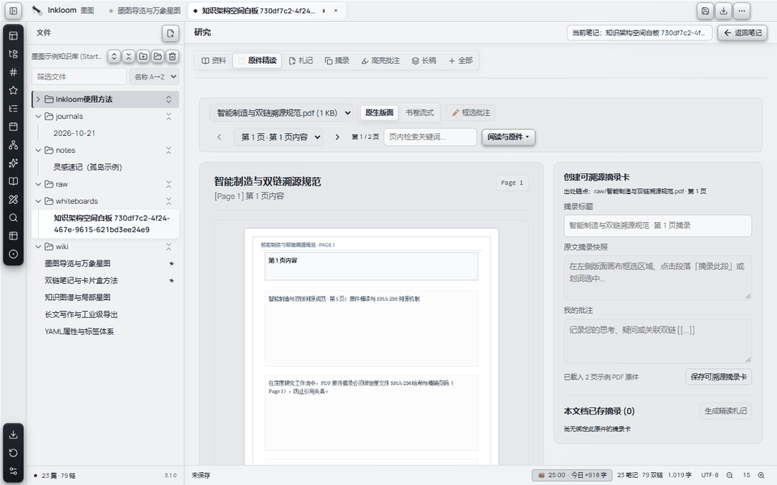
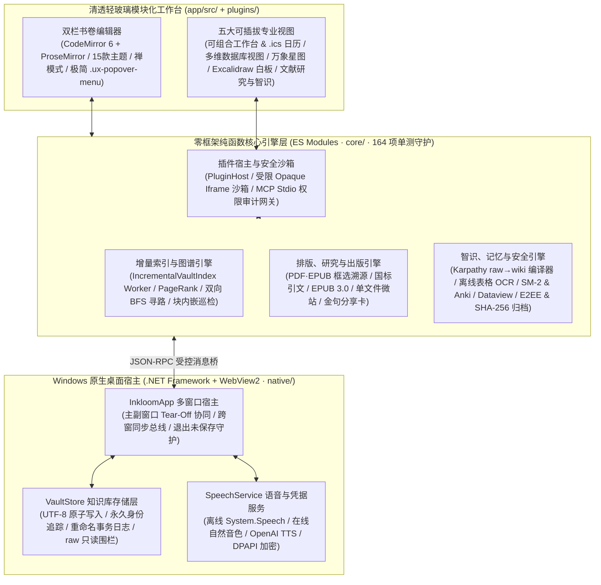

# Inkloom 墨图 · 本地优先的个人知识管理、学术研读与长篇创作工作台

<div align="center">
  
  <h2>Inkloom 墨图 · v3.1.0</h2>
  <p><strong>“一念落笔，万象成图”</strong></p>
  <p>
    一款<strong>免费、MIT 开源、本地优先（Local-First）</strong>的个人知识与深度创作桌面工作台。<br>
    以纯文本 Markdown 文件夹为唯一数据真源，融合<strong>双栏书卷写作、全维双链星图、空间手绘白板、多维属性数据库、PDF/EPUB 原件框选研读、Karpathy <code>raw/ → wiki/</code> 知识编译、SM-2 / Anki 记忆闪卡、周期手记日历与 EPUB 3.0 / DOCX / PDF 多格式出版</strong>，无需注册账号，解压即用。
  </p>
  <p>
    <a href="https://github.com/Qingyumin/inkloom/releases/tag/v3.1.0"></a>
    <a href="LICENSE"></a>
    
    <a href="docs/USER-MANUAL.md"></a>
  </p>
  <p>
    <a href="#一界面全景与动态实机导览">动态演示</a> ·
    <a href="#二为什么选择-inkloom-墨图">设计初衷</a> ·
    <a href="#三十大核心功能体系">功能全景</a> ·
    <a href="#四六大典型应用场景与工作流">应用场景</a> ·
    <a href="#五下载安装与快速上手">下载安装</a> ·
    <a href="#六使用边界与诚实工程声明">使用边界</a> ·
    <a href="#七系统架构与从源码构建验证">架构与构建</a> ·
    <a href="#八致敬与开源鸣谢">致敬与鸣谢</a> ·
    <a href="#九文档索引许可证与作者">许可与作者</a>
  </p>
</div>

---

## 一、界面全景与动态实机导览



**Inkloom 墨图** 坚持 **「表层极简 · 菜单收纳（Minimalist Surface, Menu-Driven Disclosure）」** 的交互哲学：
- **最大化中央创作画布**：采用 `40px` 随主题深色微浮雕窄活动栏 + 可拖拽调宽多级目录树 + 中央双栏同步书卷舞台 + 右侧按需关联脉络栏，搭配清透轻玻璃表面（无厚重毛玻璃模糊开销，内置 15 款清透/莫兰迪/糖果/暗色主题）。
- **零工具栏膨胀**：主界面仅保留最高频的写作与切换入口；所有进阶工具（思维导图、金句卡片、内嵌巡检、全库正则替换、图谱寻路、视图批处理、Anki 牌组同步、周期手记与 `.ics` 日历等）均按语境收纳于统一的 `.ux-popover-menu` 轻量弹出菜单中，需要时一键呼出，写作时静谧无扰。

### 1. 清透双栏写作、极简收纳菜单、思维导图与知识金句分享卡片



> **实录演示要点**：源码与可视书卷双栏实时同步 → 点击笔记顶栏 `⋯` 极简菜单呼出扩展工具 → 一键将当前笔记章节与双链渲染为可折叠交互式 **SVG 思维导图** → 一键生成带「墨图」印鉴的**离线知识金句分享卡片**（支持书卷清透 / 暗夜黑金 / 莫兰迪青瓷 / 苍穹靛青四款版式，离线导出 SVG 或 2x 高清 PNG）→ 明暗双主题一键联动切换。

### 2. 万象知识星图寻路、多维属性数据库视图与空间手绘白板


> **实录演示要点**：进入全屏**万象知识星图**（自动计算 PageRank 枢纽与社区聚类，展开 `🧭 图谱寻路 ▾` 执行双向 BFS 最短路径桥梁高亮并附源文件行号依据）→ 切换至**多维属性数据库视图**（常驻预设视图页签、表格/状态看板一键切换、`视图管理 ▾` 支持 CSV / Markdown 汇总表双向同步）→ 进入 **Excalidraw 空间手绘白板**（混排真实 Markdown 笔记卡片，并与 Obsidian `.canvas` 1.0 双向无损互通）。

### 3. PDF/EPUB 原件精读、Karpathy 知识编译器、Anki 闪卡与周期手记日历



> **实录演示要点**：「研究 → 原件精读」按原生版面精读 `raw/` 下的 PDF/EPUB 原件并校验 64 位 SHA-256 指纹 → 「智识工作台」执行 **Karpathy `raw/ → wiki/` 知识编译** → **SM-2 间隔重复记忆闪卡** 14 天负荷预测、翻转评分与 `牌组与制卡 ▾` Anki `.apkg / .tsv` 双向同步 → 内置 **Obsidian Dataview DQL** 实时执行 `TABLE` 查询 → 工作台总览热力图与 `📅 周期手记 ▾`（一键生成周报/月报/季报、追踪写作字数冲刺里程碑并双向同步 `.ics` 日程）。

---

## 二、为什么选择 Inkloom 墨图？

| 知识管理与创作高频痛点 | 常见云端笔记 / 碎片化插件拼装方案 | Inkloom 墨图 v3.1.0 解决方案 |
| --- | --- | --- |
| **1. 数据私有格式锁定与云端依赖** | 笔记存入专有云数据库，断网受限，迁移导出格式易损 | **100% 本地纯文本 Markdown 真源**：所有笔记、任务、白板均保存在本地文件夹中，随时可用 Git 或任意编辑器读写，零账号强制绑定 |
| **2. 功能越多界面越拥挤杂乱** | 装满数十个第三方插件后，顶栏与侧栏堆满五颜六色的按钮 | **表层极简 · 菜单收纳架构**：主舞台保持书卷留白，低频与进阶能力按上下文收敛进 `.ux-popover-menu` 弹出菜单与 `Ctrl+K` 命令中心 |
| **3. 文献阅读与写稿割裂、引用失真** | PDF 阅读器与笔记软件来回切窗，手抄页码易错且无法跳回原位 | **原件画布框选批注 + 右侧同屏联动引文**：直接在 PDF 原页面框选生成绑定 `source_bbox` 与 SHA-256 的摘录卡，支持 `GB/T 7714 / APA / BibTeX` 四档学术引文一键插入与点击跳回原页 |
| **4. 异构行业资料难以沉淀为结构化百科** | 文件夹里堆满 PDF/Word/PPT/Excel，检索靠翻找，缺乏跨文档关联 | **Karpathy `raw/ → wiki/` 知识编译器**：`raw/` 原始资料 100% 只读保护，离线提取正文与扫描件表格，自动编译生成文献页、概念卡、跨源对照矩阵与 `index.md` 路由索引 |
| **5. 记了大量笔记却“只藏不记、只收不产”** | 缺乏原生复习闭环与长文出版工具，导出电子书需额外折腾工具链 | **记忆温习 + 工业级出版双闭环**：内置 SM-2 闪卡提炼与 **Anki `.apkg/.tsv` 双向同步**；长稿支持多级目录汇编并一键离线打包 **标准 EPUB 3.0 电子书、Word (`.docx`)、A4 PDF 与单文件知识微站** |
| **6. 敏感笔记不敢接入 AI 或语音服务** | 全局一刀切开关，机密商业/个人笔记存在误发往外部接口风险 | **笔记级三态隐私护盾 + 零知识备份**：支持逐篇标记 `公开 / 仅限本机AI / 机密隔绝AI（AES-256-GCM 加密）`，宿主层硬性拦截受控笔记外发；内置 `.inkloom-vault.zip` 64 位 SHA-256 验签归档 |

---

## 三、十大核心功能体系

### 1. 清透双栏书卷写作舞台与多形态内容表达
- **双栏同步与所见即所得**：基于 CodeMirror 6 与 ProseMirror 深度定制，支持单栏阅读编辑、单栏源码或左右双栏段落级同步滚动；保留未改动区段的 UTF-8 BOM 与 CRLF 行尾。
- **结构化排版与微交互**：支持 `/` 斜杠快捷插入、5 类语义 Callout（`NOTE / TIP / IMPORTANT / WARNING / CAUTION`）、LaTeX 数学公式（MathJax）、Mermaid 图表（单击缩放平移、一键复制高清 SVG 或源码）、Markdown 表格列排序/列对齐/`Σ` 自动合计均值行及 Excel/TSV 粘贴自动转表。
- **书卷专注禅模式（`Ctrl + Shift + F`）**：一键收起全部周界侧栏，开启当前段落聚光灯（Typewriter Dimming）与心流番茄钟（`#pomodoro-pill`）。
- **一键多维衍生表达**：同一篇 Markdown 笔记无需改写，即可在顶栏 `⋯` 菜单中一键开启**全屏幻灯片演示**（按 `---` 或 `##` 自动分页并附演讲备注）、**交互式 SVG 知识大纲思维导图**、**四主题离线知识金句分享卡片（SVG / 2x PNG）** 以及 **逐行红绿历史 Diff 与按块局部回滚**。

### 2. 多级目录树、全维双链与全库受控重构
- **深层多级目录管理**：支持 8 层以上嵌套文件夹、**选中目录一键递归展开至最底层 / 一键全部收起**、鼠标拖拽移动文件或整个目录（悬停自动展开折叠目录并自动批量重写全库路径双链）、四维排序（名称正逆序 / 最近日期 / 星标优先）及删除前反向引用影响预览。
- **全维双链与动态块内嵌巡检**：支持 `[[目标笔记#章节|显示别名]]` 自动补全、悬停毛玻璃预览卡、`^block-id` 段落块引用与 `![[笔记#章节]]` / `![[笔记#^block-id]]` 动态只读内嵌；内置**跨笔记块/章节内嵌健康巡检台**，自动识别源章节改名或块锚点升级并提供一键批量对齐修复。
- **全库受控正则查找替换与 YAML 属性改名**：支持纯文本、大小写敏感、正则表达式分组（`$1`）与子目录限定范围扫描，默认跳过代码块并自动保护 `[[双链]]` 目标路径；先展示逐行红绿 Diff 预览，执行后保留内存安全回退点支持**一键整批无损撤销**，同时支持全库 YAML Frontmatter 属性键名批量重命名。

### 3. 万象知识星图与空间手绘白板（JSON Canvas 1.0 互通）
- **局部与全局知识图谱**：右侧关联栏实时渲染 1~2 跳局部星图；全屏万象星图在独立 Web Worker 中运行力导向/环形/目录分组/Hodge 纵向能级分层（`L1 基石 → L2 晶体 → L3 综合`）与重整化群星团水泡布局。
- **图谱分析与可解释寻路**：自动计算全库节点 PageRank 枢纽度与标签传播社区聚类；内置**双向 BFS 最短路径寻路器**，高亮描绘跨领域知识桥梁链路 `A → M → N → B` 并列出每一跳的源文件与精确行号依据；区分显式引用（`EXTRACTED`）与概念/标签推断关系（`INFERRED`，支持原位一键采纳为真实双链）。
- **Excalidraw 空间白板与 `.canvas` 互通**：按需懒加载 Excalidraw 画布（随包内置 8 套开源手写与代码字体），支持插入真实 Markdown 双链笔记卡片、创建绑定月历日期的「今日手绘手帐」、将星图寻路链路一键投射为空间白板，并支持 **Obsidian JSON Canvas (`.canvas` 1.0) 双向无损导入与导出**。

### 4. 多维属性数据库视图与内置 Dataview DQL 引擎
- **表格与状态看板双视图**：按目录、标签、状态、分类或任意自定义 YAML 属性筛选、分组与排序；支持表格内联编辑属性、看板拖拽流转状态及 `Shift / Ctrl` 多选批量加减标签、改状态、移目录。
- **常驻视图预设页签与派生公式列**：内置「全部笔记 · 进行中项目 · 待读文献」视图页签，支持保存自定义组合筛选视图并拖拽排序；内置 `任务完成率(%)`、`字数达成率(%)`、`正文字数`、`项目关联数`、`反向链接数` 5 项确定性派生公式与关系汇总列。
- **CSV / Markdown 汇总表双向批处理与 Dataview 查询**：支持将当前视图导出为 RFC 4180 CSV 或存为带 `[[双链]]` 的 Markdown 汇总笔记，支持粘贴 CSV 批量同步多篇笔记 YAML 属性（自动忽略只读公式列）；内置零外部依赖的 **Obsidian Dataview DQL 引擎**，实时解析执行 `TABLE ... AS ... FROM ... WHERE ... SORT ... LIMIT ...`、`LIST` 与 `TASK` 查询。

### 5. 可组合工作台、周期性手记中心、写作冲刺与 `.ics` 日历
- **总览与可组合面板**：工作台默认展示真实笔记日期活动热力图（月/季/年）、最近记录、待办聚焦与星标卡片；切换至「面板」即可使用基于 GridStack 的 6 模块自由拖拽缩放网格（快速收集、任务、Memo、FullCalendar 月历、项目进度、星标），支持 `.inkloom-workspace.json` 布局模板导入导出。
- **日 / 周 / 月 / 季周期性手记模板中心**：在工作台 `📅 周期手记 ▾` 菜单、活动栏「今日手记」悬停菜单与 `Ctrl+K` 中一键打开或创建今日手记（`YYYY-MM-DD`）、ISO 周报（`YYYY-Www`）、月度复盘（`YYYY-MM`）与季度规划（`YYYY-Qn`），创建时自动汇总本周期活跃笔记 `[[双链]]`、已完成/待推进任务与待温习闪卡数。
- **写作字数冲刺里程碑与 RFC 5545 `.ics` 日程互通**：实时追踪今日产出字数、每日/全库目标达成率与连续创作天数（Streak），一键生成近 7 日写作热力报告；三态任务（`- [ ] / - [/] / - [x]`）支持 `@due`、`@time`、`@priority` 与 RRule 重复规则，并支持与系统日历 / Outlook / Apple Calendar **双向导入导出标准 `.ics` 日历文件**。

### 6. 学术文献研读、PDF/EPUB 原件框选批注与多格式长稿出版
- **学术文献库与国标引文快切**：支持粘贴或导入 `.bib`（BibTeX）/ `.ris` 文献自动生成 `sources/` 资料卡（严格遵循不编造铁律，缺失年份或作者绝不虚构）；支持在 **双链引文 / 国标 `GB/T 7714-2015` / `APA 7th` / `BibTeX`** 四种引文格式间一键切换。
- **PDF 原生版面双页阅读与画布框选批注**：支持单页/双页并排阅读 `raw/` 下的 PDF 与 EPUB 原件；按住鼠标在 PDF 页面上拖拽框选即可提取区域文本、生成离线矢量区域快照缩略图，并将归一化坐标 `source_bbox` 与 64 位 SHA-256 指纹写入 `excerpts/` 摘录卡；支持右侧分屏边看 PDF 边写笔记一键插入引文，原件更新导致哈希漂移时自动弹出琥珀色核对同步提醒。
- **多级目录长稿总控台与五格式净化导出**：支持将任意多级文件夹递归汇编为带分卷进度与章节字数表的长稿总控台（Folder Manuscript Binder），提供跨章节「人物·概念·时间线」追踪矩阵与设定冲突核查；支持一键净化双链语法导出 **纯净 HTML、A4 PDF、可编辑 Word (`.docx`)、标准 EPUB 3.0 电子书 (`.epub`) 以及带交互搜索与大纲的单文件离线知识微站**。

### 7. Karpathy `raw/ → wiki/` 知识编译器与多模态离线 OCR
- **只读原始资料摄取（`Ingest`）**：将 PDF、Word (`.docx`)、PPT (`.pptx`)、Excel (`.xlsx`)、CSV/TSV、HTML、TXT 或扫描版 PDF / 本地长图（`.png/.jpg/.webp/.svg`，内置基于空间坐标聚类的离线表格还原）放入 `raw/` 目录，在 100% 不修改原件字节的前提下提取结构化文本，自动生成或增量更新 `wiki/sources/` 文献摘要页、`wiki/entities/` 实体概念页、`wiki/topics/` 跨源专题综合对照矩阵、`wiki/index.md` 总目录与 `wiki/log.md` 编译账本（重编译时无损保留 `## ✍️ 人工研读批注`）。
- **百科穿透检索与审校闭环（`Query & Lint`）**：问答支持「Wiki 百科优先 + 底层 `raw/` 原文穿透溯源」，高价值回答可一键反哺写入 `wiki/`；审校台自动检测上游原件变更导致的 `source_fingerprints` 证据失效、缺失概念页与跨篇认知张力，支持一键增量重算修复。

### 8. 本地/在线智识副驾驶、受控 MCP Server 与三态隐私护盾
- **多引擎自由选择（离线可用）**：内置零配置特征哈希混合检索（BM25 + 128/256/384 维向量 RRF 融合），预置本地轻量模型（`SmolLM2-135M GGUF` / 本地 `Ollama`）与在线 OpenAI / Copilot 兼容接口；支持划词浮栏 6 项原位润色、斜杠 `/ai` 续写、三模三引擎智能补链、孤岛笔记织网与可复用 Skills 方法卡提炼。
- **标准受控 MCP Server 与权限审计台**：随仓库提供 `tools/inkloom-mcp-server.mjs`（JSON-RPC 2.0 over Stdio），支持 VS Code GitHub Copilot / Claude Desktop / Cursor 等外部客户端接入；内置 `🛡️ 权限与审计 ▾` 菜单，提供「仅开放只读工具」一键预设、7 项工具独立开关、允许目录白名单越界拦截与实时调用审计账本，写操作强制经过 Diff 预览确认。
- **笔记级三态隐私隔离与 AES-256-GCM 加密**：每篇笔记顶栏可一键切换 `🟢 公开知识`、`🟡 仅限本机AI`、`🔴 机密隔绝AI`；内控与机密笔记在宿主层硬性阻断向任何在线 AI 或在线语音服务发送正文，机密笔记更支持基于 `PBKDF2-HMAC-SHA256 (100,000 次迭代) + AES-256-GCM` 的本地认证加密落盘。

### 9. SM-2 间隔重复记忆闪卡与 Anki（`.apkg` / TSV）双向同步
- **原位制卡与科学温习**：支持从任意笔记中的 `Q: ... / A: ...` 或 `概念 :: 定义` 语法自动提取闪卡（亦可一键扫描加粗定义对预览勾选生成闪卡），基于 SuperMemo SM-2 算法将 `@sr(due=...,interval=...,ease=...,reps=...)` 复习元数据直接写回原笔记行尾；提供 14 天到期负荷预测柱状图、按目录/`#标签`/🔥难点错题本筛选，以及右侧关联栏底部的今日 3 张到期微闪卡折叠抽屉。
- **Anki 生态无缝往返**：在 `牌组与制卡 ▾` 菜单中支持一键导出标准 **Anki TSV** 与离线 **`.apkg` 牌组包**，并支持导入外部 `.apkg`（含原生 SQLite `collection.anki21` 字段解析）或 `.tsv` 牌组，自动去重并 100% 保留加粗、行内代码、`[[双链]]` 与 SM-2 复习进度参数。

### 10. 书籍朗读、跨原生多屏协同、多源迁入与全库便携归档
- **Markdown 书籍朗读与中文防拆词管线**：支持整篇、从光标处或划词即读，具备当前朗读段落高亮跟随、上下段跳转、`0.75x ~ 2.0x` 倍速、按章或定时停止；经过中文注音剥离与短词引号防断词预处理，支持本机离线 `System.Speech` 语音、16 款在线自然音色（含中英混读模型）及自建 OpenAI `/v1/audio/speech` 兼容语音接口。
- **跨原生窗口多屏协同（Tear-Off Multi-Window）**：将顶部笔记水泡页签向下拖出顶栏（或通过 `⋯` 菜单 / 目录右键菜单），即可将笔记、万象知识星图、Excalidraw 白板或 PDF/EPUB 阅读器拆分为独立的 Windows WebView2 原生副窗口；主副窗口共享单实例 `VaultStore` 写入锁与跨窗实时同步总线，并自动保护未保存本地草稿免遭覆盖。
- **多源无损迁入、零知识 E2EE 同步与 `.inkloom-vault.zip` 便携归档**：支持 **Notion 导出**（剥离 32 位 UUID 后缀 + 顶部属性转 YAML）、**Logseq 大纲**（`key:: value` 提取 + `TODO/DOING/DONE` 转换）、**Obsidian 配色与语法净化**及 **OneNote XML 迁入**（含 `<one:InkDrawing>` 手写墨迹离线 SVG 矢量还原）；支持本地双目录 SHA-256 增量合并、零知识 E2EE 加密同步仓，以及带 **FIPS 180-4 64 位 SHA-256 签名清单的 `.inkloom-vault.zip` 全库便携归档与防篡改无损还原**。

---

## 四、六大典型应用场景与工作流

```text
① 学术科研与深度精读：导入 .bib/.ris ──▶ PDF 原生画布拖拽框选批注 ──▶ 右侧分屏同屏写论文插入 GB/T 7714 引文 ──▶ 导出 DOCX / PDF
② 长篇专著与网文连载：多级目录分卷建章 ──▶ 一键汇编长稿总控台 ──▶ 跨章人物·概念·时间线追踪核查 ──▶ 离线打包标准 EPUB 3.0 电子书
③ 行业咨询与资料编译：拖入 PDF/Word/PPT/Excel 至 raw/ ──▶ Karpathy 编译器生成 wiki/ 概念与对照矩阵 ──▶ 原文穿透溯源问答
④ 终身学习与考试备考：撰写原子双链笔记 ──▶ 一键提炼问答闪卡 ──▶ 右侧微闪卡 / 14天负荷温习 ──▶ 双向同步 Anki .apkg 牌组
⑤ 个人效能与复盘打卡：闪念静默快记追加今日手记 ──▶ 自动生成周报/月报/季报双链综述 ──▶ 写作字数热力冲刺 + .ics 日历双向同步
⑥ 跨工具迁入与安全归档：迁入 Notion/Logseq/Obsidian/OneNote ──▶ 敏感笔记开启 AES-256-GCM 机密锁 ──▶ 导出 .inkloom-vault.zip 验签备份
```

1. **科研人员、硕博生与深度阅读者**：将论文 PDF/EPUB 放入 `raw/`、导入 `.bib` 题录，左边写综述、右边同屏翻阅原件并一键插入带精确页码与区域坐标的引文，文末自动生成国标 `GB/T 7714-2015` 或 `APA 7th` 参考文献表。
2. **非虚构作者、技术图书作者与长篇小说创作者**：用深层文件夹管理「部 → 卷 → 章 → 节」，右键目录即可生成长稿编排总控台，通过「设定与时间线矩阵」核查跨章前后矛盾，定稿后直接离线生成可分发或放入阅读器审阅的标准 `.epub` 电子书。
3. **咨询顾问、产品架构师与行业研究员**：面对几十份客户访谈、调研报告与数据表，直接拖入 `raw/` 只读证据仓，由 Karpathy 知识编译器提炼跨文档专题矩阵，任何结论均可一键穿透回读原始文档对应节次。
4. **备考学生、语言学习者与知识卡片盒实践者**：边读教材边用 `概念 :: 定义` 记录要点，一键生成 SM-2 闪卡，日常写作间隙在右侧栏顺手刷完 3 张到期微闪卡，也可导出 `.apkg` 到手机端 Anki 随时巩固。
5. **注重规划复盘的个体开发者与知识工作者**：工作中按快捷键静默追加灵感至今日手记（不打断当前写稿），周五或月末在 `📅 周期手记 ▾` 一键拉起已自动聚好双链与完成事项的周报/月报，并将设期任务导出为 `.ics` 同步至手机日历。
6. **高度重视数据主权与隐私安全的团队/个人**：知识库纯本地落盘，核心机密卡片使用 AES-256-GCM 独立口令加密并物理隔绝外网接口，定期一键打包 `.inkloom-vault.zip` 进行逐文件 SHA-256 完整性验签冷备。

---

## 五、下载安装与快速上手

### 1. 直接下载 Windows 便携版（免安装、无需配置开发环境）

1. 前往 **[GitHub Releases 发布页](https://github.com/Qingyumin/inkloom/releases/tag/v3.1.0)** 下载 **`Inkloom-3.1.0-Windows-x64.zip`**（约 `32.8 MB`，已内置全部离线前端引擎、数学公式、图表与 8 套白板开源字体）。
2. 将压缩包**完整解压**到本地文件夹（请保留目录内的 `Inkloom.exe`、`Inkloom.resources`、`WebView2` 组件与 `licenses/`，不要只将 `Inkloom.exe` 单独移出目录运行）。
3. 双击 **`Inkloom.exe`** 即可启动。首次运行会在 `%LOCALAPPDATA%\Inkloom\StarterVault` 自动创建包含 **`Inkloom使用方法/`** 互动实操教程的示例知识库；你也可以随时通过顶栏「文件 → 打开知识库」打开本地任意 Markdown 文件夹。

### 2. 运行环境与 SHA-256 完整性校验

| 环境项 | 说明 |
| --- | --- |
| **操作系统** | Windows 10 / Windows 11 (`x64`) |
| **系统框架** | `.NET Framework 4.7.2` 或更新版本（Windows 10/11 已自带） |
| **页面运行时** | `Microsoft Edge WebView2 Runtime`（Windows 10/11 默认内置；若精简版系统缺失，可从 [微软官方 WebView2 页面](https://developer.microsoft.com/microsoft-edge/webview2/) 安装） |
| **普通使用依赖** | **零外部依赖**（无需安装 Node.js、Python、Git 或注册任何云账号） |

下载后可在 PowerShell 中对照 Release 页附带的 `SHA256SUMS.txt` 核验压缩包哈希一致性：

```powershell
Get-FileHash .\Inkloom-3.1.0-Windows-x64.zip -Algorithm SHA256
```

### 3. 核心快捷键与内置手册速查

> 在软件内任意位置按下 **`F1`** 即可打开可搜索、支持一键插入语法示例的**全界面交互式操作手册**；完整图文文档亦见仓库内的 **[docs/USER-MANUAL.md](docs/USER-MANUAL.md)** 与 **[QUICKSTART.md](QUICKSTART.md)**。

| 快捷键 / 入口 | 作用说明 |
| --- | --- |
| `Ctrl + K` | 打开全域命令中心（最近访问笔记与 PDF 原件页码 MRU 栈、章节标题/待建节点跳转、全局工作台命令） |
| `Ctrl + G` / `Ctrl + Alt + H` / `Ctrl + Alt + A` | 快速打开全屏万象知识图谱 / 可组合工作台 / 智识与编译器工作台 |
| `Ctrl + F` | 页内查找替换（点击右侧「全库替换…」进入跨文件受控正则替换与 YAML 属性批量改名） |
| `Ctrl + Shift + F` | 一键进入或退出「书卷专注禅模式」（自动收起周界栏并开启打字机段落聚光灯） |
| `Ctrl + S` / `Ctrl + P` / `F1` | 保存当前笔记 / 打开五格式净化导出窗口 / 呼出交互式操作手册 |

---

## 六、使用边界与诚实工程声明

把真实边界与前提说清楚，是对每一位使用者本地知识资产的基本尊重：

1. **平台与签名说明**：当前正式构建与自动化实机验收面向 **Windows 10/11 x64**（内置跨平台路径可移植性巡检工具供多系统协同参考，但本仓库当前不提供预编译的 macOS/Linux 安装包）。当前预览版未附带商业 EV 代码签名证书，Windows 首次启动可能提示“未知发布者”，请认准本仓库 Release 并核验 `SHA256SUMS.txt`。
2. **网络与隐私边界**：笔记读写、双链图谱、多维视图、白板、原件精读、闪卡、日历与五格式导出均**完全离线运行，零遥测、零后台上传**。仅当你主动开启「在线自然音色朗读」或自行配置连接「在线大模型 API」时，相关文本片段才会发往你所选的服务商（被标记为 `仅限本机AI` 或 `机密隔绝AI` 的笔记在宿主层会被硬性拦截外发）。
3. **存储规模与原子保护**：桌面端文件保存采用版本比对与临时文件原子替换机制，批量重命名与全库替换均保留恢复日志或回退快照；首次全库扫描默认上限为 `20,000` 篇笔记、单篇 Markdown 上限 `24 MiB`、目录深度 `64` 层。任何软件恢复机制均不能替代独立多副本备份，处理重要正式库前建议先用内置 `.inkloom-vault.zip` 归档备份。
4. **生态兼容与实验特性边界**：
   - **Obsidian / Notion / Logseq 互通**：支持标准 Markdown 双链、JSON Canvas `.canvas` 1.0、声明式 Dataview DQL（`TABLE / LIST / TASK`，不执行任意 `dataviewjs` 代码）与 Obsidian 主题安全颜色变量映射，**不是**第三方闭源二进制插件的直接运行兼容层。
   - **OneNote 迁入与外部 MCP**：支持标准导出的 OneNote XML（含 `<one:InkDrawing>` 手写墨迹 SVG 还原）三步核对迁入，缺少原始附件字节时会主动阻断以防假迁入；本机实时桌面 OneNote COM 直连与跨第三方 MCP 客户端权限边界受具体本机办公环境影响，建议先在测试副本上验证。
   - **图表与算法指标**：首页活动热力图如实统计笔记有效记录日期（不伪造编辑次数），知识图谱中心度与能级指标用于辅助结构梳理，不冒充对个人认知质量的绝对评判。

---

## 七、系统架构与从源码构建验证

### 1. 系统架构全景图



### 2. 仓库目录结构

```text
inkloom/
├── app/
│   ├── public/              # 应用透明双色图标、纸张纹理与随包离线 Excalidraw 字体资产 (233 个字体文件)
│   ├── src/                 # 主工作台外壳、双栏同步桥、分屏阅读器、F1 交互式手册、语音面板与清透轻玻璃样式表
│   ├── index.html           # 前端应用入口模板
│   └── package.json         # 锁定版本的前端构建与运行依赖清单 (MIT)
├── assets/                  # 多尺寸 Windows 应用图标 (.ico) 与高分辨率透明品牌标志
├── core/                    # 26 个零 DOM 耦合核心算法与领域模块 + 28 套 Node TAP 单元测试 (164 项用例)
├── docs/
│   ├── images/              # README 实录动态 GIF 与实机界面截图
│   ├── USER-MANUAL.md       # 全界面从上到下、从左到右图文操作手册
│   ├── UX-UI-SPECIFICATION.md # 清透轻玻璃与「表层极简·菜单收纳」UX/UI 设计规范
│   ├── ORIGINAL-ALGORITHMS.md # 核心索引、图谱能级与编译算法说明
│   └── SDK.md               # 插件宿主 API、权限声明与沙箱隔离规范
├── licenses/                # 346 个打包依赖包、8 套白板开源字体与 WebView2 SDK 的完整许可证原文与哈希清单
├── native/                  # C# WinForms + WebView2 原生宿主、VaultStore 原子存储、语音合成与 19 项原生故障注入测试
├── plugins/                 # 六大内置工作台插件 (workspace-home / note-views / knowledge-graph / whiteboard / research-desk / ai-assistant / unlinked-notes)
├── tools/                   # Web 打包、C# 编译、外部 MCP Server、性能基准、双端 Playwright 验收与发行包哈希门禁脚本
├── vendor/inklet/           # 经 shared-source-lock.json 逐文件 SHA-256 锁定的共享双栏编辑与导出底座
├── DESIGN.md                # 视觉与排版设计契约
├── ROADMAP.md               # 产品长期架构演进与工程验收台账
├── CREATION-NOTES.md        # 产品设计缘起与历次里程碑迭代记录
├── QUICKSTART.md            # 快速上手指南
├── LICENSE                  # MIT 开源许可证
└── THIRD-PARTY-NOTICES.txt  # 第三方开源软件、字体与方法论致敬声明
```

### 3. 从源码构建与运行全链路验证门禁

准备 Windows 10/11 x64、**Node.js `>= 20 LTS`**（含 npm）、系统内置 `.NET Framework 4.x` C# 编译器与 Microsoft Edge：

```powershell
# 1. 克隆仓库并安装锁定依赖
git clone https://github.com/Qingyumin/inkloom.git
cd inkloom
npm --prefix app ci

# 2. 校验共享底座哈希锁并运行 164 项核心算法单元测试
node tools/shared-source.mjs
node --test --test-reporter=tap core/*.test.mjs

# 3. 运行 19 项 C# 原生存储、事务回滚与故障注入测试
powershell -NoProfile -ExecutionPolicy Bypass -File .\tools\test-native.ps1 -ProjectRoot $PWD.Path

# 4. 构建前端离线资源包并编译 Windows x64 原生客户端 (输出至 release/Inkloom-3.1.0/)
powershell -NoProfile -ExecutionPolicy Bypass -File .\tools\build.ps1 -ProjectRoot $PWD.Path -ReleaseName Inkloom-3.1.0

# 5. 运行浏览器与隔离 Windows WebView2 EXE 端到端回归测试 (含 UX / 创作 / 规划 / 工作台 / 外观 / 核心 / 朗读)
node tools/verify-phase2.mjs --ux
node tools/verify-phase2.mjs --ux --exe release/Inkloom-3.1.0/Inkloom.exe
node tools/verify-phase2.mjs --creation
node tools/verify-phase2.mjs --phase3

# 6. 运行 100 / 1,000 / 10,000 篇笔记增量索引与渲染性能基准测试
node tools/benchmark.mjs
```

---

## 八、致敬与开源鸣谢

**Inkloom 墨图** 站在众多思想先驱、优秀知识工具与开源社区的肩膀上诞生。全部主体源码以 **[MIT License](LICENSE)** 开源开放，随附组件的完整授权文本保存在 [`licenses/`](licenses/bundled/manifest.json) 与 **[THIRD-PARTY-NOTICES.txt](THIRD-PARTY-NOTICES.txt)** 中。在此谨向以下学者、产品团队与开源维护者致以诚挚敬意：

### 1. 思想先驱与产品设计致敬

- **Niklas Luhmann（尼克拉斯·卢曼）与卡片盒笔记法（Zettelkasten）**：启发了墨图「一卡一概念、双链自下而上生长成网、让思考在连接中自然涌现」的知识组织底层哲学。
- **Andrej Karpathy 与 LLM Wiki 知识编译构想**：启发了墨图 `raw/`（只读异构原始资料仓）→ `wiki/`（可审校、可穿透溯源的结构化编译百科层）的 `Ingest / Query / Lint` 三算子知识工程闭环。
- **Piotr Woźniak（SuperMemo SM-2 算法）与 [Anki](https://apps.ankiweb.net/) 开源记忆生态**：启发了墨图原位间隔重复调度与 `.apkg / TSV` 开放牌组双向互通设计。
- **优秀知识与生产力产品致敬（100% 独立洁净室代码实现）**：
  - 致敬 **[Obsidian](https://obsidian.md/)** 在「本地纯文本 Markdown 优先、紧凑克制的工作区组织、[JSON Canvas 1.0](https://jsoncanvas.org/) 开放白板规范」以及社区 `Dataview` 声明式查询上的卓越探索；
  - 致敬 **Notion**（多维数据库视图、看板与派生属性交互）、**Logseq**（大纲块级引用与周期手记工作流）、**Foam / Quartz / SilverBullet** 等现代 PKM 先锋项目；
  - 承袭并致敬同门开源编辑器 **[Inklet 墨点](https://github.com/Qingyumin/inklet-windows)** 沉淀的双栏书卷同步编辑、15 款清透/暗色主题色彩体系、原子文件保护与中文防拆词语音韵律管线。

### 2. 核心开源引擎与组件致敬

| 开源项目 | 作者 / 维护团队 | 许可证 | 在 Inkloom 墨图中的核心贡献 |
| --- | --- | --- | --- |
| **[ProseMirror](https://github.com/ProseMirror/prosemirror)** & **[CodeMirror 6](https://codemirror.net/)** | Marijn Haverbeke & Contributors | `MIT` | 驱动可视书卷编辑、结构化表格/提示块建模与高性能 Markdown 源码编辑 |
| **[markdown-it](https://github.com/markdown-it/markdown-it)** | Vitaly Puzrin, Alex Kocharin | `MIT` | 提供高速、精准的 Markdown 语法树与行号区间解析底座 |
| **[Excalidraw](https://github.com/excalidraw/excalidraw)** & **[Rough.js](https://roughjs.com/)** | Excalidraw Contributors / Preet Shihn | `MIT` | 驱动空间手绘白板、手绘手帐与双链笔记混排画布 |
| **[d3-force](https://github.com/d3/d3-force)** & **[Cytoscape.js](https://js.cytoscape.org/)** | Mike Bostock / Cytoscape Consortium | `ISC` / `MIT` | 支撑万象知识星图与局部星图的物理力导向仿真与图论布局 |
| **[TanStack Table](https://tanstack.com/table)** | Tanner Linsley & Contributors | `MIT` | 提供轻量无框架耦合的多维属性数据库分页与列模型核心 |
| **[GridStack.js](https://gridstackjs.com/)** & **[FullCalendar](https://fullcalendar.io/)** | Alain Dumesny / Adam Shaw | `MIT` | 支撑工作台可拖拽缩放自定义模块网格与交互式任务月历 |
| **[rrule](https://github.com/jkbrzt/rrule)** | Jakub Roztocil & Contributors | `BSD-3-Clause` | 驱动任务系统与 `.ics` 日历的标准循环重复周期计算 |
| **[MathJax](https://www.mathjax.org/)** & **[Mermaid](https://mermaid.js.org/)** | MathJax Consortium / Knut Sveidqvist | `Apache-2.0` / `MIT` | 提供离线科学数学公式排版与多类型流程图/时序图矢量渲染 |
| **[PDF.js](https://mozilla.github.io/pdf.js/)** & **[epub.js](https://github.com/futurepress/epub.js)** | Mozilla Foundation / Futurepress | `Apache-2.0` / `BSD-2-Clause` | 赋能 PDF 原生版面阅读与 EPUB 电子书章节解析 |
| **[docx](https://docx.js.org/)** & **[DOMPurify](https://github.com/cure53/DOMPurify)** | Dolan Miu / Cure53 | `MIT` / `MPL-2.0 OR Apache-2.0` | 提供可编辑 `.docx` 导出生成与严密的 HTML/SVG 安全净化防线 |
| **[Comlink](https://github.com/GoogleChromeLabs/comlink)** & **[yaml](https://eemeli.org/yaml/)** | Google Chrome Labs / Eemeli Aro | `Apache-2.0` / `ISC` | 支撑后台索引 Worker 零阻塞通信与保留注释的 YAML Frontmatter 读写 |
| **[Lucide Icons](https://lucide.dev/)** | Lucide Contributors | `ISC` | 提供全站统一、轻盈克制的语义矢量图标体系 |
| **[Microsoft Edge WebView2](https://developer.microsoft.com/microsoft-edge/webview2/)** | Microsoft Corporation | `WebView2 License` | 提供高兼容、轻量分发的 Windows 原生桌面渲染宿主 |
| **[Vite](https://vite.dev/) / [Rolldown](https://rolldown.rs/)** & **[Playwright](https://playwright.dev/)** | Evan You & Rolldown Team / Microsoft | `MIT` / `Apache-2.0` | 提供极速离线资源打包与浏览器 + 真实桌面 EXE 双端自动化回归验收 |

### 3. 开源字体致敬（`SIL Open Font License 1.1`）

- **界面与书卷阅读字体**：感谢 **Manrope**（Mikhail Sharanda）、**Literata**（TypeTogether & Google）以及中文开源字体 **[霞鹜文楷 (LXGW WenKai)](https://github.com/lxgw/LxgwWenKai)** 带来的温润阅读质感。
- **空间白板随包开源字体**：感谢 **Excalifont**、**Virgil**、**Xiaolai（小赖字体）**、**Cascadia Code**、**Comic Shanns**、**Nunito**、**Assistant**、**Lilita One** 字体作者（完整版权与 OFL 许可证见 [`licenses/whiteboard-fonts/font-manifest.json`](licenses/whiteboard-fonts/font-manifest.json)）。

---

## 九、文档索引、许可证与作者

### 1. 深度文档导航

- 📘 **[全界面图文操作手册 (`docs/USER-MANUAL.md`)](docs/USER-MANUAL.md)**：按从上到下、从左到右空间顺序详解每个区域、语法与实操案例
- ⚡ **[快速上手指南 (`QUICKSTART.md`)](QUICKSTART.md)**：解压即用步骤与高频快捷键速查
- 🎨 **[UX/UI 视觉与极简菜单规范 (`docs/UX-UI-SPECIFICATION.md`)](docs/UX-UI-SPECIFICATION.md)** & **[设计契约 (`DESIGN.md`)](DESIGN.md)**
- 🧭 **[开发与扩展路线台账 (`ROADMAP.md`)](ROADMAP.md)** & **[创作札记与完整版本演进史 (`CREATION-NOTES.md`)](CREATION-NOTES.md)**
- 🧠 **[核心索引与图谱算法说明 (`docs/ORIGINAL-ALGORITHMS.md`)](docs/ORIGINAL-ALGORITHMS.md)** & **[插件隔离 SDK 说明 (`docs/SDK.md`)](docs/SDK.md)**
- 🧪 **[验证方法与边界说明 (`docs/0.3-VERIFICATION.md`)](docs/0.3-VERIFICATION.md)** & **[共享源码锁定清单 (`shared-source-lock.json`)](shared-source-lock.json)**

### 2. 作者与开源许可

- **软件作者**：达芬奇Vincent（GitHub: [@Qingyumin](https://github.com/Qingyumin) ｜ 微信号: `seveniear_7`）
- **版权声明**：Copyright © 2026 泰安市岱岳区清云智数企业管理咨询工作室
- **开源许可证**：本项目主体源代码采用 **[MIT License](LICENSE)** 免费开源发布；随附第三方库与开源字体遵循各自原始许可证（详见 **[THIRD-PARTY-NOTICES.txt](THIRD-PARTY-NOTICES.txt)** 与 `licenses/` 目录）。


