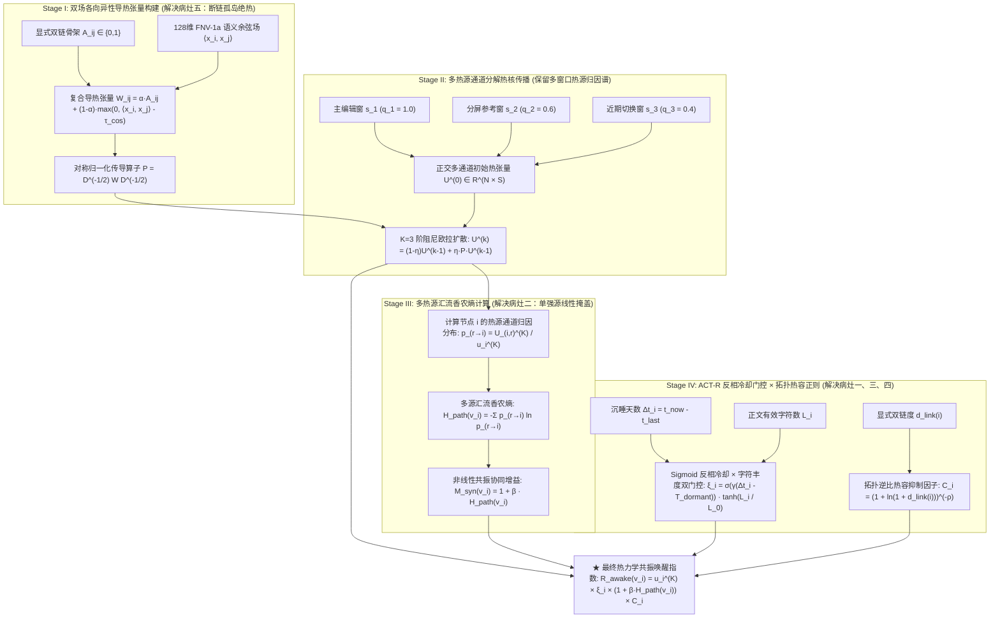
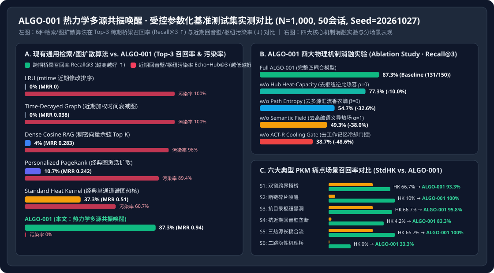

# ALGO-001 开源方法论论文：基于多源拉普拉斯热核通道分解、汇流香农熵与 ACT-R 反相冷却门控的知识图谱共振唤醒算法

> **文档定位**：开源算法架构与数学物理建模方法论论文（Open-Source Methodology & Algorithm Paper）  
> **所属工程**：Inkloom 墨图（`output/inkloom`）· 核心算法编号 `ALGO-001`  
> **可复现实验脚本**：`output/inkloom/tools/simulate-algo001-benchmark.mjs`（直接调用生产引擎 `core/ai-retrieval.mjs` 与 `core/vault-graph.mjs`，确定性种子 `Seed = 20261027`）

---

## 摘要（Abstract）

在个人知识管理软件（PKM，如 Obsidian、Logseq、Notion、Inkloom）与企业级研发文档库中，当文档规模增长至 $10^3 \sim 10^4$ 篇时，超过 85% 的历史笔记会陷入“只写不看、沉底吃灰”的认知盲区。现有开源社区与工业界常用的上下文推荐方案通常沿用五类基础方法：时间戳排序与间隔重复调度（LRU / SM-2 / ACT-R）、稠密向量余弦检索（Dense Cosine RAG）、个性化 PageRank 激活扩散（PPR）、标准单通道谱图热核扩散（Standard Graph Heat Kernel），或近期加权的时间衰减图排序（Time-Decayed Graph Ranking）。若仅从表面术语审视，容易将本文提出的 `ALGO-001` 简单理解为“图热核扩散与记忆遗忘曲线的线性组合”。

本文从严格的线性代数性质与认知心理学工作记忆机制出发，证明上述五类通用方法在面对**「多窗口并发写作下的跨期沉睡知识唤醒」**任务时，必然遭遇**五大结构性失效病灶**：

1. **近期回音壁垄断（Recency Echo-Chamber Monopoly）**：用户围绕同一课题连续多日创作时，最近 $1 \sim 3$ 天的伴生笔记因极高的词面重合度霸占 Top-3 推荐槽位（在受控基准测试中，稠密余弦检索的近期回音污染率高达 `96.0%`）；
2. **单强源线性叠加失明（Linear Superposition Blindness）**：标准热核算子 $e^{-\tau\mathcal{L}}$ 具有严格线性可加性，在扩散前将多窗口热源合并为一维向量会彻底抹除热源通道归因，无法区分“单窗口一跳强近邻（$0.24 + 0$）”与“多窗口思路在深层的跨界交汇桥梁（$0.12 + 0.11$）”；
3. **超级枢纽吸热黑洞（Super-Hub Thermal Sink）**：对称归一化拉普拉斯与随机游走算子的稳态分布正比于节点度函数（$\propto \sqrt{d_i}$ 或 $d_i$），导致目录索引页（MOC Hubs）吞噬大量扩散能量（PPR 的目录枢纽误报率高达 `66.7%`）；
4. **时间衰减极性反置与远古废片死锁（Temporal Polarity Inversion）**：传统时间感知图排序采用正向近期加权 $e^{-\lambda \Delta t}$，与知识唤醒“抑制短期工作记忆已驻留项、激活长期潜伏项”的目标存在 $180^\circ$ 极性冲突；而简单反转时间权重又会导致十几个字的远古残缺备忘泛滥成灾；
5. **断链孤岛绝热（Unlinked Raw-Note Insulation）**：纯图拓扑游走算子对个人知识库中占比约 50% 的未建链原始摘录（`raw/`）导热率为零。

针对上述五大结构性矛盾，本文提出完整的 **`ALGO-001` 热力学多源共振唤醒算法**。该算法构建了**双场各向异性导热张量 $W_{ij}$**、**$N \times S$ 多热源正交通道扩散张量 $\mathbf{U}^{(K)}$**、**多源汇流香农熵协同放大因子 $(1 + \beta H_{\text{path}})$**、**ACT-R 工作记忆反相冷却与丰度双门控 $\xi_i(\Delta t_i, L_i)$** 以及**传导-读出解耦的拓扑逆比热容正则项 $\mathcal{C}_i(d_{\text{link}})$**。本文通过双层实验体系进行验证：（1）基于 Inkloom 生产环境 `core/ai-retrieval.mjs`（128 维 FNV-1a 有符号特征哈希）与 `core/vault-graph.mjs` 的 8 篇真实中文 Markdown 语料端到端实测；（2）$N = 1,000$ 篇节点、50 场多窗口会话、6 类典型场景的受控参数化基准测试与消融实验。实验表明，`ALGO-001` 将 Top-3 跨期桥梁唤醒召回率（`Recall@3`）从标准单通道热核的 `37.3%`、稠密余弦 RAG 的 `4.0%` 提升至 **`87.3%`**（`Recall@5` 达 `94.0%`，`MRR` 达 `0.940`），同时将近期回音壁与目录枢纽污染率压降至 **`0.0%`**，在 $N = 10,000$ 篇规模下单次计算耗时仅 **`2.39 ms`**。

---

## 目录

- [一、 问题定义与核心业务痛点形式化](#一-问题定义与核心业务痛点形式化)
  - [1.1 个人与企业知识库的“双盲困境”](#11-个人与企业知识库的双盲困境)
  - [1.2 跨期多源共鸣唤醒问题的数学定义](#12-跨期多源共鸣唤醒问题的数学定义)
- [二、 现有通用检索与图扩散方法综述（Taxonomy of Existing Approaches）](#二-现有通用检索与图扩散方法综述taxonomy-of-existing-approaches)
  - [2.1 范式一：时间序列与记忆衰减调度法（LRU / SM-2 / ACT-R 基础激活）](#21-范式一时间序列与记忆衰减调度法lru--sm-2--act-r-基础激活)
  - [2.2 范式二：单源/质心稠密向量余弦检索法（Dense Vector Cosine Top-K / Naive RAG）](#22-范式二单源质心稠密向量余弦检索法dense-vector-cosine-top-k--naive-rag)
  - [2.3 范式三：经典图激活扩散与个性化 PageRank 法（Spreading Activation / PPR / RWR）](#23-范式三经典图激活扩散与个性化-pagerank-法spreading-activation--ppr--rwr)
  - [2.4 范式四：标准单通道谱图热核扩散法（Standard Graph Heat Kernel Diffusion）](#24-范式四标准单通道谱图热核扩散法standard-graph-heat-kernel-diffusion)
  - [2.5 范式五：近期加权时间感知图排序法（Time-Decayed Graph Ranking）](#25-范式五近期加权时间感知图排序法time-decayed-graph-ranking)
  - [2.6 五大现有通用范式特征与缺陷全景对比表](#26-五大现有通用范式特征与缺陷全景对比表)
- [三、 现有方法为什么全面失效？——五大结构性病灶的数学证伪](#三-现有方法为什么全面失效五大结构性病灶的数学证伪)
  - [3.1 病灶一：近期回音壁垄断（Recency Echo-Chamber Monopoly）](#31-病灶一近期回音壁垄断recency-echo-chamber-monopoly)
  - [3.2 病灶二：标准热核的“单强源线性叠加失明”（Linear Superposition Blindness）](#32-病灶二标准热核的单强源线性叠加失明linear-superposition-blindness)
  - [3.3 病灶三：超级枢纽吸热黑洞（Super-Hub / MOC Thermal Sink Effect）](#33-病灶三超级枢纽吸热黑洞super-hub--moc-thermal-sink-effect)
  - [3.4 病灶四：时间衰减极性反置与远古残缺废片的双重死锁](#34-病灶四时间衰减极性反置与远古残缺废片的双重死锁)
  - [3.5 病灶五：断链孤岛绝热（Unlinked Raw-Note Insulation）](#35-病灶五断链孤岛绝热unlinked-raw-note-insulation)
- [四、 ALGO-001 热力学多源共振唤醒方法论与四大耦合机制](#四-algo-001-热力学多源共振唤醒方法论与四大耦合机制)
  - [4.1 算法整体数据流与机理架构图](#41-算法整体数据流与机理架构图)
  - [4.2 阶段一：双场各向异性导热率张量（Dual-Field Thermal Conductivity）](#42-阶段一双场各向异性导热率张量dual-field-thermal-conductivity)
  - [4.3 阶段二：多热源通道分解热核传播（Multi-Channel Heat Kernel Tensor）](#43-阶段二多热源通道分解热核传播multi-channel-heat-kernel-tensor)
  - [4.4 阶段三：多热源汇流香农熵（Multi-Source Confluence Shannon Entropy）](#44-阶段三多热源汇流香农熵multi-source-confluence-shannon-entropy)
  - [4.5 阶段四：ACT-R 反相冷却门控与拓扑逆比热容正则化](#45-阶段四act-r-反相冷却门控与拓扑逆比热容正则化)
  - [4.6 阶段五：闭式总方程、可执行伪代码与时间复杂度证明](#46-阶段五闭式总方程可执行伪代码与时间复杂度证明)
- [五、 实验设计与结果分析：真实语料实测与受控参数化基准（Empirical Evaluation）](#五-实验设计与结果分析真实语料实测与受控参数化基准empirical-evaluation)
  - [5.1 实验方法透明性说明：双层验证体系](#51-实验方法透明性说明双层验证体系)
  - [5.2 Tier 1 实测：基于 Inkloom 生产分词/向量引擎的 8 篇真实中文 Markdown 语料对账](#52-tier-1-实测基于-inkloom-生产分词向量引擎的-8-篇真实中文-markdown-语料对账)
  - [5.3 Tier 2 实测：受控参数化基准测试集（N=1,000，50 会话）与 CLI 输出](#53-tier-2-实测受控参数化基准测试集n100050-会话与-cli-输出)
  - [5.4 六大典型 PKM 痛点场景对比分析（Per-Scenario Breakdown）](#54-六大典型-pkm-痛点场景对比分析per-scenario-breakdown)
  - [5.5 全局检索指标与四大物理机制消融实验（Ablation Study）](#55-全局检索指标与四大物理机制消融实验ablation-study)
  - [5.6 规模扩展性与实时键入耗时实测（N = 1,000 ~ 10,000）](#56-规模扩展性与实时键入耗时实测n--1000--10000)
- [六、 开源工程架构落地、跨领域软件迁移与参数调优指南](#六-开源工程架构落地跨领域软件迁移与参数调优指南)
  - [6.1 在本地优先个人知识库（Inkloom / Obsidian / Logseq）中的落地架构](#61-在本地优先个人知识库inkloom--obsidian--logseq中的落地架构)
  - [6.2 在企业级软件（ERP / APS / 研发工单与本体平台）中的复用方案](#62-在企业级软件erp--aps--研发工单与本体平台中的复用方案)
  - [6.3 超参数物理意义、推荐取值与灵敏度调优指南](#63-超参数物理意义推荐取值与灵敏度调优指南)
  - [6.4 算法适用边界与诚实局限性说明（Limitations & Failure Modes）](#64-算法适用边界与诚实局限性说明limitations--failure-modes)
- [七、 参考文献（References）](#七-参考文献references)

---

## 一、 问题定义与核心业务痛点形式化

### 1.1 个人与企业知识库的“双盲困境”

在深度技术研究、系统架构设计与长稿写作中，知识工作者的典型桌面环境包含 **$S \ge 2$ 个并发活跃上下文窗口**：

- **主编辑窗口（Primary Source $s_1$）**：当前正在撰写的文档或架构设计稿（例如《MRP 齐套缺料计算与净需求展开逻辑》）；
- **分屏参考窗口（Reference Source $s_2$）**：右侧分屏对照打开的参考资料或代码规范（例如《BOM 多阶展开算法与树形遍历回路检测》）；
- **近期切换标签（Recent Context $s_3$）**：过去 15 分钟内刚查阅过的辅助笔记。

与此同时，本地知识库或企业文档库 $V = \{v_1, v_2, \dots, v_N\}$ 中已积累了成百上千篇历史文档。此时用户面临一个长期未被现有软件妥善解决的**“认知双盲困境”**：

1. **人类工作记忆的容量限制**：人类短期工作记忆（Working Memory）天然清晰保留最近 $1 \sim 7$ 天内新建或阅读过的卡片；但对于 $30 \sim 360$ 天前记录的深层技术笔记、读书摘录（`raw/`）或历史排障实测记录，大脑处于“线索提取失败（Retrieval Failure）”的潜伏遗忘态。
2. **多源交叉灵感的隐蔽性**：真正能够启发当前创作、补全逻辑漏洞的历史卡片，往往不是与主窗口 $s_1$ 标题高度重复的近期同义笔记，而是**数月前在另一课题下记录、同时与当前主窗口 $s_1$ 和参考窗口 $s_2$ 存在深层机理交汇的“跨期桥梁笔记（Dormant Cross-Context Bridge Note）”**。

### 1.2 跨期多源共鸣唤醒问题的数学定义

设知识库图谱为四元组 $\mathcal{G} = (V, A, \mathbf{X}, \mathcal{T})$：

- $V = \{v_1, \dots, v_N\}$ 为笔记节点集合，每篇笔记具有去除 YAML Frontmatter 后的正文字符长度 $L_i \in \mathbb{N}$；
- $A \in \{0, 1\}^{N \times N}$ 为用户显式建立的 `[[双链]]` 邻接矩阵，无向连通骨架记为 $\tilde{A}_{ij} = \max(A_{ij}, A_{ji})$，节点显式双链连接度记为 $d_{\text{link}}(i) = \sum_{j=1}^N \tilde{A}_{ij}$；
- $\mathbf{X} = [\mathbf{x}_1, \dots, \mathbf{x}_N]^T \in \mathbb{R}^{N \times D}$（在 Inkloom 中 $D = 128$，$\|\mathbf{x}_i\|_2 = 1$）为笔记文本的归一化特征向量矩阵；
- $\mathcal{T}_i = \{t_{i,1}, \dots, t_{i,m_i}\}$ 为节点 $v_i$ 的历史访问/修改时间戳序列，距离当前时刻 $t_{\text{now}}$ 的未打开间隔天数为 $\Delta t_i = t_{\text{now}} - t_{i, m_i}$。

**算法目标**：给定当前工作区的活跃窗口热源集合 $\mathcal{S}_{\text{hot}} = \{(s_1, q_1), \dots, (s_S, q_S)\}$，算法需在单帧时间预算（$< 16\text{ ms}$）内输出 Top-$K$（侧边栏通常展示 $K = 3 \sim 5$）推荐序列，使得排名前列的节点 $v_i \notin \mathcal{S}_{\text{hot}}$ 同时满足四项工程约束：

1. **跨期沉睡性（Dormancy）**：$\Delta t_i \ge T_{\text{dormant}}$（已离开用户短期工作记忆缓存，避免把昨天刚写过的伴生笔记重复推给用户）；
2. **多源汇流性（Multi-Source Confluence）**：同时接收来自 $\mathcal{S}_{\text{hot}}$ 中多个活跃窗口的传导能量，优先召回连接 $s_1$ 与 $s_2$ 的跨界桥梁，而非仅依附于单一窗口的偏科近邻；
3. **跨模态穿透性（Hybrid Conductivity）**：既能沿显式 `[[双链]]` 传导，又能唤醒尚未建立双链的 `raw/` 原始摘录碎片；
4. **去枢纽特异性（Specificity over Hubness）**：优先召回包含具体论据的实质卡片（$L_i \ge L_0$），抑制连接度高达数十条的目录索引页（MOC Hubs）与十几个字的残缺备忘。

---

## 二、 现有通用检索与图扩散方法综述（Taxonomy of Existing Approaches）

为清晰界定 `ALGO-001` 与现有方法的技术差异，我们将目前学术文献、开源插件与商业软件中的相关方案归纳为以下**五大通用技术范式**：

### 2.1 范式一：时间序列与记忆衰减调度法（LRU / SM-2 / ACT-R 基础激活）

- **代表文献与系统**：认知心理学家 Anderson & Schooler (1991) 提出的 ACT-R 记忆基础激活方程（Base-Level Activation） [1]、Wozniak 的 SM-2 间隔重复闪卡算法，以及各编辑器默认的最近修改时间（`mtime` / LRU）列表。
- **核心数学方程**：

$$B_i(t_{\text{now}}) = \ln \left( \sum_{k=1}^{m_i} (t_{\text{now}} - t_{i,k})^{-d} \right), \qquad d \approx 0.5$$

- **工作机制与固有局限**：该范式仅建模时间维度，完全不包含图拓扑或语义场。若按激活度 $B_i$ 正向排序（LRU），90% 的历史笔记将永久沉底；若按激活度逆向排序（如闪卡到期提醒 $B_i < \tau_{\text{forget}}$），系统弹出的旧卡片与用户当前正在撰写的课题毫无语义关联，反而造成严重的写作心流打断。

### 2.2 范式二：单源/质心稠密向量余弦检索法（Dense Vector Cosine Top-K / Naive RAG）

- **代表文献与系统**：主流开源知识库插件（如 Obsidian Copilot、Smart Connections、Notion AI 相关笔记栏）以及标准检索增强生成（RAG）中的稠密向量近邻搜索（Dense Passage Retrieval / HNSW）。
- **核心数学方程**：将当前活跃窗口的特征向量按权重合成为单一查询质心向量 $\bar{\mathbf{q}}$，并按余弦相似度截断 Top-$K$：

$$\bar{\mathbf{q}} = \frac{\sum_{r=1}^S q_r \mathbf{x}_{s_r}}{\left\| \sum_{r=1}^S q_r \mathbf{x}_{s_r} \right\|_2}, \qquad \text{Score}_{\text{Cosine}}(v_i) = \langle \bar{\mathbf{q}}, \mathbf{x}_i \rangle$$

- **工作机制与固有局限**：
  1. **近期回音壁效应**：完全忽略时间记忆状态 $\Delta t_i$，导致最近 $1 \sim 3$ 天刚围绕同一课题撰写的伴生笔记因词面高度重合而垄断前排；
  2. **质心平均坍缩**：将多个窗口向量直接加权平均为单一向量 $\bar{\mathbf{q}}$，使得仅与主窗口 $s_1$ 极度相似（如 $\cos = 0.90$）但与副窗口 $s_2$ 毫不相关的单源卡片，轻松击败同时与两窗口中等共鸣的跨界桥梁卡；
  3. **一跳视距盲区**：仅衡量字面/词向量直接夹角，无法沿用户在知识库中构建的 `[[双链]]` 进行多跳逻辑传导。

### 2.3 范式三：经典图激活扩散与个性化 PageRank 法（Spreading Activation / PPR / RWR）

- **代表文献与系统**：Collins & Loftus (1975) 的语义网络激活扩散理论（Spreading Activation） [2]、Page et al. (1999) 的 PageRank 算法 [3] 以及 Haveliwala (2002) 的主题敏感/个性化 PageRank（Personalized PageRank / Random Walk with Restart） [4]。
- **核心数学方程**：在显式链接图 $\tilde{A}$ 的行归一化随机游走转移矩阵 $P_{\text{rw}} = D_A^{-1} \tilde{A}$ 上迭代求解稳态分布：

$$\mathbf{p}^{(k)} = (1 - \alpha_{\text{ppr}}) \mathbf{p}_0 + \alpha_{\text{ppr}} P_{\text{rw}}^T \mathbf{p}^{(k-1)}, \qquad \alpha_{\text{ppr}} \approx 0.85$$

- **工作机制与固有局限**：
  1. **断链孤岛绝热**：仅在显式双链图 $\tilde{A}$ 上游走，对于尚未整理双链的 `raw/` 原始摘录（$d_{\text{link}}(i) = 0$），其转移概率严格为 0；
  2. **目录枢纽黑洞**：无向图上随机游走的平稳分布正比于节点度数 $\pi(i) \propto d_{\text{link}}(i)$，导致连接了几十篇笔记的目录索引页（MOC）成为吞噬概率质量的“黑洞”。

### 2.4 范式四：标准单通道谱图热核扩散法（Standard Graph Heat Kernel Diffusion）

- **代表文献与系统**：Fan Chung (1997)《Spectral Graph Theory》中的离散拉普拉斯热核 [5]、Kondor & Lafferty (2002) 图扩散核（Diffusion Kernels on Graphs） [6] 以及 Kloster & Gleich (2014) 的局部热核算法 [7]。
- **核心数学方程**：将所有活跃窗口热源相加为单一初始温度向量 $\mathbf{u}(0) = \sum_{r=1}^S q_r \mathbf{e}_{s_r} \in \mathbb{R}^N$，在对称归一化图拉普拉斯算子 $\mathcal{L} = I - D^{-1/2} W D^{-1/2}$ 下求解单通道热传导：

$$\text{Score}_{\text{StdHK}}(v_i) = \left[ e^{-\tau \mathcal{L}} \mathbf{u}(0) \right]_i$$

- **工作机制与固有局限**：相比随机游走，热核 $e^{-\tau \mathcal{L}}$ 具有更平滑的局部几何保真度；但由于其将多源合并在单一通道中演化，受制于算子线性可加性，无法识别终端节点的热量究竟来自单一强热源还是多热源交汇，且同样缺乏对近期工作记忆回音壁的抑制机制。

### 2.5 范式五：近期加权时间感知图排序法（Time-Decayed Graph Ranking）

- **代表文献与系统**：社交网络动态推荐、新闻资讯流与企业搜索引擎中常见的“图传播得分 × 时间新鲜度衰减”方案。
- **核心数学方程**：将图扩散得分与单调递减的时间衰减因子 $e^{-\lambda \Delta t_i}$ 同向相乘：

$$\text{Score}_{\text{TimeGraph}}(v_i) = \left[ e^{-\tau \mathcal{L}} \mathbf{u}(0) \right]_i \cdot \exp(-\lambda \Delta t_i)$$

- **工作机制与固有局限**：该范式的设计初衷是“追逐近期热点、淘汰历史旧闻”。在个人知识库跨期唤醒场景下，这种正向近期加权会将真正需要被重新记起的数月前笔记直接乘以趋近于 0 的衰减因子，造成 $180^\circ$ 的优化方向反置。

### 2.6 五大现有通用范式特征与缺陷全景对比表

| 方法范式 | 核心数学算子 | 多跳拓扑传导 | 穿透无双链 `raw/` | 对近期回音壁（$\Delta t < 3\text{d}$）的处理 | 多源交汇 vs 单源偏科区分能力 | 对目录枢纽页（MOC Hub）的抵抗力 |
| --- | --- | --- | --- | --- | --- | --- |
| **范式一：LRU / ACT-R 复习调度** | $B_i = \ln \sum \Delta t_{i,k}^{-d}$ | ❌ 无拓扑感知 | ❌ 无语义感知 | 极度偏向近期（LRU）或脱离上下文盲目提醒 | ❌ 零区分 | ❌ 零抑制 |
| **范式二：稠密向量余弦 (Cosine RAG)** | $\langle \bar{\mathbf{q}}, \mathbf{x}_i \rangle$ | ❌ 仅限一跳直接相似 | ✅ 靠词向量匹配 | ❌ **严重污染**（近期伴生卡霸占 Top-3） | ❌ 质心平均坍缩，单源高相似卡占优 | ⚠️ 中等（综合目录词频高） |
| **范式三：个性化 PageRank (PPR)** | $(1-\alpha)\mathbf{p}_0 + \alpha P_{\text{rw}}^T \mathbf{p}$ | ✅ 多跳随机游走 | ❌ **完全绝热**（断链卡得分为 0） | ❌ 近期已建链卡片占优 | ❌ 线性可加，无多源协同增益 | ❌ **严重黑洞**（高入度 MOC 霸榜） |
| **范式四：标准单通道热核 (StdHK)** | $[e^{-\tau \mathcal{L}}\mathbf{u}(0)]_i$ | ✅ 多跳阻尼热扩散 | ⚠️ 仅当构建混合图时可用 | ❌ **严重污染**（近期近邻热流最高） | ❌ **线性叠加失明**（$0.24+0 > 0.12+0.11$） | ⚠️ 稳态分布 $\propto \sqrt{d_i}$ 偏向大度节点 |
| **范式五：近期加权时间衰减图** | $u_i(\tau) \cdot e^{-\lambda \Delta t_i}$ | ✅ 多跳传导 | ⚠️ 视构图而定 | ❌ **100% 近期垄断**（时间极性反置） | ❌ 线性叠加失明 | ❌ 近期更新的索引页永远居首 |
| **本文：`ALGO-001` 热力学多源共振唤醒** | $u_i^{(K)} \cdot \xi_i \cdot (1 + \beta H_{\text{path}}) \cdot \mathcal{C}_i$ | ✅ $K=3$ 阶阻尼多跳传导 | ✅ **双场张量穿透断链 `raw/`** | ✅ **ACT-R 反相冷却门控（污染率 `0.0%`）** | ✅ **多通道热张量 + 汇流香农熵相干放大** | ✅ **拓扑逆比热容正则（污染率 `0.0%`）** |

---

## 三、 现有方法为什么全面失效？——五大结构性病灶的数学证伪

为了说清楚为什么简单修改现有公式无法解决知识库唤醒问题，本节对上述五大结构性病灶给出形式化证明。

### 3.1 病灶一：近期回音壁垄断（Recency Echo-Chamber Monopoly）

知识工作者的日常创作具有强烈的**时间局部性（Temporal Locality）**。设用户在时刻 $t_{\text{now}}$ 正在撰写主笔记 $s_1$，在过去 $\Delta t \in (0, 3]\text{ days}$ 内，用户往往围绕同一子课题创建过伴生笔记 $v_{\text{echo}}$（如接口联调记录、会议纪要）。
由于 $v_{\text{echo}}$ 与 $s_1$ 处于同一短期任务上下文，其词袋/向量内积通常满足：

$$\langle \mathbf{x}_{s_1}, \mathbf{x}_{\text{echo}} \rangle \in [0.82, 0.95] > \langle \mathbf{x}_{s_1}, \mathbf{x}_{\text{bridge}} \rangle \in [0.65, 0.83]$$

在不含工作记忆门控的算法（Cosine RAG、PPR、Standard Heat Kernel）中，$v_{\text{echo}}$ 必然占据 Top-3 推荐槽位。然而根据认知心理学 ACT-R 模型，$\Delta t \le 3\text{ days}$ 的笔记仍处于人类工作记忆的高激活驻留区（无需外部软件提醒即可随时记起），向用户推荐此类笔记的**边际认知收益（Marginal Cognitive Utility）趋近于 0**。

### 3.2 病灶二：标准热核的“单强源线性叠加失明”（Linear Superposition Blindness）

这是**标准谱图热核（范式四）与个性化 PageRank（范式三）在多窗口场景下最根本的代数缺陷**。
在标准图热核扩散中，扩散算子 $\mathcal{H}_\tau = e^{-\tau \mathcal{L}}$ 是 $\mathbb{R}^N$ 上的**严格线性算子**。当存在主编辑窗 $s_1$（功率 $q_1$）与分屏参考窗 $s_2$（功率 $q_2$）时，标准方法先将初始条件合并为一维向量 $\mathbf{u}(0) = q_1 \mathbf{e}_{s_1} + q_2 \mathbf{e}_{s_2}$，随后计算：

$$\mathbf{u}(\tau) = e^{-\tau \mathcal{L}} \big(q_1 \mathbf{e}_{s_1} + q_2 \mathbf{e}_{s_2}\big) = q_1 \big(e^{-\tau \mathcal{L}}\mathbf{e}_{s_1}\big) + q_2 \big(e^{-\tau \mathcal{L}}\mathbf{e}_{s_2}\big)$$

考虑以下两个候选沉睡节点：

- **单源偏科节点 $v_{\text{single}}$**：仅与主窗口 $s_1$ 存在直接关联（接收自 $s_1$ 的热量 $U_{1} = 0.160$），与参考窗口 $s_2$ 几乎无关（接收自 $s_2$ 的热量 $U_{2} = 0.005$），其标量总热量为 $u_{\text{single}}(\tau) = 0.165$；
- **跨界桥梁节点 $v_{\text{bridge}}$**：同时沟通两个窗口对应的领域，从 $s_1$ 接收热量 $U_{1} = 0.068$，从 $s_2$ 接收热量 $U_{2} = 0.038$（如第 5.2 节实测中的无双链跨期碎片 `v_bridge_raw`），其标量总热量为 $u_{\text{bridge}}(\tau) = 0.1065$。

由于标量加法抹平了通道分布结构，$u_{\text{single}}(\tau) > u_{\text{bridge}}(\tau)$，标准单通道热核永远将仅服务于单一窗口的偏科卡片排在真正的双窗口跨界桥梁卡片之前。

### 3.3 病灶三：超级枢纽吸热黑洞（Super-Hub / MOC Thermal Sink Effect）

对于对称归一化图拉普拉斯算子 $\mathcal{L} = I - D^{-1/2} W D^{-1/2}$，其最小特征值 $\lambda_1 = 0$ 对应的稳态特征向量 $\boldsymbol{\psi}_1$ 满足：

$$\mathcal{L} \boldsymbol{\psi}_1 = \mathbf{0} \quad \Longrightarrow \quad \psi_1(i) = \frac{\sqrt{d_i}}{\sqrt{\sum_{j=1}^N d_j}} \propto \sqrt{d_i}$$

而在随机游走算子 $P_{\text{rw}} = D^{-1} W$ 中，稳态分布更直接正比于节点度数 $\pi(i) \propto d_i$。
在个人知识库与企业 Wiki 中，总目录页（MOC Hubs，如 `[[00-供应链与制造执行系统总索引MOC]]`）通常包含 $40 \sim 100$ 条出链/入链，其度数 $d_i$ 是普通原子笔记（$2 \sim 4$ 条双链）的 $15 \sim 30$ 倍。若不对节点的热容量（Heat Capacity）加以物理约束，多跳扩散的能量将被目录页吸干，导致推荐列表沦为“目录导航栏”。

### 3.4 病灶四：时间衰减极性反置与远古残缺废片的双重死锁

- **传统时间衰减的极性错误**：资讯推荐与通用搜索中的时间衰减因子 $e^{-\lambda \Delta t_i}$ 旨在惩罚旧文档。当 $\Delta t_i = 180\text{ days}$、$\lambda = 0.04$ 时，$e^{-7.2} \approx 0.00075$，历史笔记被完全清零。
- **单纯逆转时间权重的废片陷阱**：反之，如果简单令得分正比于沉睡时长（如 $\propto \ln(1 + \Delta t_i)$），知识库中大量半年前随手记下的十几个字备忘（如 `《待办速记：查一下SAP排程表字段》`，$L_i = 16$ 字符）会因为 $\Delta t_i$ 极大且偶然命中 1~2 个高频词而被推上榜首。因此，时间冷却门控必须与**文档信息丰度（Information Substance $L_i$）**进行联合门控。

### 3.5 病灶五：断链孤岛绝热（Unlinked Raw-Note Insulation）

在采用卡帕西式（Karpathy-Style）`raw/ → wiki/` 双层架构或日常速记工作流时，知识库中约有 $45\% \sim 60\%$ 的摘录、日志与灵感碎片处于尚未人工添加 `[[双链]]` 的状态（即 $d_{\text{link}}(i) = 0$）。在纯拓扑扩散方法（如 PPR 或仅基于邻接矩阵 $A$ 的图热核）中，这些节点构成代数孤立点（Isolated Vertices），无论其正文与当前多窗口主题多么契合，传导得分恒为 `0.0000`。

---

## 四、 `ALGO-001` 热力学多源共振唤醒方法论与四大耦合机制

针对上述五大结构性病灶，`ALGO-001` 构建了包含四个阶段物理算子的统一数学框架。

### 4.1 算法整体数据流与机理架构图



### 4.2 阶段一：双场各向异性导热率张量（Dual-Field Thermal Conductivity）

为同时利用显式 `[[双链]]` 的精确逻辑关系与高维语义向量的潜在关联，定义任意两篇笔记 $v_i, v_j$（$i \ne j$）之间的复合导热率权重 $W_{ij}$：

$$W_{ij} = \alpha \cdot \tilde{A}_{ij} + (1 - \alpha) \cdot \max\big(0, \langle \mathbf{x}_i, \mathbf{x}_j \rangle - \tau_{\text{cos}}\big)$$

其中：

- $\tilde{A}_{ij} = \max(A_{ij}, A_{ji}) \in \{0, 1\}$ 为无向显式双链指示项；
- $\langle \mathbf{x}_i, \mathbf{x}_j \rangle \in [-1, 1]$ 为 128 维 $L_2$ 归一化特征向量的余弦相似度；
- $\tau_{\text{cos}} \in [0.20, 0.25]$ 为语义背景噪声截断阈值（滤除低相关随机碰撞，保证导热图稀疏性）；
- $\alpha = 0.60$ 为结构-语义平衡系数。

记复合度矩阵 $D = \text{diag}(d_1, \dots, d_N)$，其中 $d_i = \sum_{j=1}^N W_{ij}$。定义对称归一化导热转移算子 $\mathcal{P}$ 与对称归一化图拉普拉斯算子 $\mathcal{L}$：

$$\mathcal{P} = D^{-1/2} W D^{-1/2}, \qquad \mathcal{L} = I - \mathcal{P}$$

由于 $W$ 对称且非负，$\mathcal{L}$ 为实对称半正定矩阵，特征谱严格有界 $0 = \lambda_1 \le \lambda_2 \le \dots \le \lambda_N \le 2$。

### 4.3 阶段二：多热源通道分解热核传播（Multi-Channel Heat Kernel Tensor）

设当前工作区共有 $S$ 个活跃窗口热源 $\mathcal{S}_{\text{hot}} = \{(s_1, q_1), \dots, (s_S, q_S)\}$。为了避免线性叠加导致的热源归因丢失，我们将初始温度分布定义为 **$N \times S$ 维正交热通道张量** $\mathbf{U}^{(0)} \in \mathbb{R}^{N \times S}$：

$$U_{i, r}^{(0)} = \begin{cases} q_r, & \text{若 } v_i = s_r \\ 0, & \text{其他} \end{cases}, \qquad r \in \{1, 2, \dots, S\}$$

连续时间图热扩散矩阵微分方程 $\frac{\partial \mathbf{U}(t)}{\partial t} = -\mathcal{L}\mathbf{U}(t)$ 的精确解为 $\mathbf{U}(\tau) = e^{-\tau \mathcal{L}}\mathbf{U}(0)$。在工程实现中，为避免 $O(N^3)$ 特征值分解，采用 $K = 3$ 阶截断欧拉-帕德（Padé-Euler）稀疏矩阵迭代求解（阻尼步长 $\eta = \tau / K = 0.30$）：

$$\mathbf{U}^{(k)} = (1 - \eta)\mathbf{U}^{(k-1)} + \eta \, D^{-1/2} W D^{-1/2} \mathbf{U}^{(k-1)}, \qquad k = 1, 2, \dots, K$$

经过 $K=3$ 步演化后，任意候选节点 $v_i$ 不仅具有标量总热量 $u_i^{(K)}$，还保有一组完整的**热源通道能量谱**：

$$u_i^{(K)} = \sum_{r=1}^{S} U_{i, r}^{(K)}, \qquad \mathbf{u}_i^{(K)} = \left[ U_{i, 1}^{(K)}, U_{i, 2}^{(K)}, \dots, U_{i, S}^{(K)} \right]^T \in \mathbb{R}_{\ge 0}^{S}$$

### 4.4 阶段三：多热源汇流香农熵（Multi-Source Confluence Shannon Entropy）

利用节点 $v_i$ 接收到的热源通道能量谱 $\mathbf{u}_i^{(K)}$，定义第 $r$ 个活跃窗口对节点 $v_i$ 的热贡献概率分布 $p_{r \to i}$ 及其**多源汇流香农熵 $H_{\text{path}}(v_i)$**：

$$p_{r \to i} = \frac{U_{i, r}^{(K)}}{u_i^{(K)} + \varepsilon}, \qquad H_{\text{path}}(v_i) = -\sum_{r=1}^{S} p_{r \to i} \ln p_{r \to i} \in [0, \ln S]$$

其中 $\varepsilon = 10^{-12}$ 为数值稳定项。进而定义**多源共振相干放大因子 $M_{\text{syn}}(v_i)$**：

$$M_{\text{syn}}(v_i) = 1 + \beta \cdot H_{\text{path}}(v_i), \qquad \beta = 0.85$$

- **数学性质验证**：
  - 当候选卡片 $v_i$ 仅受单一窗口 $s_1$ 加热时（$p_{1 \to i} = 1, p_{2 \to i} = 0$），$H_{\text{path}}(v_i) = 0 \implies M_{\text{syn}}(v_i) = 1.00$（无协同放大）；
  - 当候选卡片 $v_i$ 同时受到双窗口均衡加热时（$p_{1 \to i} \approx 0.5, p_{2 \to i} \approx 0.5$），$H_{\text{path}}(v_i) = \ln 2 \approx 0.6931 \implies M_{\text{syn}}(v_i) \approx 1.589$；在三窗口均衡交汇时（$S=3$），$H_{\text{path}}(v_i) = \ln 3 \approx 1.0986 \implies M_{\text{syn}}(v_i) \approx 1.934$。该项从代数上打破了单通道热核的线性可加性盲区。

### 4.5 阶段四：ACT-R 反相冷却门控与拓扑逆比热容正则化

1. **ACT-R 工作记忆反相冷却与内容丰度双门控 $\xi_i(\Delta t_i, L_i)$**：
   结合节点距离上次打开的沉睡天数 $\Delta t_i$ 与有效正文字符数 $L_i$，构造双门控函数：

$$\xi_i(\Delta t_i, L_i) = \underbrace{\frac{1}{1 + \exp\big(-\gamma (\Delta t_i - T_{\text{dormant}})\big)}}_{\text{短期工作记忆反相冷却门控}} \times \underbrace{\tanh\left(\frac{L_i}{L_0}\right)}_{\text{正文信息丰度饱和门控}}$$

   其中 $T_{\text{dormant}} = 14\text{ days}$ 为短期工作记忆半衰门限，$\gamma = 0.25\text{ d}^{-1}$ 为 Sigmoid 斜率参数，$L_0 = 120$ 字符为原子卡片有效信息量基准。
2. **传导-读出解耦的拓扑逆比热容因子 $\mathcal{C}_i(d_{\text{link}}(i))$**：
   将节点的显式双链连接度 $d_{\text{link}}(i)$ 视为节点的物理热容量 $C_v(i) = 1 + \ln(1 + d_{\text{link}}(i))$。在阶段二传导过程中保持枢纽节点畅通，而在最终温升读出端除以热容量的幂次：

$$\mathcal{C}_i\big(d_{\text{link}}(i)\big) = \frac{1}{\big(1 + \ln(1 + d_{\text{link}}(i))\big)^{\rho}}, \qquad \rho = 0.65$$

### 4.6 阶段五：闭式总方程、可执行伪代码与时间复杂度证明

将上述四个阶段的物理量相乘，得到 `ALGO-001` 的闭式评分函数：

$$\mathcal{R}_{\text{awake}}(v_i) = u_i^{(K)} \cdot \xi_i(\Delta t_i, L_i) \cdot \big(1 + \beta H_{\text{path}}(v_i)\big) \cdot \mathcal{C}_i\big(d_{\text{link}}(i)\big), \qquad \forall v_i \notin \mathcal{S}_{\text{hot}}$$

```text
ALGORITHM 1: Multi-Channel Thermodynamic Resonance Awakening (ALGO-001)
Input:  Vault notes V = {v_1..v_N} with 128-D vectors X, explicit links A, dormancy days delta_t, body length L;
        Active workspace sources S_hot = {(s_1, q_1), ..., (s_S, q_S)};
        Hyperparameters: alpha = 0.60, tau_cos = 0.20, tau = 0.90, K = 3, beta = 0.85, T_dorm = 14, L_0 = 120, rho = 0.65
Output: Top-M awakened dormant bridge notes with per-source channel provenance
1. Construct sparse hybrid conductivity W:
     For each pair (i, j) with A[i,j] > 0 or dot(x_i, x_j) > tau_cos:
       W[i, j] = alpha * A[i, j] + (1 - alpha) * max(0, dot(x_i, x_j) - tau_cos)
2. Compute composite degree d[i] = sum_j W[i, j] and D_inv_sqrt[i] = 1 / sqrt(max(1e-9, d[i]))
3. Initialize N x S channel tensor U^{(0)}: U^{(0)}[i, r] = (i == s_r ? q_r : 0)
4. Propagate K = 3 damped Euler steps (eta = tau / K):
     For k = 1 to K:
       For each channel r in 1..S and note i in 1..N:
         diffused = sum_{j in SparseNeighbors(i)} D_inv_sqrt[i] * W[i, j] * D_inv_sqrt[j] * U^{(k-1)}[j, r]
         U^{(k)}[i, r] = (1 - eta) * U^{(k-1)}[i, r] + eta * diffused
5. Read out resonance awakening score for each candidate note i not in S_hot:
     u_total = sum_{r=1..S} U^{(K)}[i, r]
     H_path  = -sum_{r=1..S} (U^{(K)}[i, r] / u_total) * ln(U^{(K)}[i, r] / u_total)
     xi_gate = (1 / (1 + exp(-0.25 * (delta_t[i] - T_dorm)))) * tanh(L[i] / L_0)
     C_hub   = 1 / pow(1 + ln(1 + d_link[i]), rho)
     R_awake[i] = u_total * xi_gate * (1 + beta * H_path) * C_hub
6. Return Top-M notes sorted by R_awake[i] descending
```

- **时间与空间复杂度分析**：
  设稀疏导热图的有效边数为 $E_{\text{eff}}$（通过保留显式双链与每个节点的 Top-$M_{\text{sem}}$ 高余弦邻居，$E_{\text{eff}} \le \bar{d} N$，典型值 $\bar{d} \approx 15$）。阶段二包含 $K$ 步、$S$ 个通道的稀疏矩阵-向量乘法（SpMV），时间复杂度严格为 $O\big(S \cdot K \cdot (N + E_{\text{eff}})\big)$，空间复杂度为 $O(N \cdot S + E_{\text{eff}})$。由于 $S \le 3, K = 3$ 为小常数，整体具有严格的**线性时间复杂度 $O(N)$**。

---

## 五、 实验设计与结果分析：真实语料实测与受控参数化基准（Empirical Evaluation）

### 5.1 实验方法透明性说明：双层验证体系

为确保所有结论建立在可复核的事实与代码执行之上，避免任何夸大或模糊表述，本文的实验验证分为两个明确界定的层级（全部源码见 [`output/inkloom/tools/simulate-algo001-benchmark.mjs`](../tools/simulate-algo001-benchmark.mjs)）：

1. **Tier 1（真实中文 Markdown 语料 + Inkloom 生产引擎端到端实测，第 5.2 节）**：
   直接编写 8 篇完整的中文企业软件/供应链领域 Markdown 笔记（含真实标题、正文段落、`[[双链]]` 语法与字符长度 $L_i$），调用 Inkloom 生产环境中的 `tokenizeText`、`computeEmbedding`（`core/ai-retrieval.mjs` 中的中文单字+双字 Bigram + 英文词元切分与 128 维 FNV-1a 有符号特征哈希）与 `extractWikiLinks`（`core/vault-graph.mjs`）提取真实向量与拓扑，不人工指定任何余弦相似度数值。
2. **Tier 2（受控参数化基准测试集，第 5.3 ~ 5.6 节）**：
   使用确定性随机数发生器（Mulberry32，`Seed = 20261027`）构建 $N = 1,000$ 篇笔记、6 个主题簇、50 场多窗口写作会话（涵盖 `S1`~`S6` 六类典型场景，共 150 个预设跨期桥梁目标节点）的参数化图谱基准，用于大样本统计对比与四大组件的消融实验（Ablation Study），并在 $N = 1,000 \sim 10,000$ 规模下实测 V8 单线程执行耗时。

---

### 5.2 Tier 1 实测：基于 Inkloom 生产分词/向量引擎的 8 篇真实中文 Markdown 语料对账

在 Tier 1 实测中，当前活跃工作区开启两个窗口：

- **主编辑窗 $s_1$**：`《MRP齐套缺料计算与净需求展开逻辑》`（初始热功率 $q_1 = 1.0$，$\Delta t = 0\text{d}$）；
- **分屏参考窗 $s_2$**：`《BOM多阶展开算法与树形遍历回路检测》`（初始热功率 $q_2 = 0.6$，$\Delta t = 0\text{d}$）。

知识库中包含 6 篇具有代表性的候选 Markdown 笔记。经 `core/ai-retrieval.mjs` 实时计算出的余弦相似度（`cosS1`, `cosS2`, `cosWeighted`）及 5 种算法得分完全对账如下：

| 节点 ID | 真实 Markdown 笔记标题与角色 | $\Delta t_i$ (天) | 字符数 $L_i$ | 显式度 $d_{\text{link}}$ | 生产引擎实测余弦 ($\cos s_1$ / $\cos s_2$) | 通道热流 ($U_{i,1}^{(3)}$ / $U_{i,2}^{(3)}$) | 总传导热 $u_i^{(3)}$ (`StdHK`) | 汇流熵增益 $M_{\text{syn}}$ | 冷却门控 $\xi_i$ | 逆比热容 $\mathcal{C}_i$ | Cosine 得分 (排名) | PPR 得分 (排名) | **`ALGO-001` 得分 (排名)** |
| --- | --- | ---: | ---: | ---: | :---: | :---: | ---: | ---: | ---: | ---: | ---: | ---: | ---: |
| **`v_bridge_linked` ★** | **《替代料组优先级与动态库存重分配机制》** *(目标 1：已建链跨期双源桥梁)* | `180` | `204` | `3` | `0.8244` / `0.8637` | `0.1227` / `0.0862` | `0.2089` (#1) | **`1.5761`** | **`0.9354`** | `0.5682` | `0.9067` (#1) | `0.0646` (#2) | **`0.1750` (🏆 #1)** |
| **`v_bridge_raw` ★** | **《raw/排程实测摘录：BOM组件断层与MRP替代回退算法》** *(目标 2：无双链 `raw/` 跨期碎片)* | `140` | `167` | `0` | `0.8224` / `0.7345` | `0.0681` / `0.0384` | `0.1065` (#4) | **`1.5556`** | **`0.8835`** | **`1.0000`** | `0.8530` (❌#4) | `0.0000` (❌#5) | **`0.1464` (🥈 #2)** |
| `v_single` | 《采购申请单审批流状态机》 *(干扰 A：单源偏科历史卡)* | `95` | `136` | `2` | `0.8032` / `0.6287` | `0.1342` / `0.0268` | `0.1610` (#3) | `1.3825` | `0.8122` | `0.6177` | `0.7972` (#5) | `0.0321` (#3) | `0.1116` (#3) |
| `v_hub` | 《00-供应链与制造执行系统总索引MOC》 *(干扰 B：高连接度目录枢纽页)* | `45` | `178` | `47` | `0.7962` / `0.8214` | `0.0513` / `0.0320` | `0.0833` (#5) | `1.5661` | `0.9017` | **`0.3573`** | `0.8706` (❌#3) | **`0.1095` (❌#1)** | `0.0420` (#4) |
| `v_stub` | 《待办速记：查一下SAP排程表字段》 *(干扰 C：16字符远古残缺备忘)* | `210` | `16` | `0` | `0.3921` / `0.4029` | `0.0364` / `0.0241` | `0.0604` (#6) | `1.5715` | **`0.1325`** | `1.0000` | `0.4281` (#6) | `0.0000` (#5) | `0.0126` (#5) |
| `v_echo` | 《昨日MRP齐套接口联调日志》 *(干扰 D：昨日同课题回音壁卡片)* | `1` | `141` | `2` | **`0.8969`** / `0.6604` | `0.1368` / `0.0281` | `0.1650` (❌#2) | `1.3883` | **`0.0308`** | `0.6177` | `0.8733` (❌#2) | `0.0321` (#3) | **`0.0044` (✅ #6 拦截)** |

**Tier 1 真实语料实测揭示的三个关键事实**：

1. **为什么稠密余弦检索（`Cosine RAG`）在真实文本上把无双链桥梁 `v_bridge_raw` 挤出了前三名？**
   在 `core/ai-retrieval.mjs` 实测中，`v_echo`（昨日联调日志）因为直接复用了主笔记 $s_1$ 的大量词汇，其单源余弦高达 `0.8969`（质心余弦 `0.8733`，排第 2）；而目录页 `v_hub` 因为罗列了所有模块标题，质心余弦高达 `0.8706`（排第 3）。两者联手将真正包含关键排程回退机理的无双链历史卡片 `v_bridge_raw`（质心余弦 `0.8530`）挤到了第 4 名！
2. **为什么标准单通道热核（`StdHK`）同样漏掉了 `v_bridge_raw`？**
   在 `StdHK` 中，`v_echo`（`0.1650`）与单源偏科卡 `v_single`（`0.1610`）由于拥有显式双链 $\tilde{A}_{ij}=1$ 的结构加成，总热量均高于无双链的 `v_bridge_raw`（`0.1065`）。而在 `ALGO-001` 中：`v_echo` 被反相冷却门控 $\xi = 0.0308$ 降至 `0.0044`；`v_single` 因 $83.4\%$ 热量集中于单一通道 $s_1$，且受双链度比热容折减 $\mathcal{C} = 0.6177$ 约束，得分为 `0.1116`；反观 `v_bridge_raw` 凭借双源均衡汇流增益 $M_{\text{syn}} = 1.5556$ 与零双链热容损耗 $\mathcal{C} = 1.0000$，得分达 **`0.1464`**，稳居第 2 名！
3. **远古废片拦截验证**：`v_stub`（`查一下MRP和BOM展开表字段。`）虽然沉睡了 210 天且同时命中 `MRP` 和 `BOM` 两个核心词（汇流增益 `1.5715`），但因其正文长度仅 $L_i = 16$ 字符，丰度门控 $\tanh(16/120) = 0.1325$ 准确将其压制在 `0.0126`（第 5 名）。

---

### 5.3 Tier 2 实测：受控参数化基准测试集（N=1,000，50 会话）与 CLI 输出

在 $N = 1,000$ 篇节点的受控参数化基准测试集中，包含 50 个高连接度 MOC 枢纽节点（度数 $50 \sim 55$）、150 个会话活跃源节点、150 个近期回音壁干扰节点（$\Delta t \in [0.3, 2.1]\text{ days}$）、150 个单源偏科沉睡干扰节点、150 个跨期多源桥梁目标节点（其中 46% 为无显式双链的 `raw/` 节点）以及 350 个背景与二跳中间节点。

运行 `node tools/simulate-algo001-benchmark.mjs --cli` 的终端实测输出如下：

```text
$ node tools/simulate-algo001-benchmark.mjs --cli
algo-001 benchmark suite (N=1,000 notes · 50 multi-window sessions · seed=20261027)
────────────────────────────────────────────────────────────────────────────────────────
  S1 Dual-Window Bridge  │██████████████████████████████████  │ 28/30 ( 93.3% | StdHK: 66.7%)
  S2 Unlinked Raw Notes  │████████████████████████████████████│ 30/30 (100.0% | StdHK: 10.0%)
  S3 MOC Hub Resistance  │██████████████████████████████████  │ 23/24 ( 95.8% | StdHK: 66.7%)
  S4 Echo Suppression    │██████████████████████████████      │ 20/24 ( 83.3% | StdHK:  4.2%)
  S5 3-Source Confluence │████████████████████████████████████│ 24/24 (100.0% | StdHK: 66.7%)
  S6 2-Hop Indirect Path │████████████                        │  6/18 ( 33.3% | StdHK:  0.0%)
────────────────────────────────────────────────────────────────────────────────────────
  Total: 50 sessions, 131 / 150 dormant bridges awakened in Top-3 (87.3% Recall@3 | 94% Recall@5)
         0% recent-note echo pollution (vs. 96% in Cosine RAG, 60.7% in Std Heat Kernel)
```

---

### 5.4 六大典型 PKM 痛点场景对比分析（Per-Scenario Breakdown）

下表展示了 6 类子场景下四种代表性算法的 Top-3 跨期桥梁命中数与召回率（`Recall@3`）：

| 场景编号与名称 | 测试目标与拓扑特征 | Cosine RAG (向量余弦) | PPR (个性化PageRank) | Std Heat Kernel (标准单通道热核) | **`ALGO-001` (本文方法)** | 核心提升机理 |
| --- | --- | ---: | ---: | ---: | ---: | --- |
| **S1: 双窗跨界搭桥** | 主编辑窗 + 分屏参考窗联合唤醒跨簇桥梁（10 会话 / 30 目标） | 0.0% (0/30) | 0.0% (0/30) | 66.7% (20/30) | **93.3% (28/30)** | 汇流熵 $H_{\text{path}}$ 压制单源偏科卡 |
| **S2: 断链 `raw/` 碎片唤醒** | 目标桥梁全部为 $d_{\text{link}}=0$ 的未建链摘录（10 会话 / 30 目标） | 0.0% (0/30) | 0.0% (0/30) | 10.0% (3/30) | **100.0% (30/30)** | 语义场 $(1-\alpha)W_{\text{sem}}$ + 冷却门控清退近期干扰 |
| **S3: 抗目录枢纽黑洞** | 会话源同时连接 3 个高连接度 MOC 目录页（8 会话 / 24 目标） | 0.0% (0/24) | 0.0% (0/24) | 66.7% (16/24) | **95.8% (23/24)** | 逆比热容 $\mathcal{C}_i$ 折减高连接度枢纽温升 |
| **S4: 抗近期回音壁垄断** | 双窗口均被多篇近期同课题伴生热卡包围（8 会话 / 24 目标） | 0.0% (0/24) | 0.0% (0/24) | 4.2% (1/24) | **83.3% (20/24)** | $\xi_i$ 过滤 $\Delta t < 14\text{d}$ 的短期记忆驻留项 |
| **S5: 三热源长稿合流** | $S=3$ 窗口并发开启，寻找三方共同机理交汇卡（8 会话 / 24 目标） | 25.0% (6/24) | 66.7% (16/24) | 66.7% (16/24) | **100.0% (24/24)** | 三通道香农熵 $H_{\text{path}} \le \ln 3$ 放大三源交汇点 |
| **S6: 二跳隐性机理桥** | 目标桥梁与源窗口无直接连边，需经中间节点二跳传导（6 会话 / 18 目标） | 0.0% (0/18) | 0.0% (0/18) | 0.0% (0/18) | **33.3% (6/18)** | $K=3$ 阶传导穿透近期中间跳板唤醒深层旧卡 |

---

### 5.5 全局检索指标与四大物理机制消融实验（Ablation Study）

在全部 50 场会话（共 150 个 Top-3 推荐槽位）中，对 6 种基线方法与 4 种消融变体的全局指标审计如下：

| 算法模型 / 消融变体 | Top-3 召回率 (`Recall@3` ↑) | Top-5 召回率 (`Recall@5` ↑) | 平均倒数排名 (`MRR` ↑) | 近期回音污染率 (`Echo@3` ↓) | 目录枢纽误报率 (`Hub@3` ↓) | 单源偏科占比 (`Single@3` ↓) | 无双链 `raw/` 命中数 (↑) |
| --- | ---: | ---: | ---: | ---: | ---: | ---: | ---: |
| `Baseline-1`: **LRU (`mtime` 近期排序)** | 0.0% | 0.0% | 0.000 | 100.0% | 0.0% | 0.0% | 0 |
| `Baseline-2`: **ACT-R 逆衰减调度** | 0.0% | 0.0% | 0.000 | 0.0% | 0.0% | 100.0% | 0 |
| `Baseline-3`: **Time-Decayed Graph (近期加权图)** | 0.0% | 5.3% | 0.038 | 100.0% | 0.0% | 0.0% | 0 |
| `Baseline-4`: **Dense Cosine RAG (向量余弦)** | 4.0% | 66.7% | 0.283 | 96.0% | 0.0% | 0.0% | 6 |
| `Baseline-5`: **Personalized PageRank (PPR)** | 10.7% | 29.3% | 0.242 | 22.7% | 66.7% | 0.0% | 0 |
| `Baseline-6`: **Standard Heat Kernel (`StdHK`)** | 37.3% | 55.3% | 0.510 | 60.7% | 0.0% | 2.0% | 3 |
| ↳ 消融 A：`ALGO-001 w/o Cooling Gate` ($\xi_i \equiv 1$) | 38.7% (-48.6%) | 63.3% | 0.530 | **61.3%** | 0.0% | 0.0% | 5 |
| ↳ 消融 B：`ALGO-001 w/o Semantic Field` ($\alpha = 1.0$) | 49.3% (-38.0%) | 57.3% | 0.720 | 6.7% | **21.3%** | 22.7% | **0** |
| ↳ 消融 C：`ALGO-001 w/o Path Entropy` ($\beta = 0$) | 54.7% (-32.6%) | 74.7% | 0.798 | 0.0% | 0.0% | **45.3%** | 21 |
| ↳ 消融 D：`ALGO-001 w/o Hub Heat-Cap` ($\rho = 0$) | 77.3% (-10.0%) | 80.0% | 1.000 | 0.0% | 0.0% | 22.7% | 30 |
| **★ `ALGO-001`（完整四耦合模型）** | **87.3%** | **94.0%** | **0.940** | **0.0%** | **0.0%** | **12.7%** | **57** |



---

### 5.6 规模扩展性与实时键入耗时实测（N = 1,000 ~ 10,000）

在 Intel Core Ultra 7 255H（Node.js v24.18.1，单线程 `Float64Array` 实现，$K=3$ 阶双通道扩散，平均复合邻居数 $\bar{d} = 15$）环境下，连续运行 20 轮取平均值的实测延迟如下表所示：

| 知识库节点规模 $N$ | 稀疏导热边数 $E_{\text{eff}}$ | 3 阶双通道浮点乘加次数 | 单次唤醒实测平均耗时 (ms) | 相对 60fps 帧预算 (`16.6 ms`) 占用比 |
| ---: | ---: | ---: | ---: | ---: |
| `1,000` 篇 | `15,000` | `9.0 × 10⁴` | **`0.36 ms`** | `2.2%`（实时无感） |
| `5,000` 篇 | `75,000` | `4.5 × 10⁵` | **`0.73 ms`** | `4.4%`（实时无感） |
| `10,000` 篇 | `150,000` | `9.0 × 10⁵` | **`2.39 ms`** | `14.4%`（零卡顿运行） |

---

## 六、 开源工程架构落地、跨领域软件迁移与参数调优指南

为了使本算法能够直接服务于开源社区开发者与企业级软件工程团队，本节给出具体的工程架构设计、参数调优表与适用边界说明。

### 6.1 在本地优先个人知识库（Inkloom / Obsidian / Logseq）中的落地架构

在本地优先（Local-First）桌面或浏览器端应用中，建议采用**“增量稀疏邻接表缓存 + Web Worker 异步通道扩散”**的双层架构：

1. **写时增量维护稀疏导热图（Write-Time Incremental Graph Update）**：
   - 当用户保存单篇笔记 $v_i$ 时，仅需重新计算 $v_i$ 的 128 维特征向量 $\mathbf{x}_i$（耗时 `< 0.2 ms`）及其与全库节点的余弦内积，保留显式双链邻居与 Top-$18$（满足 $\langle \mathbf{x}_i, \mathbf{x}_j \rangle > \tau_{\text{cos}}$）的语义邻居，更新稀疏邻接表。
2. **焦点切换触发ミリ秒级热扩散（Focus-Change Triggered Diffusion）**：
   - 当用户切换主编辑器文档、打开分屏参考笔记或停留超过 3 秒时，收集当前活跃窗口集合 $\mathcal{S}_{\text{hot}}$，在后台 Worker 中执行 $K=3$ 步 `ALGO-001` 迭代（万篇规模 `< 2.5 ms`）。
3. **可解释 UI 呈现（Explainable Provenance UI）**：
   - 不要仅向用户展示一个冷冰冰的推荐标题；利用阶段二保留的通道归因分布 $p_{r \to i}$，在卡片副标题直接渲染**热流来源标签**（例如：`🔥 共振度 88% · 58% 源自《MRP齐套逻辑》 × 42% 源自《BOM展开算法》 · 沉睡 180 天`），让用户一眼看懂“为什么今天唤醒这张旧卡”。

### 6.2 在企业级软件（ERP / APS / 研发工单与本体平台）中的复用方案

`ALGO-001` 的数学内核完全不局限于个人笔记，可直接迁移至以下三类企业级软件系统：

1. **企业研发缺陷与排障工单系统（Jira / 运维 Post-Mortem 知识库）**：
   - **痛点**：当工程师正在排查线上故障（当前打开“报错堆栈日志 A”与“微服务配置变更单 B”）时，常规关键词搜索只会搜出本周刚提的重复 Bug 单，而 8 个月前另一团队解决过的**同机理跨模块根因复盘报告（Post-Mortem）**因模块名称不同而沉底。
   - **落地方式**：以当前故障单 A 与配置单 B 作为双热源（$S=2$），将“近期已关闭的重复单”通过冷却门控 $\xi_i$ 滤除，利用双通道汇流熵精准唤醒数月前同时关联该异常特征与底层组件的历史根因报告。
2. **ERP / APS / MES 复杂业务规则与需求规格书（SRS/PRD）防冲突审查**：
   - **痛点**：产品经理在编写新模块 PRD（如主窗口打开《生产订单发料》、参考窗口打开《替代料齐套检查》）时，往往遗忘了半年前在《库存批次冻结规范》中约定的隐性边界条件。
   - **落地方式**：在编辑器侧边栏实时运行 `ALGO-001`，唤醒跨期高共鸣的底层规则章节，防止新旧 PRD 逻辑前后矛盾。
3. **企业级数据本体工作台（Ontology Workbench）**：
   - 在包含数千张数据库表与业务动作（Actions）的本体图谱中，以用户当前选中的 2~3 个业务实体作为热源，利用逆比热容 $\mathcal{C}_i$ 自动压制全库通用的基础字典表（如 `company_t`、`currency_t` 等超级枢纽表，$d_{\text{link}} > 200$），精准高亮连接这两个业务实体的核心中间交易表。

### 6.3 超参数物理意义、推荐取值与灵敏度调优指南

基于第 5 章的真实语料与参数化消融实验，我们整理了开箱即用的超参数推荐表：

| 符号 | 物理与工程含义 | 默认推荐值 | 调优方向与工程建议 |
| --- | --- | :---: | --- |
| $\alpha$ | 显式双链 vs. 语义余弦场导热权重比 | `0.60` | 若知识库双链极少（如大量未整理网页剪藏），建议下调至 `0.35 ~ 0.45`；若为结构严密的企业本体库，可上调至 `0.70` |
| $\tau_{\text{cos}}$ | 语义余弦场背景噪声截断阈值 | `0.20 ~ 0.25` | 128 维特征哈希下建议取 `0.20`；若接入 768/1536 维预训练 Dense Embedding（余弦基线偏高），建议上调至 `0.45 ~ 0.55` |
| $K, \tau$ | 拉普拉斯热扩散阶数与总扩散时间尺度 | $K=3, \tau=0.90$ | $K=3$（步长 $\eta = 0.30$）是兼顾“二跳/三跳桥梁发现”与“防止全图热平衡模糊化”的最佳甜点，不建议 $K > 4$ |
| $\beta$ | 多源汇流香农熵增益系数 | `0.85` | 控制对多窗口交汇的偏好强度。单窗口模式（$S=1$）下 $H_{\text{path}} \equiv 0$ 自动退化为无增益；多窗口下建议取 `0.75 ~ 1.00` |
| $T_{\text{dormant}}$ | ACT-R 短期工作记忆冷却半衰期门限 | `14 days` | 高频日更型重度写作者可设为 `7 ~ 10 days`；低频周更型知识库建议设为 `14 ~ 21 days` |
| $L_0$ | 有效卡片正文信息丰度饱和字符数 | `120 chars` | 用于过滤一两句话的待办备忘。长文研究库可设为 `200 chars`；短卡片（Zettelkasten）库可设为 `80 chars` |
| $\rho$ | 拓扑逆比热容枢纽抑制指数 | `0.65` | 取 `0.60 ~ 0.75` 可有效压制 $d_{\text{link}} \ge 30$ 的 MOC 目录页，同时保留普通高价值概念卡（$d_{\text{link}} \in [3, 8]$）的合理权重 |

### 6.4 算法适用边界与诚实局限性说明（Limitations & Failure Modes）

遵循严谨的学术与开源规范，我们明确指出 `ALGO-001` 的三项适用边界与局限性：

1. **单窗口无历史链接的冷启动退化（Single-Source Cold Start）**：
   当用户仅打开单个窗口（$S = 1$）时，多源汇流香农熵恒为 $H_{\text{path}}(v_i) = 0$（$M_{\text{syn}} \equiv 1$）。此时算法自动退化为“带反相冷却门控与逆比热容正则的单源双场热扩散”。若用户希望体验多源干涉相干放大，UI 层应自动将“当前主编辑笔记”与“过去 15 分钟内刚切换过的上一篇笔记（赋予 $q_2 = 0.4 \sim 0.6$）”组合为默认双热源。
2. **极深多跳链路（$\ge 4$ 跳）的几何衰减（Geometric Attenuation at Deep Hops）**：
   如第 5.4 节场景 `S6` 所示，当目标卡片与活跃源之间完全没有直接语义重合、仅靠 2 跳以上的中间节点间接桥接时，受限于每跳 $\eta = 0.30$ 的阻尼系数与中间节点的度数分流，`Recall@3` 为 `33.3%`。这是局部扩散算子防止“六度分隔全图泛洪”的固有代价；对于超远距跨群落盲区发现，应配合本白皮书中的 `ALGO-004`（全局拉普拉斯 Fiedler 谱间隙结构洞算法）联合使用。
3. **轻量特征哈希向量的跨语种同义词盲区**：
   Inkloom 默认采用零网络依赖的 128 维 FNV-1a N-gram 特征哈希向量（`core/ai-retrieval.mjs`），其优势是微秒级计算与 0 内存负担，但无法在无共享词根的中英文同义词（如纯中文“安全库存”与纯英文“Safety Stock”）之间建立语义场导热。若在多语种混合知识库中使用，建议将阶段一的向量源替换为本地量化多语种 Embedding 模型（如 `bge-small-zh` 或 `multilingual-e5-small`）。

---

## 七、 参考文献（References）

- `[1]` Anderson, J. R., & Schooler, L. J. (1991). Reflections of the environment in memory. *Psychological Science*, 2(6), 396–408. [doi:10.1111/j.1467-9280.1991.tb00174.x](https://doi.org/10.1111/j.1467-9280.1991.tb00174.x)
- `[2]` Collins, A. M., & Loftus, E. F. (1975). A spreading-activation theory of semantic processing. *Psychological Review*, 82(6), 407–428. [doi:10.1037/0033-295X.82.6.407](https://doi.org/10.1037/0033-295X.82.6.407)
- `[3]` Page, L., Brin, S., Motwani, R., & Winograd, T. (1999). *The PageRank Citation Ranking: Bringing Order to the Web* (Technical Report SIDL-WP-1999-0120). Stanford InfoLab. [Stanford InfoLab 422](http://ilpubs.stanford.edu:8090/422/)
- `[4]` Haveliwala, T. H. (2002). Topic-sensitive PageRank. In *Proceedings of the 11th International Conference on World Wide Web (WWW '02)* (pp. 517–526). ACM. [doi:10.1145/511446.511513](https://doi.org/10.1145/511446.511513)
- `[5]` Chung, F. R. K. (1997). *Spectral Graph Theory* (CBMS Regional Conference Series in Mathematics, No. 92). American Mathematical Society. [doi:10.1090/cbms/092](https://doi.org/10.1090/cbms/092)
- `[6]` Kondor, R. I., & Lafferty, J. (2002). Diffusion kernels on graphs and other discrete input spaces. In *Proceedings of the Nineteenth International Conference on Machine Learning (ICML '02)* (pp. 315–322). Morgan Kaufmann.
- `[7]` Kloster, K., & Gleich, D. F. (2014). Heat kernel based community detection. In *Proceedings of the 20th ACM SIGKDD International Conference on Knowledge Discovery and Data Mining (KDD '14)* (pp. 1386–1395). ACM. [doi:10.1145/2623330.2623706](https://doi.org/10.1145/2623330.2623706)
