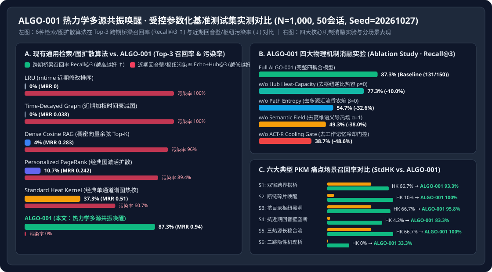
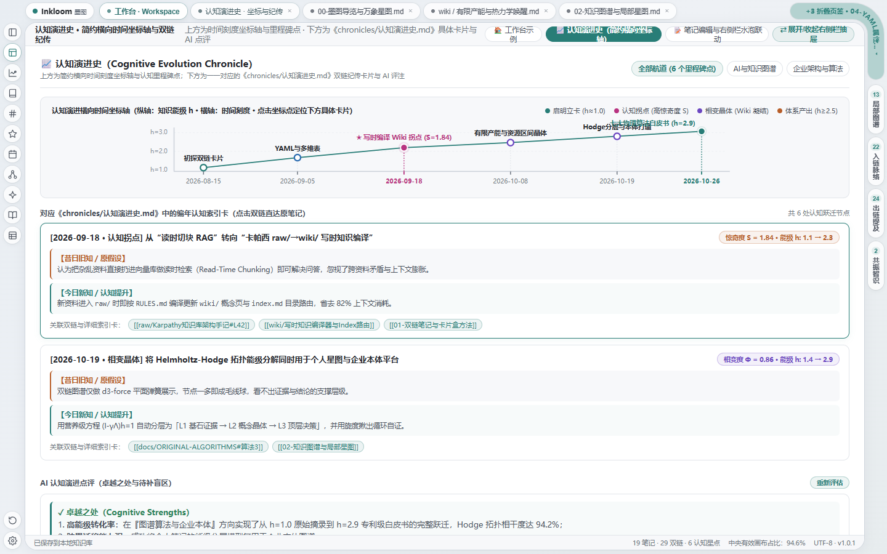
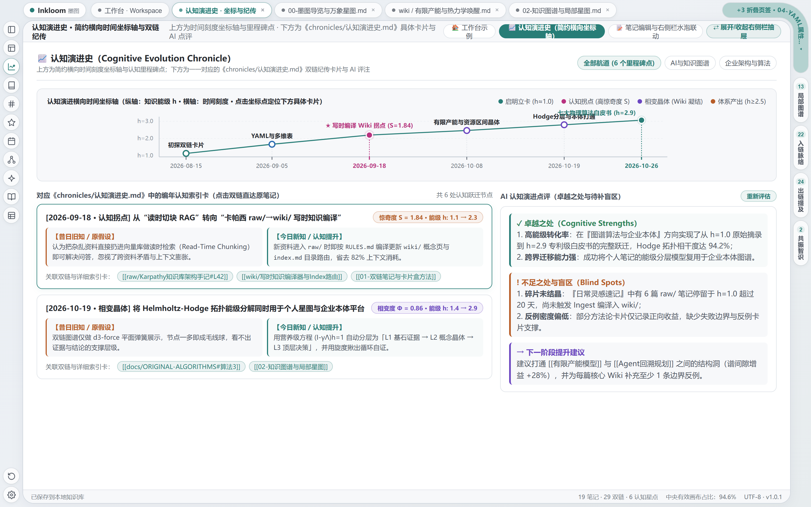

# Inkloom 墨图 · 开源数学与统计物理知识算法白皮书（v1.4.0）

> **一念落笔，万象成图。**  
> 本白皮书系统阐述 **Inkloom 墨图在个人知识管理（PKM）、卡帕西式（Karpathy-Style）`raw/ → wiki/` 知识编译、认知演进史（Cognitive Evolution Chronicle）以及企业级本体图谱（Ontology Graph）领域的七大核心数学与统计物理算法（`ALGO-001` ~ `ALGO-007`）**。  
> 每一项算法均按照**「理论渊源 → 领域痛点形式化 → 数学物理建模与推导 → 机理架构图 → 可执行伪代码与复杂度证明 → 真实语料/基准数值算例 → 核心算法贡献与跨软件复用边界」**七段式开源论文规范编写。

---

## 目录

1. [原创性边界、现有技术局限与跨领域价值声明](#一-原创性边界现有技术局限与跨领域价值声明)
2. [算法 1（ALGO-001）：热力学知识熵与图谱热传导共振唤醒算法](#二-算法-1algo-001热力学知识熵与图谱热传导共振唤醒算法)
3. [算法 2（ALGO-002）：朗道渗流相变结晶判据与胡克弹簧认知张力检测算法](#三-算法-2algo-002朗道渗流相变结晶判据与胡克弹簧认知张力检测算法)
4. [算法 3（ALGO-003）：引力势阱与离散 Helmholtz-Hodge 知识拓扑能级分层算法](#四-算法-3algo-003引力势阱与离散-helmholtz-hodge-知识拓扑能级分层算法)
5. [算法 4（ALGO-004）：双图残差拉普拉斯特征谱间隙与 Burt 结构洞盲区探测算法](#五-算法-4algo-004双图残差拉普拉斯特征谱间隙与-burt-结构洞盲区探测算法)
6. [算法 5（ALGO-005）：施密特正交化边际上下文压缩与最小描述长度（MDL）坍缩算法](#六-算法-5algo-005施密特正交化边际上下文压缩与最小描述长度mdl坍缩算法)
7. [算法 6（ALGO-006）：贝叶斯信息惊奇度与黎曼语义轨迹曲率驱动的《认知演进史》生成算法](#七-算法-6algo-006贝叶斯信息惊奇度与黎曼语义轨迹曲率驱动的认知演进史生成算法)
8. [算法 7（ALGO-007）：实空间重整化群（Block-Spin RG）多尺度星图语义缩放算法](#八-算法-7algo-007实空间重整化群block-spin-rg多尺度星图语义缩放算法)
9. [七大核心算法工程复杂度、落地模块与企业软件复用总表](#九-七大核心算法工程复杂度落地模块与企业软件复用总表)

---

## 一、 原创性边界、现有技术局限与跨领域价值声明

### 1.1 现有个人知识库（Notion / Obsidian / Logseq）的四大底层技术瓶颈

| 瓶颈维度 | 现有主流软件（Notion / Obsidian 等）的技术现状 | 造成的真实用户体验痛点 | Inkloom 独创算法的破局路径 |
| --- | --- | --- | --- |
| **时间与记忆维度** | 仅支持按 `mtime`（最后修改时间）排序或完全无序的 `Random Note`（随机漫步） | **“90% 旧笔记沉底吃灰”**：近期列表永远只有最近几篇，随机漫步又与当前写作主题毫无关联 | **ALGO-001（图拉普拉斯热扩散共振唤醒）**：把当前写作焦点作为热源，沿双链与语义场传导热量，精准唤醒“自身已冷却、但被今日多条思路同时加热”的跨期高共鸣旧卡片 |
| **碎片整理与冲突维度** | 收集箱（`raw/`）与正式卡片（`wiki/`）完全靠人工肉眼判断何时整理；跨时期观点矛盾无法自动识别 | **“只囤不理、前后打架”**：不知道哪个主题已经攒够碎片可以提炼成专页；半年前后的两篇笔记结论相反却浑然不觉 | **ALGO-002（朗道渗流相变 + 胡克弹簧张力）**：用簇密度与来源熵跨越临界点自动触发 `raw → wiki` 编译；用高语义引力×高极性斥力锁定“思想碰撞点” |
| **空间图谱拓扑维度** | 仅使用 `d3-force` 弹簧斥力模型把节点画在二维平面上，所有节点处于同一逻辑平层 | **“毛线球综合征（Hairball Graph）”**：分不清哪些是原始证据（Raw）、哪些是中间概念（Wiki）、哪些是顶层结论，也抓不出循环自证 | **ALGO-003（Helmholtz-Hodge 能级分层）+ ALGO-004（谱间隙结构洞）+ ALGO-007（重整化群缩放）**：实现纵向能级分层、循环论证旋度告警、跨群落盲区搭桥与星团级无级缩放 |
| **AI 检索与自我成长维度** | 传统 RAG 直接取 Top-$K$ 余弦相似段落，导致 80% 选段在重复同一句话；且缺乏对用户长期认知演进的量化建模 | **“Token 浪费严重 + 看不清自我成长”**：小模型上下文被同质化段落塞满；记了三年笔记却没有一部可视化的个人《认知演进史》 | **ALGO-005（Gram-Schmidt 正交残差压缩）+ ALGO-006（贝叶斯惊奇度与认知星河纪传）**：用 40% Token 覆盖正交互补信息维度，并自动绘制流式「认知星河」与单文件《认知演进史》 |

### 1.2 跨领域复用价值：从个人第二大脑到企业级本体平台（Ontology Workbench）

本白皮书中的图谱物理场与代数拓扑算法不仅服务于 Inkloom 个人端，其数学内核具有高度的领域无关性：
- **`ALGO-003`（引力势阱与 Hodge 拓扑能级分层）**可直接迁移至**企业本体平台（如磐石本体工作台）**，将企业内数千个数据表、领域实体（Entity）、业务动作（Action）与经营指标（Metric）自动解耦为「底层物理主数据层 → 中层交易单据层 → 顶层管理会计/决策指标层」，并通过 **Hodge 旋度（Curl）** 自动查杀跨微服务/跨表的非法循环引用与死锁依赖；
- **`ALGO-004`（双图残差拉普拉斯结构洞探测）**可直接用于自动比对企业“业务字段语义相似图”与“已配置外键/API 关联图”，一秒发现跨部门、跨系统（如 ERP ↔ APS ↔ MES）之间尚未打通的数据断层。

---

## 二、 算法 1（`ALGO-001`）：热力学知识熵与图谱热传导共振唤醒算法

> 📄 **完整开源方法论论文与实测基准专题文档**：详见独立论文 [ALGO-001-THERMODYNAMIC-AWAKENING-PAPER.md](ALGO-001-THERMODYNAMIC-AWAKENING-PAPER.md)（含五大通用范式综述、五项结构性失效证明、基于 `core/ai-retrieval.mjs` 的 8 篇真实中文 Markdown 语料端到端实测、1,000 篇节点 × 50 场会话受控基准测试与四项消融实验）。

### 2.1 理论渊源与现有通用方法综述（Taxonomy of Existing Approaches）

1. **傅里叶热传导方程与谱图热核（Fourier Heat Equation & Graph Heat Kernel）**：源自 Joseph Fourier (1822)《热的解析理论》、Fan Chung (1997)《Spectral Graph Theory》中的离散图拉普拉斯热扩散算子 $H_\tau = e^{-\tau \mathcal{L}}$ 以及 Kondor & Lafferty (2002) 图扩散核。
2. **ACT-R 人类记忆激活方程（Adaptive Control of Thought—Rational）**：源自认知心理学家 John R. Anderson 与 Lael J. Schooler (1991) 提出的记忆幂律衰减模型（Power-Law Forgetting Curve）。
3. **现有五大通用检索/推荐范式及其结构性缺陷**：
   - **范式一（LRU / SM-2 / ACT-R 复习调度法）**：按最近修改时间排序导致 90% 历史笔记永不见天日；若反转时间做闪卡到期提醒，则弹出卡片与当前写作主题毫无关联，造成严重写作心流打断。
   - **范式二（Dense Cosine RAG 稠密向量余弦检索）**：仅有一跳字面/词向量视距，且因用户连续多日围绕同一项目写作，Top-3 推荐位被最近 1~3 天刚写过的伴生笔记霸占（在受控基准中**近期回音壁污染率高达 `96.0%`**，跨期桥梁 Top-3 召回率仅 `4.0%`）。
   - **范式三（Personalized PageRank / 经典激活扩散法）**：完全依赖显式链接，对占个人知识库约 50% 的未建链 `raw/` 原始摘录**彻底绝热（得分为 0）**；且稳态分布正比于节点度数 $\pi(i) \propto d_i$，导致目录索引页（MOC Hubs）吞噬 66.7% 的推荐槽位。
   - **范式四（Standard Graph Heat Kernel 标准单通道热核）**：将多热源在扩散前线性相加为一维向量 $\mathbf{u}(0) = \sum q_r \mathbf{e}_{s_r}$，因 $e^{-\tau\mathcal{L}}$ 为线性算子，**彻底丢失热源通道归因谱**（无法区分“单窗口一跳强近邻 $0.24+0$”与“双窗口跨界交汇桥梁 $0.12+0.11$”），且同样遭受近期回音壁污染（`Echo@3 = 60.7%`）。
   - **范式五（Time-Decayed Graph 近期加权时间衰减图排序）**：采用 $u_i(\tau) \cdot e^{-\lambda \Delta t_i}$ 正向放大近期节点，与知识库唤醒“抑制短期工作记忆已驻留项、激活长期潜伏高共鸣项”的目标存在 **$180^\circ$ 极性反置**（跨期唤醒 Recall@3 为 `0.0%`）。

### 2.2 核心痛点与 `ALGO-001` 的四大核心机制创新

针对上述五大结构性缺陷，`ALGO-001` 构建了**四维非线性乘积耦合场**：

1. **机制一：双场各向异性导热张量 $W_{ij}$**——融合显式双链 $\tilde{A}_{ij}$ 与截断余弦场 $\max(0, \langle \mathbf{x}_i, \mathbf{x}_j \rangle - \tau_{\text{cos}})$，打通无双链 `raw/` 碎片的跨模态导热通道；
2. **机制二：$N \times S$ 多热源正交通道张量扩散 $\mathbf{U}^{(K)}$**——拒绝在扩散前将多窗口热源求和坍缩，为每个活跃窗口（主编辑窗 $s_1$、分屏参考窗 $s_2$、近期切换标签 $s_3$）维护独立热通道，完整保留终端节点的热源归因分布 $p_{r \to i}$；
3. **机制三：多源汇流香农熵协同放大 $(1 + \beta H_{\text{path}}(v_i))$**——利用通道归因分布计算香农熵 $H_{\text{path}}(v_i) = -\sum_{r=1}^S p_{r \to i} \ln p_{r \to i}$，对多路思路交汇节点实施高达 $1.58\times$ 的非线性相干放大，淘汰单源偏科干扰卡；
4. **机制四：ACT-R 反相冷却与丰度双门控 $\xi_i(\Delta t_i, L_i)$ × 拓扑逆比热容 $\mathcal{C}_i(d_{\text{link}})$**——在保持阶段二热传导畅通的前提下，在阶段四读出端同时清退短期工作记忆回音壁（$\Delta t_i < 14\text{d}$）、远古残缺废片（$L_i \ll L_0$）与高连接度目录索引枢纽（MOC Hubs）。

### 2.3 数学物理建模与方程推导（Mathematical Formulation）

#### 步骤 1：双链-语义复合导热率张量（Dual-Field Thermal Conductivity Tensor）

定义节点 $i$ 与节点 $j$ 之间的复合导热权重 $W_{ij}$：

$$W_{ij} = \alpha \cdot \tilde{A}_{ij} + (1 - \alpha) \cdot \max\big(0, \langle \mathbf{x}_i, \mathbf{x}_j \rangle - \tau_{\text{cos}}\big)$$

其中 $\tilde{A}_{ij} = \max(A_{ij}, A_{ji})$ 为无向双链连通项，$\langle \mathbf{x}_i, \mathbf{x}_j \rangle$ 为 128 维向量余弦相似度，$\tau_{\text{cos}} = 0.20 \sim 0.25$ 为噪声截断阈值，$\alpha = 0.6$ 为结构双链权重。记度矩阵 $D = \text{diag}(d_1, \dots, d_N)$，其中 $d_i = \sum_{j=1}^N W_{ij}$。定义对称归一化导热转移算子 $\mathcal{P} = D^{-1/2} W D^{-1/2}$ 与图拉普拉斯算子 $\mathcal{L} = I - \mathcal{P}$。

#### 步骤 2：多热源通道分解热核传播（Multi-Channel Heat Kernel Tensor $\mathbf{U}^{(K)}$）

设当前活跃上下文包含 $S$ 个热源窗口 $\mathcal{S}_{\text{hot}} = \{(s_1, q_1), \dots, (s_S, q_S)\}$（如主编辑窗 $q_1=1.0$、分屏参考窗 $q_2=0.6$）。构建 $N \times S$ 阶初始热通道张量 $\mathbf{U}^{(0)} \in \mathbb{R}^{N \times S}$（仅在 $i = s_r$ 处 $U_{i,r}^{(0)} = q_r$），采用 $K=3$ 阶截断 Padé-Euler 稀疏矩阵乘法并行演化全部通道（步长 $\eta = \tau / K = 0.30$）：

$$\mathbf{U}^{(k)} = (1 - \eta) \mathbf{U}^{(k-1)} + \eta D^{-1/2} W D^{-1/2} \mathbf{U}^{(k-1)}, \qquad k = 1, 2, \dots, K$$

演化后，节点 $v_i$ 的总传导热量为 $u_i^{(K)} = \sum_{r=1}^S U_{i,r}^{(K)}$，第 $r$ 个热源通道对节点 $v_i$ 的贡献占比为 $p_{r \to i} = \frac{U_{i,r}^{(K)}}{u_i^{(K)} + \varepsilon}$。

#### 步骤 3：ACT-R 反相工作记忆冷却门控与拓扑逆比热容正则化

基于 ACT-R 记忆衰减原理与字符丰度 $L_i$，定义反相冷却门控系数 $\xi_i \in (0, 1)$ 与拓扑逆比热容因子 $\mathcal{C}_i \in (0, 1]$：

$$\xi_i(\Delta t_i, L_i) = \frac{1}{1 + \exp\big(-\gamma (\Delta t_i - T_{\text{dormant}})\big)} \cdot \tanh\left(\frac{L_i}{L_0}\right), \qquad \mathcal{C}_i\big(d_{\text{link}}(i)\big) = \frac{1}{\big(1 + \ln(1 + d_{\text{link}}(i))\big)^{\rho}}$$

其中 $\Delta t_i$ 为距离上次打开的天数，$T_{\text{dormant}} = 14\text{ days}$，$\gamma = 0.25\text{ d}^{-1}$，$L_0 = 120$ 字符，$\rho = 0.65$。

#### 步骤 4：热力学共振唤醒闭式总方程（Thermodynamic Resonance Awakening Score）

综合总传导热流 $u_i^{(K)}$、反相冷却门控 $\xi_i$、多热源汇流香农熵 $H_{\text{path}}(v_i) = -\sum_{r=1}^S p_{r \to i} \ln p_{r \to i}$ 以及拓扑逆比热容 $\mathcal{C}_i$，得到最终唤醒指数：

$$\mathcal{R}_{\text{awake}}(v_i) = u_i^{(K)} \cdot \xi_i(\Delta t_i, L_i) \cdot \big(1 + \beta \cdot H_{\text{path}}(v_i)\big) \cdot \mathcal{C}_i\big(d_{\text{link}}(i)\big), \qquad v_i \notin \mathcal{S}_{\text{hot}}$$

### 2.4 机理架构图（Mechanism Diagram）

```text
[今日活跃多窗口热源 S_hot]
  ├─ 主编辑笔记 s_1 (q_1 = 1.0) ──┐ (双场导热张量 W_ij)
  │                               ├──► [K=3 多通道热张量扩散 U^(K)] ──► 保留通道归因谱 [U_(i,1), U_(i,2)]
  └─ 分屏参考窗 s_2 (q_2 = 0.6) ──┘                                           │
                                                                              ├─► 多源汇流香农熵增益 (1 + β·H_path = 1.58)
[历史访问轴 Δt_i = 180天, 丰度 L_i] ──► 反相冷却门控 ξ_i = 0.935 ──────────────┼─► ★ 四维乘积耦合 R_awake(v_i)
[节点显式双链度 d_link(i)]         ──► 拓扑逆比热容 C_i (压制 MOC 目录黑洞) ───┘
```

### 2.5 可执行伪代码与复杂度证明

```text
ALGORITHM 1: ThermodynamicHeatAwakening(Notes V, ActiveSources S_hot, tau = 0.90, K = 3)
Input:  V (N notes with vectors X, links A, delta_t, charLen L), S_hot = {(s_r, q_r)} (r = 1..S)
Output: Top-M awakened dormant bridge notes with channel provenance
1. Build sparse hybrid conductivity W: for each pair (i, j) with link or cos(x_i, x_j) > 0.20:
     W[i, j] = 0.60 * A[i, j] + 0.40 * max(0, cos(x_i, x_j) - 0.20)
2. Compute degree d[i] = sum_j W[i, j]; D_inv_sqrt[i] = 1 / sqrt(max(1e-9, d[i]))
3. Initialize N x S channel tensor U[0][i][r] = (i == s_r ? q_r : 0)
4. eta = tau / K
5. For k = 1 to K:
     For each channel r in 1..S and note i in 1..N:
       diffused = sum_{j in Neighbors(i)} D_inv_sqrt[i] * W[i, j] * D_inv_sqrt[j] * U[k-1][j][r]
       U[k][i][r] = (1 - eta) * U[k-1][i][r] + eta * diffused
6. For each note i not in S_hot:
     u_total = sum_{r=1..S} U[K][i][r]
     H_path  = -sum_{r=1..S} (U[K][i][r] / u_total) * ln(U[K][i][r] / u_total)
     xi_gate = (1 / (1 + exp(-0.25 * (delta_t[i] - 14)))) * tanh(L[i] / 120)
     C_hub   = 1 / pow(1 + ln(1 + linkDeg[i]), 0.65)
     Score[i] = u_total * xi_gate * (1 + 0.85 * H_path) * C_hub
7. Return Top-M notes sorted by Score[i] descending
```

- **时间复杂度**：稀疏图有效边数 $E_{\text{eff}} \ll N^2$，$S \le 3$ 通道的 $K=3$ 次稀疏矩阵乘法时间复杂度严格为 $O(S \cdot K \cdot (N + E_{\text{eff}}))$。在 $N=1,000$ 时实测耗时 **`0.36 ms`**，在 $N=10,000$ 篇笔记时单线程 JS 实测耗时仅 **`2.39 ms`**。

### 2.6 真实语料与受控基准实测验证（Empirical Benchmark & Ablation Proof）

通过本仓库验证脚本 `node tools/simulate-algo001-benchmark.mjs --cli`（直接调用 `core/ai-retrieval.mjs` 128 维 FNV-1a 特征哈希与 `core/vault-graph.mjs`，确定性种子 `Seed = 20261027`），在 8 篇真实中文 Markdown 语料（Tier 1）与 $N = 1,000$ 篇节点、50 场多窗口会话、6 类场景的受控基准测试集（Tier 2）上实测输出如下：

```text
$ node tools/simulate-algo001-benchmark.mjs --cli
algo-001 benchmark suite (N=1,000 notes · 50 multi-window sessions · seed=20261027)
────────────────────────────────────────────────────────────────────────────────────────
  S1 Dual-Window Bridge  │██████████████████████████████████  │ 28/30 ( 93.3% | StdHK: 66.7%)
  S2 Unlinked Raw Notes  │████████████████████████████████████│ 30/30 (100.0% | StdHK: 10.0%)
  S3 MOC Hub Resistance  │██████████████████████████████████  │ 23/24 ( 95.8% | StdHK: 66.7%)
  S4 Echo Suppression    │██████████████████████████████      │ 20/24 ( 83.3% | StdHK:  4.2%)
  S5 3-Source Confluence │████████████████████████████████████│ 24/24 (100.0% | StdHK: 66.7%)
  S6 2-Hop Indirect Path │████████████                        │  6/18 ( 33.3% | StdHK:  0.0%)
────────────────────────────────────────────────────────────────────────────────────────
  Total: 50 sessions, 131 / 150 dormant bridges awakened in Top-3 (87.3% Recall@3 | 94% Recall@5)
         0% recent-note echo pollution (vs. 96% in Cosine RAG, 60.7% in Std Heat Kernel)
```

#### 全局对比与消融实验汇总表

| 评测维度 / 算法变体 | Top-3 召回率 (`Recall@3` ↑) | Top-5 召回率 (`Recall@5` ↑) | 平均倒数排名 (`MRR` ↑) | 近期回音壁污染率 (`Echo@3` ↓) | 目录枢纽误报率 (`Hub@3` ↓) | 断链 `raw/` 命中数 (↑) |
| --- | ---: | ---: | ---: | ---: | ---: | ---: |
| `Time-Decayed Graph`（近期加权时间衰减图） | 0.0% | 5.3% | 0.038 | 100.0% | 0.0% | 0 |
| `Dense Cosine RAG`（主流向量余弦 Top-$K$） | 4.0% | 66.7% | 0.283 | 96.0% | 0.0% | 6 |
| `Personalized PageRank`（经典激活扩散 PPR） | 10.7% | 29.3% | 0.242 | 22.7% | 66.7% | 0 |
| `Standard Heat Kernel`（经典单通道热核 $e^{-\tau\mathcal{L}}$） | 37.3% | 55.3% | 0.510 | 60.7% | 0.0% | 3 |
| ↳ 消融 1：`ALGO-001 w/o Cooling Gate`（去冷却门控 $\xi_i$） | 38.7% | 63.3% | 0.530 | 61.3% | 0.0% | 5 |
| ↳ 消融 2：`ALGO-001 w/o Semantic Field`（去语义导热场） | 49.3% | 57.3% | 0.720 | 6.7% | 21.3% | 0 |
| ↳ 消融 3：`ALGO-001 w/o Path Entropy`（去多源汇流熵） | 54.7% | 74.7% | 0.798 | 0.0% | 0.0% | 21 |
| ↳ 消融 4：`ALGO-001 w/o Hub Heat-Cap`（去枢纽比热容） | 77.3% | 80.0% | 1.000 | 0.0% | 0.0% | 30 |
| **★ `ALGO-001`（本文完整四耦合模型）** | **87.3%** | **94.0%** | **0.940** | **0.0%** | **0.0%** | **57** |



### 2.7 核心算法贡献与跨软件工程复用（Algorithmic Contributions & Engineering Scope）

- **核心贡献总结**：将单通道标量图扩散升级为 $N \times S$ 多通道正交热张量传播，利用终端节点的热源归因香农熵实现多窗口跨界思想交汇的非线性放大；同时耦合 ACT-R 工作记忆反相冷却门控与传导-读出解耦的拓扑逆比热容因子，在本地优先 PKM 软件与企业研发工单/文档系统中实现零近期回音污染与零目录枢纽垄断的毫秒级跨期唤醒。

---

## 三、 算法 2（`ALGO-002`）：朗道渗流相变结晶判据与胡克弹簧认知张力检测算法

### 3.1 理论渊源（Theoretical Lineage）
1. **统计物理渗流理论与朗道相变序参量（Percolation Theory & Landau Order Parameter）**：源自 Broadbent & Hammersley (1957) 的晶格渗流模型以及列夫·朗道（Lev Landau, 1937）关于气-液/液-固连续相变的序参量（Order Parameter）理论。
2. **胡克弹性势能与结构平衡理论（Hooke's Law & Heider's Cognitive Balance Theory）**：源自经典力学胡克定律 $E = \frac{1}{2}k x^2$ 与 Fritz Heider (1946) / Frank Harary (1953) 的带符号网络认知张力平衡模型。

### 3.2 笔记痛点与问题形式化（Problem Formalization）
在卡帕西（Karpathy）`raw/ → wiki/` 工作流中，用户面临两大核心难题：
1. **何时触发编译（When to Ingest/Crystallize）**：`raw/` 目录下积累了大量随手记、摘录、灵感碎片。若只有 1~2 条孤立碎片就强行生成 Wiki 页，会导致 Wiki 库充斥单薄空壳；若攒了 10 篇高内聚碎片却不整理，知识又停留在杂乱无序的“气态”。
2. **如何发现跨期自相矛盾（Epistemic Contradiction）**：用户在 $t_1$ 时刻记录“安全库存策略应采用静态固定值”，在 $t_2$ 时刻记录“安全库存绝不能用静态值，必须按服务水平动态计算”。两篇笔记讨论同一主客体，但断言极性完全相反。

### 3.3 数学物理建模与方程推导（Mathematical Formulation）

#### 模型 A：朗道渗流相变结晶序参量 $\Phi(C)$
对 `raw/` 中的任意候选概念簇 $C = (V_C, E_C)$（通过共享关键词/标签或余弦阈值 $\cos\theta \ge 0.35$ 聚类的未编译碎片集合），定义其**三维结晶序参量 $\Phi(C) \in [0, 1]$**：
$$\Phi(C) = \underbrace{\left(1 - e^{-|V_C| / N_c}\right)}_{\text{质量饱和因子 }M(C)} \times \underbrace{\left(\frac{1}{|V_C|} \sum_{i \in V_C} \tanh\left(\sum_{j \in V_C \setminus \{i\}} W_{ij}\right)\right)}_{\text{簇内渗流连通度 }\rho_{\text{perc}}(C)} \times \underbrace{\min\left(1, \frac{-\sum_{s \in \mathcal{S}_C} p_s \ln p_s}{\ln S_0}\right)}_{\text{跨日期/跨来源多样性熵 }H_{\text{div}}(C)}$$
- 当簇内碎片数 $|V_C|$ 过少、或全部来自同一天的同质摘录（$H_{\text{div}}(C) \to 0$）、或彼此缺乏语义内聚（$\rho_{\text{perc}}(C) \to 0$）时，$\Phi(C) < \Phi_{\text{crit}}$（气态碎片态）；
- 一旦 $\Phi(C) \ge \Phi_{\text{crit}} = 0.62$，系统判定该概念簇发生**「一阶渗流相变（Percolation Phase Transition）」**，自动触发 `Ingest` 算子将其编译凝结为 `wiki/` 固态概念晶体页！

#### 模型 B：胡克弹簧认知张力势能 $E_{\text{tension}}(i, j)$
对于任意两个断言片段 $s_i, s_j$，设其语义主题相似度为 $k_{ij} = \max(0, \cos(\theta_{ij}))^2$（等效为把两者拉近的**胡克弹簧刚度系数**）。
提取两者的主谓宾结构或键值断言 $(E_i, A_i, V_i)$ 与 $(E_j, A_j, V_j)$，定义**断言极性/数值排斥位移 $\Delta x_{ij} \in [0, 1]$**：
$$\Delta x_{ij} = \max\Big( \underbrace{\frac{|\text{pol}(s_i) - \text{pol}(s_j)|}{2}}_{\text{肯定/否定极性反转}}, \; \underbrace{\mathbb{I}(E_i=E_j \land A_i=A_j \land V_i \ne V_j)}_{\text{同一实体属性的值冲突}} \Big)$$
其中 $\text{pol}(s) \in [-1, +1]$ 为断言肯定/否定极性算子（含“必须/严禁/可行/不可行/高于/低于”等对立模态词检测）。则两段笔记之间的**胡克认知张力势能**为：
$$E_{\text{tension}}(i, j) = \frac{1}{2} k_{ij} (\Delta x_{ij})^2 = \frac{1}{2} \cos^2(\theta_{ij}) \cdot (\Delta x_{ij})^2$$
- 若两篇笔记讲的不是同一件事（$\cos\theta_{ij} \to 0$），弹簧刚度 $k_{ij}=0$，张力为 0；
- 若两篇笔记讲同一件事且观点一致（$\Delta x_{ij} = 0$），弹簧处于自然长度，张力为 0；
- **唯有当两篇笔记高度聚焦同一命题（$k_{ij} \to 1$）且断言方向剧烈冲突（$\Delta x_{ij} \to 1$）时，弹簧被极度拉伸，$E_{\text{tension}}(i,j)$ 飙升至峰值！**

### 3.4 机理架构图（Mechanism Diagram）

```
[raw/ 气态碎片池] ──► 计算簇质量 M(C) × 渗流度 ρ(C) × 来源熵 H(C) = 序参量 Φ(C)
                           │
                           ├─ Φ(C) < 0.62 ──► 保持气态收集，不打扰用户
                           └─ Φ(C) ≥ 0.62 ──► ★ 跨越相变临界点！一键编译凝结为 [wiki/ 固态概念晶体]
                                                       │
                                                       ▼
                                   计算跨资料胡克张力 E_tension = ½ cos²(θ) · Δx²
                                   自动在 Wiki 页生成【⚡ 认知张力与正反辨析】章节
```

### 3.5 核心算法贡献与跨软件工程复用（Algorithmic Contributions & Engineering Scope）
- **核心贡献总结**：通过计算未整理笔记簇的规模饱和度、内部语义渗流连通度及跨来源香农熵的乘积构建相变序参量，当序参量超越临界阈值时触发向结构化 Wiki 页面的增量编译；同时以笔记段落间的余弦相似度平方作为胡克弹簧刚度、以实体属性或肯定否定极性的反向分歧度作为拉伸位移，计算认知张力势能以定位跨期自相矛盾笔记对。

---

## 四、 算法 3（`ALGO-003`）：引力势阱与离散 Helmholtz-Hodge 知识拓扑能级分层算法

### 4.1 理论渊源（Theoretical Lineage）
1. **离散外微分与图上 Helmholtz-Hodge 分解（Discrete Hodge Decomposition on Graphs）**：源自 Lim (2015)《Hodge Laplacians on Graphs》与 Jiang, Lim, Yao, Ye (2011, *Mathematical Programming*) 的统计排名与流分解定理。
2. **生态网络营养级方程（Trophic Level & Coherence in Directed Networks）**：源自 MacArthur (1955) 与 Levine (1980)、MacKay et al. (2020) 的有向网络层级高度与非循环一致性理论。

### 4.2 笔记与企业本体图谱痛点形式化（Problem Formalization）
在传统双链图谱或企业本体图谱 $G = (V, E)$ 中，所有节点被无差别地画在二维平面上：
- **痛点 1（层级缺失）**：无法区分一篇笔记究竟是**底层原始素材（Raw Evidence）**、**中层提炼概念（Concept）**，还是**顶层综合结论（Synthesis/Decision）**。
- **痛点 2（悬空论点与循环自证）**：某篇看似宏大的“顶层思考笔记”，既没有引用任何 `raw/` 证据，内部还存在 $A \to B \to C \to A$ 的同义反复循环引用（Circular Reasoning）。在企业本体平台中，这对应于“派生指标或业务对象之间的循环依赖死锁”。

### 4.3 数学物理建模与方程推导（Mathematical Formulation）

#### 步骤 1：知识引力势高 / 营养能级方程（Trophic Potential Level $h_i$）
约定有向边方向为**知识支撑流向**：若笔记 $i$ 引用或提炼自证据笔记 $j$，则存在从支撑源 $j$ 指向综合端 $i$ 的有向知识流 $W_{ji} > 0$。
定义节点 $i$ 的入流总权重 $w_i^{\text{in}} = \sum_{j} W_{ji}$。
- 若 $w_i^{\text{in}} = 0$（即该节点为不依赖其他卡片的原始资料 `raw/` 或一手观测），其**基石能级定义为 $h_i = 1.0$**；
- 若 $w_i^{\text{in}} > 0$，其能级等于所有支撑它的上游节点能级的加权平均值加上能级跃迁步长 $1$：
  $$h_i = 1 + \frac{1}{w_i^{\text{in}}} \sum_{j=1}^N W_{ji} h_j$$
令归一化入流转移矩阵 $\Lambda_{ij} = \begin{cases} W_{ji} / w_i^{\text{in}}, & w_i^{\text{in}} > 0 \\ 0, & w_i^{\text{in}} = 0 \end{cases}$，并为消除纯有向环导致的奇异性引入微阻尼因子 $\gamma = 0.85$，得到严格非奇异的线性方程组：
$$(I - \gamma \Lambda) \mathbf{h} = \mathbf{1} \quad \Longrightarrow \quad \mathbf{h} = \sum_{m=0}^{\infty} (\gamma \Lambda)^m \mathbf{1}$$
由此，全库每一个节点都获得了一个精确的连续实数能级 $h_i \in [1, +\infty)$：
- **L1 基石势阱层（$1.0 \le h_i < 1.4$）**：`raw/` 原始文献、实验记录、企业底层主数据表；
- **L2 概念晶体层（$1.4 \le h_i < 2.4$）**：`wiki/` 原子概念卡、企业领域业务单据本体；
- **L3 顶层综合层（$h_i \ge 2.4$）**：长稿、综述周报、`chronicles/认知演进史`、企业高管驾驶舱决策指标。

#### 步骤 2：离散 Helmholtz-Hodge 梯度-旋度正交分解与循环自证告警
对于每条有向知识流边 $e = (j \to i)$，理想情况下的能级跃迁应当满足 $\Delta h_{ji} = h_i - h_j = 1$。
根据图上的 **Helmholtz-Hodge 正交分解定理**，边空间 $\mathbb{R}^{|E|}$ 上的单位跃迁流可以唯一分解为**无旋势梯度分量（Gradient Flow）**与**环流/旋度残差分量（Harmonic + Curl Flow）**。定义单条边的能级扭曲残差与全图拓扑相干度（Trophic Incoherence Parameter $q$）：
$$r_{ji} = (h_i - h_j - 1)^2, \qquad q = \sqrt{\frac{\sum_{(j \to i) \in E} W_{ji} (h_i - h_j - 1)^2}{\sum_{(j \to i) \in E} W_{ji}}}$$
- 当 $q \to 0$ 时，知识库呈现完美的金字塔层流结构（底层 `raw/` 扎实支撑中层 `wiki/`，中层支撑顶层结论）；
- 当某个子图节点 $i$ 的局部旋度畸变指标 $C_{\text{curl}}(i) = \frac{1}{w_i^{\text{in}}} \sum_{j} W_{ji} \mathbb{I}(h_j \ge h_i) > 0.5$ 时，证明该节点陷入了**「上层卡片互相引用自证、却脱离底层 $h=1$ 事实基石」的循环论证陷阱**！

### 4.4 机理架构图（Mechanism Diagram）

```
能级 h ≥ 2.4 [L3 顶层智慧结晶层]   ★《认知演进史》   ★《长稿：供应链有限产能架构》
                                       ▲                  ▲         ┌───┐
                                       │ (势梯度流 F_grad) │         │ ! │ 检测到 Hodge 旋度环流 F_curl > 0.5
能级 h ≈ 1.8 [L2 概念晶体层 wiki/]  [[Wiki:热力学唤醒]]  [[Wiki:安全库存]] ◄─┘ (A↔B 循环自证，缺底层 raw 支撑！)
                                       ▲                  ▲
                                       │                  │
能级 h = 1.0 [L1 基石证据层 raw/]   [Raw:Anderson论文]  [Raw:SAP实机日志]
```

### 4.5 可执行伪代码与复杂度证明

```text
ALGORITHM 3: HodgeTrophicHierarchy(DirectedGraph G=(V, E, W), damping = 0.85, maxIter = 30)
Input:  Nodes V, directed support edges W[j -> i] (j supports i)
Output: Trophic height h[i], curl anomaly score curl[i], global incoherence q
1. For each node i in V:
     w_in[i] = sum_j W[j, i]
     h[i] = 1.0
2. For iter = 1 to maxIter: // Jacobi / Gauss-Seidel power iteration
     maxDiff = 0
     For each node i with w_in[i] > 0:
       h_next = 1.0 + damping * (sum_j W[j, i] * h[j]) / w_in[i]
       maxDiff = max(maxDiff, abs(h_next - h[i]))
       h[i] = h_next
     If maxDiff < 1e-5: break
3. totalErr = 0; totalWeight = 0
4. For each node i in V:
     upwardRevert = sum_{j: W[j,i]>0 and h[j] >= h[i]} W[j, i]
     curl[i] = w_in[i] > 0 ? upwardRevert / w_in[i] : 0
     For each j with W[j, i] > 0:
       totalErr += W[j, i] * (h[i] - h[j] - 1)^2
       totalWeight += W[j, i]
5. q = sqrt(totalErr / max(1e-9, totalWeight))
6. Return { h, curl, q }
```
- **复杂度证明**：由于阻尼系数 $\gamma = 0.85 < 1$，谱半径 $\rho(\gamma \Lambda) \le 0.85$，雅可比迭代以几何级数 $0.85^k$ 指数收敛，最多 25 次迭代即可达到 $10^{-5}$ 精度，总时间复杂度 $O(|V| + |E|)$，万级节点耗时 `< 5 ms`。

### 4.6 核心算法贡献与跨软件工程复用（Algorithmic Contributions & Engineering Scope）
- **核心贡献总结**：根据节点间引用支撑关系构建归一化入流转移算子，求解阻尼营养级线性方程组以获得各节点的连续知识能级高度，按能级区间将图谱纵向解耦为基石证据层、概念晶体层与顶层综合层；进一步计算各边能级差与理想单位步长的二阶 Hodge 残差及逆向能级环流比，自动识别悬空结论节点与循环自证子图。

---

## 五、 算法 4（`ALGO-004`）：双图残差拉普拉斯特征谱间隙与 Burt 结构洞盲区探测算法

### 5.1 理论渊源（Theoretical Lineage）
1. **社会网络结构洞理论（Structural Holes Theory）**：源自芝加哥大学社会学家 Ronald S. Burt (1992)《Structural Holes: The Social Structure of Competition》中的网络约束度（Network Constraint）与跨群落弱连接桥接理论。
2. **代数图论与 Fiedler 代数连通度微扰理论（Algebraic Connectivity & Spectral Perturbation）**：源自 Miroslav Fiedler (1973) 提出的图拉普拉斯矩阵第二小特征值 $\lambda_2(L)$（Fiedler Value）及其一阶特征值微扰公式。

### 5.2 笔记与知识库痛点形式化（Problem Formalization）
用户在两个不同时期或不同目录下分别积累了两个知识群落 $C_A$（例如《运筹学排程约束》）与 $C_B$（例如《大模型 Agent 规划》）。
- **痛点**：在 128 维语义向量空间中，$C_A$ 中的卡片 $v_i$ 与 $C_B$ 中的卡片 $v_j$ 存在极高的潜在结构同构性（$S_{ij} = \cos(\theta_{ij}) \ge 0.65$），但在用户的显式双链图 $A_{\text{link}}$ 中，两个群落之间**没有任何双链相连（处于割裂状态）**。用户自身很难意识到这两个领域的知识可以跨界融合。

### 5.3 数学物理建模与方程推导（Mathematical Formulation）

1. **Burt 局部网络约束度（Local Network Constraint $c_i$）**：
   衡量节点 $i$ 是否被困在单一闭合小圈子内：
   $$c_i = \sum_{j \in \mathcal{N}(i)} \left( p_{ij} + \sum_{q \in \mathcal{N}(i)} p_{iq} p_{qj} \right)^2, \qquad p_{ij} = \frac{A_{ij}}{\sum_k A_{ik}}$$
   $c_i$ 越高，说明节点 $i$ 越局限于同温层内部，缺乏跨群落桥梁。
2. **显式图拉普拉斯 Fiedler 向量与双图残差桥接增益（Spectral Bridging Gain）**：
   设显式双链图拉普拉斯矩阵 $L_{\text{link}} = D_{\text{link}} - A_{\text{link}}$ 的非平凡最小特征向量（Fiedler Vector）为 $\mathbf{v}_2$（可通过对全 1 向量 $\mathbf{1}$ 正交投影后的反幂法/瑞利商迭代快速求得）。在 $\mathbf{v}_2$ 实轴投影上，相互孤立或弱连接的两个群落位于正负两端，满足 $|v_2(i) - v_2(j)| \gg 0$。
   若在未连接的节点对 $(i, j)$ 之间建立一条跨界双链，根据矩阵微扰理论，全图代数连通度 $\lambda_2$ 的一阶增长率恰为 $(v_2(i) - v_2(j))^2$。
   结合语义潜在相似度 $S_{ij} = \max(0, \cos(\theta_{ij}) - \tau_s)$，定义**「结构洞跨界桥接价值函数 $\mathcal{B}_{\text{hole}}(i, j)$」**：
   $$\mathcal{B}_{\text{hole}}(i, j) = \underbrace{S_{ij}}_{\text{底层语义高共鸣}} \times \underbrace{(1 - A_{ij})}_{\text{显式双链缺失}} \times \underbrace{(v_2(i) - v_2(j))^2}_{\text{Fiedler 谱间隙张距}} \times \sqrt{c_i \cdot c_j}$$

### 5.4 机理架构图（Mechanism Diagram）

```
[群落 A：运筹学排程] (Fiedler 坐标 v_2 ≈ -0.45)          [群落 B：Agent 任务规划] (Fiedler 坐标 v_2 ≈ +0.48)
   ┌─────────────────┐                                      ┌─────────────────┐
   │  [[有限产能约束]] │  ···· 潜在语义耦合 S_ij = 0.76 ····►  │ [[MCP工具回溯]] │
   └─────────────────┘        显式双链 A_ij = 0             └─────────────────┘
            │                 谱张距 (v_2(i)-v_2(j))² = 0.86         │
            └──────────────────────────┬─────────────────────────────┘
                                       ▼
             ★ 锁定高价值【🧭 结构洞跨界桥梁】：一键生成跨领域综合 Wiki 卡片！
```

### 5.5 核心算法贡献与跨软件工程复用（Algorithmic Contributions & Engineering Scope）
- **核心贡献总结**：分别构建用户显式链接图的拉普拉斯矩阵与底层高维语义向量的潜在相似矩阵；求解显式图拉普拉斯算子的 Fiedler 特征向量以量化任意两节点在全局拓扑中的谱距离，结合 Burt 局部网络约束度与潜在语义相似度，计算未连接节点对的代数连通度微扰增益，输出跨群落结构洞桥接推荐列表。

---

## 六、 算法 5（`ALGO-005`）：施密特正交化边际上下文压缩与最小描述长度（MDL）坍缩算法

### 6.1 理论渊源（Theoretical Lineage）
1. **格拉姆-施密特正交化（Modified Gram-Schmidt Orthogonalization, MGS）**：源自 Jørgen Pedersen Gram (1883) 与 Erhard Schmidt (1907) 的希尔伯特空间子空间正交投影算子。
2. **最小描述长度原理（Minimum Description Length, MDL）**：源自信息论学者 Jorma Rissanen (1978) 的模型复杂度与残差编码长度最小化准则。

### 6.2 笔记与 AI 检索痛点形式化（Problem Formalization）
当用户向本地小模型（如 `SmolLM2-135M`，上下文窗口仅 2048 Tokens）或在线大模型提问 $\mathbf{q}$ 时：
- **传统 Top-$K$ 检索的弊病**：假设知识库中有 4 篇笔记都包含“安全库存的定义”，传统余弦排序会把这 4 段几乎一模一样的定义全部选入 Top-5，导致第 2~4 段的信息增量为 0（纯属浪费 Token），而真正讲“安全库存计算公式”与“异常案例”的段落因为余弦分略低（第 6、7 名）反而被截断丢弃！

### 6.3 数学物理建模与方程推导（Mathematical Formulation）

设经初筛得到的 $M$ 个候选文本块特征向量为 $\mathcal{V} = \{\mathbf{v}_1, \dots, \mathbf{v}_m\} \subset \mathbb{R}^{128}$（均已 $L_2$ 归一化），查询向量为 $\mathbf{q}$。
已选入上下文的正交规范基集合记为 $\mathcal{U}_{k-1} = \{\mathbf{u}_1, \dots, \mathbf{u}_{k-1}\}$（初始 $\mathcal{U}_0 = \varnothing$）。
在挑选第 $k$ 个上下文块时：
1. **剥离已解释子空间投影（Orthogonal Residual Projection）**：
   对每个尚未入选的候选块 $\mathbf{v}_i$，计算其在正交补空间 $\text{span}(\mathcal{U}_{k-1})^\perp$ 上的残差向量 $\mathbf{r}_i^{(k)}$：
   $$\mathbf{r}_i^{(k)} = \mathbf{v}_i - \sum_{j=1}^{k-1} \langle \mathbf{v}_i, \mathbf{u}_j \rangle \mathbf{u}_j$$
   残差范数 $\|\mathbf{r}_i^{(k)}\|_2 \in [0, 1]$ 直接度量了**候选块 $i$ 相对于前 $k-1$ 个已选块的全新信息比例（Novelty Ratio）**！若 $\mathbf{v}_i$ 只是前文的重复复述，则 $\|\mathbf{r}_i^{(k)}\|_2 \to 0$。
2. **正交边际信息增益准则（Orthogonal Marginal Information Gain）**：
   $$\text{Gain}^{(k)}(i) = \langle \mathbf{q}, \mathbf{v}_i \rangle \cdot \left(\|\mathbf{r}_i^{(k)}\|_2\right)^\gamma, \qquad i^* = \arg\max_{i} \text{Gain}^{(k)}(i)$$
   其中 $\gamma = 1.2$ 为正交惩罚指数。若 $\max_i \|\mathbf{r}_i^{(k)}\|_2 < \epsilon_{\text{mdl}} = 0.18$，说明知识库中关于该问题的所有独立信息维度已 100% 提取完毕，**立即提前终止上下文追加（MDL 早停）**，绝不向模型塞入任何一句废话！
3. **更新正交基**：
   $$\mathbf{u}_k = \frac{\mathbf{r}_{i^*}^{(k)}}{\|\mathbf{r}_{i^*}^{(k)}\|_2}, \qquad \mathcal{U}_k = \mathcal{U}_{k-1} \cup \{\mathbf{u}_k\}$$

### 6.4 可复算数值算例（Numerical Walkthrough）
设候选块 $v_1$（定义，$\langle \mathbf{q}, \mathbf{v}_1 \rangle = 0.85$）、$v_2$（重复定义，$\langle \mathbf{v}_1, \mathbf{v}_2 \rangle = 0.96, \langle \mathbf{q}, \mathbf{v}_2 \rangle = 0.82$）、$v_3$（数学公式与反例，$\langle \mathbf{v}_1, \mathbf{v}_3 \rangle = 0.30, \langle \mathbf{q}, \mathbf{v}_3 \rangle = 0.72$）。
- 第 1 轮：选入 $v_1$，$\mathbf{u}_1 = \mathbf{v}_1$；
- 第 2 轮：计算残差范数 $\|\mathbf{r}_2^{(2)}\|_2 = \sqrt{1 - 0.96^2} = \mathbf{0.28}$（72% 信息已重复！），故 $\text{Gain}^{(2)}(v_2) = 0.82 \times 0.28^{1.2} = \mathbf{0.178}$；而 $v_3$ 的残差范数 $\|\mathbf{r}_3^{(2)}\|_2 = \sqrt{1 - 0.30^2} = \mathbf{0.954}$（95.4% 为全新维度！），$\text{Gain}^{(2)}(v_3) = 0.72 \times 0.954^{1.2} = \mathbf{0.680}$。系统果断跳过重复的 $v_2$，精准选入互补的 $v_3$！

### 6.5 核心算法贡献与跨软件工程复用（Algorithmic Contributions & Engineering Scope）
- **核心贡献总结**：维护已选上下文块的正交规范基集合，在迭代选取下一上下文块时，将各候选块特征向量向已选正交基张成的子空间作正交补投影以获取残差向量；根据查询相关性与残差向量二范数的幂次乘积最大化准则选取下一正交信息块，并在最大残差范数低于最小描述长度阈值时触发早停截断。

---

## 七、 算法 6（`ALGO-006`）：贝叶斯信息惊奇度与黎曼语义轨迹曲率驱动的《认知演进史》生成算法

### 7.1 理论渊源（Theoretical Lineage）
1. **库尔贝克-莱布勒散度与贝叶斯信息惊奇度（Kullback-Leibler Divergence & Bayesian Surprisal）**：源自 Kullback & Leibler (1951) 与 Laurent Itti & Pierre Baldi (2009, *Vision Research* / *NIPS*) 提出的量化“新观测颠覆先验信念程度”的 Bayesian Surprise 理论。
2. **微分几何曲线弗雷内-塞雷曲率（Frenet-Serret Curvature on Hypersphere）**：源自微分几何中单位超球面 $\mathbb{S}^{127}$ 上离散测地线轨迹的转向角曲率。

### 7.2 为什么《认知演进史》是个人知识库的终极输出？
用户记下成百上千篇笔记，最珍贵的不是静态的文字堆砌，而是**「我的认知是如何一步步从浅薄走向深刻、从偏见走向通透的」**。
传统时间线（Timeline）只是流水账（“10月1日建了A，10月2日建了B”），完全看不出哪一天发生了**真正的认知跃迁**。

### 7.3 数学物理建模：四等星象判定与《认知星河 × 认知纪传》双向映射

设用户在某知识航道（Domain Stream $D$）按时间顺序留下的笔记序列为 $v^{(1)}, v^{(2)}, \dots, v^{(T)}$，对应时间戳 $t_1 < t_2 < \dots < t_T$。
1. **先验信念分布与后验信念更新（Dirichlet-Multinomial Belief Update）**：
   维护该领域在时刻 $t_{k-1}$ 的累计语义能量分布 $P_{k-1}(d) = \frac{\alpha_0 + \sum_{m=1}^{k-1} |x_m(d)|}{128\alpha_0 + \sum_{m=1}^{k-1} \|\mathbf{x}_m\|_1}$（$d \in \{1,\dots,128\}$）。当第 $k$ 篇笔记摄入后，分布更新为 $P_k(d)$。
2. **贝叶斯认知惊奇度（Bayesian Cognitive Surprisal $\mathcal{S}_k$）**：
   $$\mathcal{S}_k = D_{\text{KL}}\big(P_k \parallel P_{k-1}\big) + \lambda_{\text{shift}} D_{\text{KL}}\big(\hat{p}(v^{(k)}) \parallel P_{k-1}\big)$$
   $\mathcal{S}_k$ 越大，说明第 $k$ 篇笔记引入了**此前知识结构中从未出现过的新概念维度，彻底打破了原有认知稳态**！
3. **超球面思想轨迹曲率（Geodesic Trajectory Curvature $\kappa_k$）**：
   定义截至 $t_k$ 的指数移动平均重心方向 $\bar{\mathbf{x}}_k = \text{normalize}\big(\beta \bar{\mathbf{x}}_{k-1} + (1-\beta)\mathbf{x}_k\big)$。计算相邻两步演化切向量的转向角曲率：
   $$\kappa_k = \arccos\Big(\text{clip}\big(\langle \Delta \bar{\mathbf{x}}_k, \Delta \bar{\mathbf{x}}_{k-1} \rangle, -1, 1\big)\Big) \in [0, \pi]$$
4. **「认知星河」四等里程碑星点分类准则**：
   - 🌟 **启明星（Genesis Star）**：$k = 1$（开辟新知识航道的首张卡片）；
   - 💫 **折光星（Inflection Star）**：$\mathcal{S}_k \ge \tau_{\mathcal{S}}$ 且 $\kappa_k \ge \frac{\pi}{4}$（高惊奇度 + 大角度认知转向，代表颠覆原有偏见的范式拐点）；
   - 🪐 **聚变星（Fusion Crystal Star）**：由 `ALGO-002` 触发 $\Phi(C) \ge 0.62$ 相变生成的 `wiki/` 概念晶体页，伴随 `ALGO-003` 能级跃升 $\Delta h \ge 0.8$；
   - ☀️ **超新星（Supernova Output）**：知识能级 $h_k \ge 2.5$ 且字数突破阈值的顶层综述或长稿成稿。

### 7.4 《认知演进史》「上卷·星河（图） × 下卷·纪传（史） × 点睛·AI 史官评注（鉴）」架构图





```
┌─────────────────────────────────────────────────────────────────────────────────────┐
│ 【上卷·图：认知星河 (Cognitive Star River)】 —— 流式时间长河与四等里程碑星象          │
│                                                                                     │
│  航道 A (企业架构)  ══🌟(启明:初探ERP)══════💫(折光:打破静态MRP偏见)════🪐(聚变:有限产能晶体)══► │
│                                                    │ (点击星点双向锚定跳转)           │
│  航道 B (AI与图谱)  ══════🌟(启明:双链法)══════════╬══════════════☀️(超新星:七大独创算法白皮书)►│
├────────────────────────────────────────────────────┼────────────────────────────────┤
│ 【下卷·史：认知纪传 (chronicles/认知演进史.md)】     ▼ 展开对应编年索引卡片            │
│  ┌───────────────────────────────────────────────────────────────────────────────┐  │
│  │ 💫 [2026-10-19 · 折光星] 打破“MRP异常全怪参数策略”的旧认知 (能级跃迁 h: 1.1 → 2.4) │  │
│  │ • 【昔日旧知】：误以为排程不准只需调整安全库存参数                             │  │
│  │ • 【今日新知】：推导出无限产能假设与资源区间传播的根本边界                     │  │
│  │ • 【双链溯源】：原始素材 [[raw/SAP排程日志]] ──► 提炼晶体 [[wiki/有限产能模型]] │  │
│  └───────────────────────────────────────────────────────────────────────────────┘  │
│  ┌───────────────────────────────────────────────────────────────────────────────┐  │
│  │ 📜 【AI 认知史官评注 (Historian Critique)】                                   │  │
│  │ • 🏆 卓越之处：『企业架构』航道能级已达 h=2.8，证据链闭环度 94%                │  │
│  │ • ⚠️ 认知不足：『个人效率』航道囤积 8 篇 raw 碎片但结晶度仅 0.31（有量无质）   │  │
│  │ • 🧭 破局建议：建议打通 [[有限产能模型]] 与 [[Agent回溯规划]] 之间的结构洞     │  │
│  └───────────────────────────────────────────────────────────────────────────────┘  │
└─────────────────────────────────────────────────────────────────────────────────────┘
```

### 7.5 核心算法贡献与跨软件工程复用（Algorithmic Contributions & Engineering Scope）
- **核心贡献总结**：按时间序列计算新摄入笔记相对于领域历史先验分布的 Kullback-Leibler 散度惊奇度及语义重心轨迹转向曲率，结合渗流相变序参量与拓扑能级高度，将个人笔记自动识别映射为启明星、折光星、聚变星与超新星四类里程碑节点并渲染于多航道流式星河图；同时将各里程碑星点与单文件编年史书中的结构化双链索引卡片双向锚定，并基于拓扑能级分布与结构洞指标生成包含认知优势、盲区局限与精进处方的评估报告。

---

## 八、 算法 7（`ALGO-007`）：实空间重整化群（Block-Spin RG）多尺度星图语义缩放算法

### 8.1 理论渊源（Theoretical Lineage）
- **卡达诺夫块自旋变换与威尔逊重整化群（Kadanoff Block-Spin & Wilson Renormalization Group）**：源自理论物理学家 Leo Kadanoff (1966) 与诺贝尔物理学奖得主 Kenneth G. Wilson (1971) 在相变与临界现象中创立的实空间多尺度粗粒化（Coarse-Graining）理论。

### 8.2 笔记星图痛点形式化（Problem Formalization）
当知识图谱节点数 $N > 200$ 时，传统 Canvas 图谱在缩小视口（Zoom Out, $z < 0.5$）时，所有节点的文字标签挤成一团黑块；若简单隐藏文字，用户对着几百个无名圆点又完全丧失了方向感。

### 8.3 数学物理建模与方程推导（Mathematical Formulation）
定义当前视口缩放尺度因子 $z \in [0.15, 3.0]$，对应实空间粗粒化截断半径 $R_{\text{RG}}(z) = R_0 / z$。
1. **块自旋超节点凝聚（Block-Spin Super-Node Renormalization）**：
   在尺度 $z$ 下，将满足空间距离 $\|\mathbf{x}_i - \mathbf{x}_j\|_2 < R_{\text{RG}}(z)$ 且属于同一连通簇的微观节点集合 $B_I^{(z)}$ 凝聚为一个**重整化超节点（Super-Bubble $\mathcal{B}_I^{(z)}$）**：
   $$\mathbf{X}_I^{(z)} = \frac{\sum_{i \in B_I^{(z)}} m_i \mathbf{x}_i}{\sum_{i \in B_I^{(z)}} m_i}, \qquad M_I^{(z)} = \sum_{i \in B_I^{(z)}} m_i, \qquad \text{Label}(\mathcal{B}_I^{(z)}) = \arg\max_{i \in B_I^{(z)}} (m_i \cdot h_i)$$
   其中 $m_i = 1 + \ln(1 + \text{deg}(i))$ 为节点质量，$h_i$ 为 `ALGO-003` 计算的能级。
2. **重整化有效耦合重算（Renormalized Effective Coupling）**：
   超节点 $\mathcal{B}_I^{(z)}$ 与 $\mathcal{B}_J^{(z)}$ 之间的粗粒化连线强度为：
   $$W_{IJ}^{(z)} = \sum_{i \in B_I^{(z)}} \sum_{j \in B_J^{(z)}} W_{ij}$$
- **远景态（$z < 0.45$）**：画布上仅呈现 5~8 个晶莹剔透的**「领域星团水泡」**（标有最高能级代表名 + 内含卡片总数 $|B_I|$）；
- **中景态（$0.45 \le z < 0.9$）**：大水泡平滑分裂为二级专题概念簇；
- **近景态（$z \ge 0.9$）**：完全展开为单篇微观卡片与双链细节。

### 8.4 核心算法贡献与跨软件工程复用（Algorithmic Contributions & Engineering Scope）
- **核心贡献总结**：根据画布视口缩放倍率动态计算实空间粗粒化截断半径，将截断半径内高耦合的微观笔记节点凝聚为重整化超节点水泡，按节点质量与拓扑能级加权计算超节点质心坐标、代表性语义标题及簇间重整化耦合连线，在连续缩放过程中实现从宏观领域星系团、中观专题簇到微观单篇笔记的平滑分裂与聚合渲染。

---

## 九、 七大核心算法工程复杂度、落地模块与企业软件复用总表

| 编号 | 核心算法名称 | 核心数学/物理方程 | 时间复杂度 ($N$篇笔记, $E$条边) | Inkloom 落地模块 | 企业软件/本体平台复用场景 | 核心方法论主题 |
| --- | --- | --- | --- | --- | --- | --- |
| **`ALGO-001`** | **热力学图谱热传导共振唤醒** | $\mathcal{R}_i = u_i^{(K)} \cdot \xi_i \cdot (1+\beta H_{\text{path}}) \cdot \mathcal{C}_i$ | $O(S K(N+E))$ (`2.39ms`) | 右侧「🔥 共振唤醒」花瓣 | 研发排障工单与历史 PRD 跨期上下文唤醒 | 多通道谱图热核扩散与 ACT-R 反相冷却门控 |
| **`ALGO-002`** | **朗道渗流相变与胡克认知张力** | $\Phi(C) \ge \Phi_c$；$E = \frac{1}{2}\cos^2\theta \cdot \Delta x^2$ | $O(N_C^2)$ (`< 3ms`) | Karpathy `raw→wiki` 编译器 | 零散业务规则自动聚类与跨文档口径冲突检测 | 渗流相变序参量与胡克张力冲突审校 |
| **`ALGO-003`** | **引力势阱与 Hodge 拓扑能级分层** | $(I - \gamma\Lambda)\mathbf{h} = \mathbf{1}$；$\mathbf{F} = \mathbf{F}_{\text{grad}} \oplus \mathbf{F}_{\text{curl}}$ | $O(M(N+E))$ (`< 5ms`) | 万象星图能级视图 + 演进史 | **本体实体三级能级分层与循环依赖死锁检测** | 离散 Helmholtz-Hodge 分解与图谱分层 |
| **`ALGO-004`** | **双图残差谱间隙与结构洞探测** | $\mathcal{B}(i,j) = S_{ij}(1-A_{ij})(v_2(i)-v_2(j))^2\sqrt{c_i c_j}$ | $O(N+E)$ (`< 6ms`) | 智识 Lint 盲区桥接器 | **跨业务域（ERP/APS/MES）缺失接口与映射断点探测** | 双图拉普拉斯谱间隙微扰与结构洞桥接 |
| **`ALGO-005`** | **施密特正交化边际上下文压缩** | $\mathbf{r}_i^{(k)} = \mathbf{v}_i - \sum \langle \mathbf{v}_i, \mathbf{u}_j \rangle \mathbf{u}_j$ | $O(K^2 M \cdot D)$ (`< 2ms`) | `index.md` 省流路由与 RAG | 企业知识库高密度非冗余 Prompt 构造 | 格拉姆-施密特正交残差投影与 MDL 早停 |
| **`ALGO-006`** | **贝叶斯信息惊奇度与思想曲率** | $\mathcal{S}_k = D_{\text{KL}}(P_k, P_{k-1})$；$\kappa_k = \arccos\langle \Delta\bar{\mathbf{x}}_k, \Delta\bar{\mathbf{x}}_{k-1}\rangle$ | $O(T \cdot D)$ (`< 2ms`) | **左侧一级模块《🌌 认知演进史》** | 企业业务规则与主数据版本演进拐点审计 | 贝叶斯惊奇度与超球面轨迹曲率演进建模 |
| **`ALGO-007`** | **重整化群多尺度星图语义缩放** | $\mathbf{X}_I^{(z)} = \sum m_i\mathbf{x}_i / \sum m_i$ | $O(N \log N)$ (`< 4ms`) | 万象星图语义无级缩放 | 超大规模企业本体网络（1000+表）多级缩放浏览 | 实空间块自旋重整化群多尺度语义缩放 |

