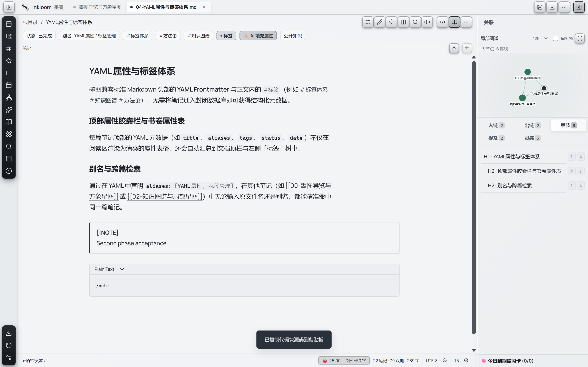
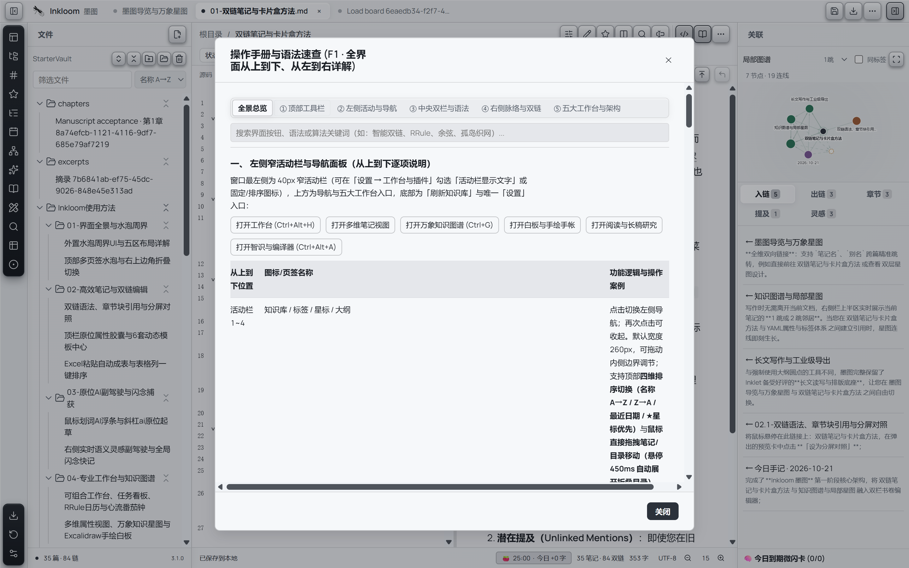
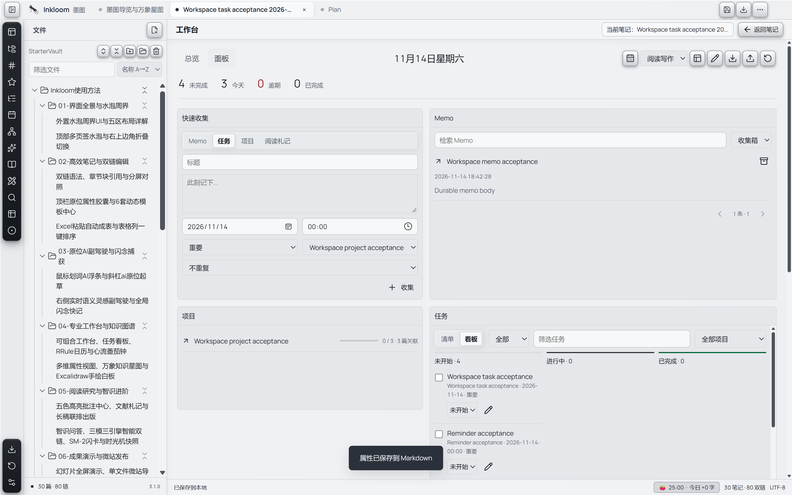
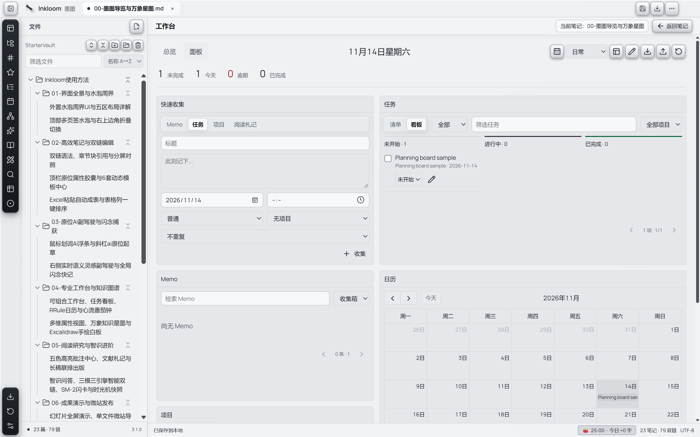
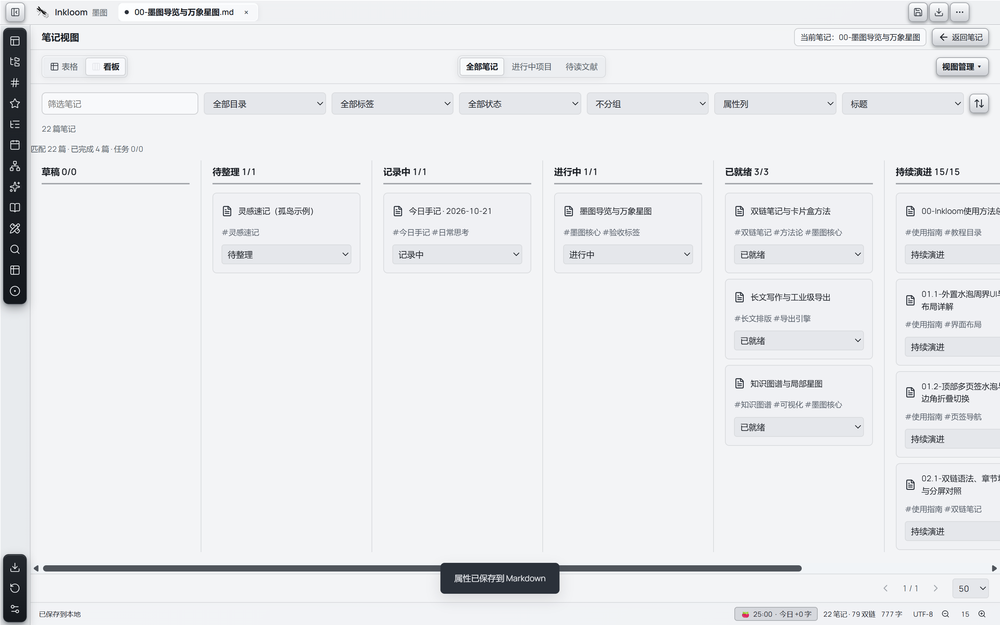
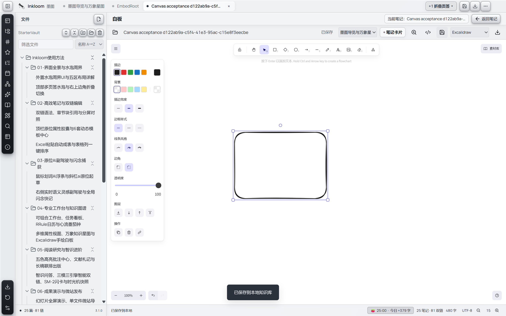
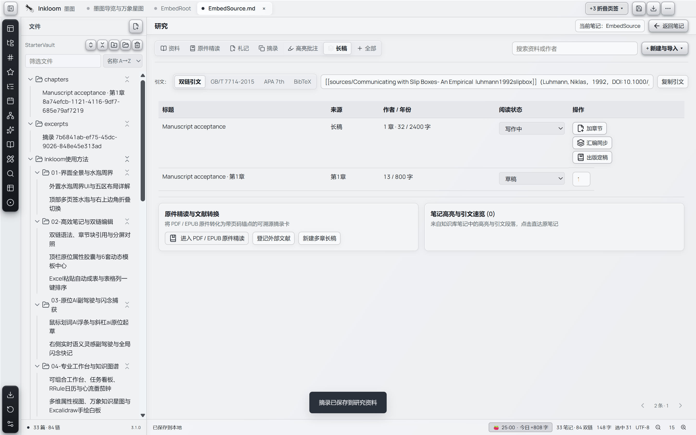
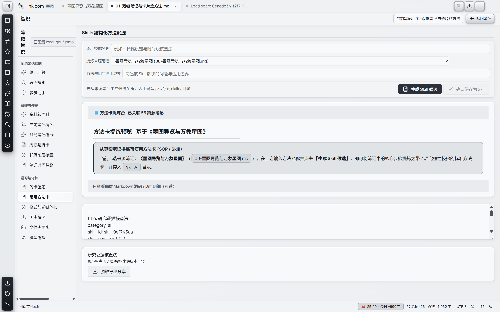
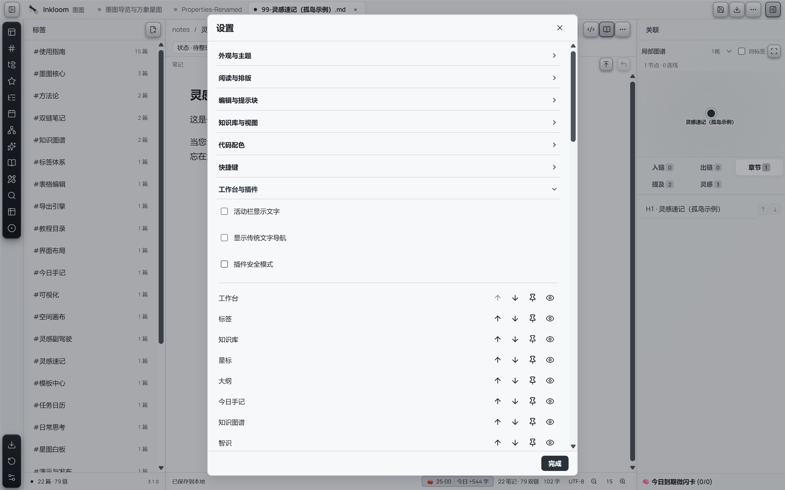

# Inkloom 墨图 · 用户操作手册（v3.1.0）

> **一念落笔，万象成图。**  
> 本手册严格按照软件界面的空间排布顺序（**从上到下、从左到右**），逐一拆解每一个界面区域、每一个按钮功能、涉及的 Markdown 扩展语法、完整端到端使用案例、实机界面截图以及底层算法与技术实现原理。全站视觉与组件设计标准详见 [《Inkloom UX/UI 设计系统与视觉交互规范》](UX-UI-SPECIFICATION.md)。在软件内任意位置按快捷键 **`F1`**（或点击顶栏「文件 → 操作手册与语法速查」）即可呼出交互式章节手册。

---

## 目录

### 本轮操作速查

| 操作 | 入口与步骤 | 边界 |
| --- | --- | --- |
| 全局设置 | 任意工作区点击活动栏底部“设置”；点分类标题展开，再点可收起；按 Escape 关闭并返回触发按钮 | 七个分类一次展开一组；主题包与外观扩展默认收起。文件菜单打开的是同一窗口 |
| 背景配色 | 设置 → 外观与主题 → 客户端主题、源码背景或阅读背景 → 选择色系和小色签 | 切换客户端明暗会同步两栏并停用外观包覆盖；随后仍可分别自选两栏背景 |
| 正文大小 | 设置 → 阅读与排版 → 正文字号、行距 | 新配置为 15px、1.75；升级保留已有偏好，不强制缩字 |
| 全库受控正则查找替换与 .ics 日历双向同步（3.1.0 · MAJOR-310） | ① **全库预览式查找替换与 YAML 键改名**：点击笔记顶栏「⋯ 更多笔记工具 → 全库受控查找替换与属性改名」（或按 `Ctrl+F` 点击查找栏「全库替换…」），输入查找/替换词（可选正则表达式或 YAML 属性键名重命名）→ 点击「🔍 预览全库差异」核对逐行红绿 Diff → 点击「✅ 执行受控替换」，如需还原可点击「↩️ 撤销上次批量替换」；② **RFC 5545 `.ics` 日历双向互通**：工作台 → 总览 → 点击「📅 周期手记 ▾」菜单 → 点击「📤 导出待办日程 (.ics)」或选择/粘贴外部 `.ics` 点击「📅 同步 .ics 日程到任务库」 | 默认跳过代码块并保护 `[[双链]]` 目标路径及机密加密笔记；`.ics` 仅导出已设有效 `@due` 日期的日程，不伪造未标日期任务 |
| 全库便携归档验签与跨笔记块引用内嵌巡检（3.0.0 · MAJOR-300） | ① **全库便携归档与 SHA-256 验签还原**：点击左侧活动栏底部「导入与库管理 → 全库便携归档 (.zip)」（或「文件 → 全库便携归档与验签」）→ 点击「📦 打包导出全库归档 (.zip)」或「🔍 选择归档包验签对账」，校验通过后可点击「♻️ 无损还原缺失与变更笔记」；② **跨笔记块/章节内嵌巡检**：点击笔记顶栏「⋯ 更多笔记工具 → 跨笔记块/章节内嵌巡检」（或「智识 → 格式与断链体检 → 🧬 Dataview与多源迁移 ▾ → 🔗 巡检全库 ![[块/章节]] 内嵌引用」），支持实时预览、原位跳源与一键对齐改名锚点 | 归档单字节篡改或哈希不匹配时硬性拦截写入；还原保留当前库独有新笔记及原文件 UTF-8 BOM/CRLF |
| 知识金句分享卡片与写作字数冲刺里程碑（2.9.0 · MAJOR-290） | ① **知识金句分享卡片（SVG / PNG）**：点击笔记顶栏「⋯ 更多笔记工具 → 生成知识金句分享卡片 (SVG/PNG)」（或鼠标拖选正文后点击浮栏图标），切换「书卷清透 / 暗夜黑金 / 莫兰迪青瓷 / 苍穹靛青」四款主题版式，一键复制 SVG、导出 `.svg` 或导出 2x 高清 `.png`；② **写作目标冲刺与里程碑统计**：工作台 → 总览 → 点击「📅 周期手记 ▾」菜单 → 查看今日/全库目标字数达成率、连续创作天数与 4 项里程碑，点击「📊 生成写作冲刺与里程碑报告」沉淀复盘手记 | 全部收纳于菜单与划词浮栏，零外部联网依赖，自动净化双链语法 |
| 周期性手记日/周/月/季与 Anki 闪卡双向同步（2.8.0 · MAJOR-280） | ① **日/周/月/季周期手记**：在「工作台 → 总览 → 📅 周期手记 ▾」弹出菜单、左侧活动栏「今日手记」图标悬停/右键菜单或 `Ctrl+K` 命令中心选择「本周周报手记 / 本月复盘手记 / 本季规划手记」，自动汇总周期活跃笔记双链与任务进度；② **Anki `.apkg / TSV` 闪卡双向导入导出**：智识 → 闪卡温习 → 点击「牌组与制卡 ▾」菜单 → 点击「导出 Anki TSV」「导出 Anki .apkg 包」或选择/粘贴 `.apkg / .tsv` 同步至知识库 | 入口均收纳于弹出菜单；重复闪卡自动跳过不覆盖原文，SM-2 复习参数通过 HTML 注释无损往返 |
| EPUB 3.0 电子书导出与多维视图 CSV 批处理（2.7.0 · MAJOR-270） | ① **EPUB 3.0 电子书导出**：点击顶栏「导出文档」选择 `EPUB 3.0 电子书 (.epub)`（或「研究 → 长稿 → 出版定稿 → 导出 EPUB 3.0 电子书」）；② **多维视图 CSV 导出与属性同步**：笔记视图 → 点击「视图管理 ▾」菜单 → 点击「导出 CSV」「存为汇总笔记」或粘贴 CSV 点击「同步 CSV 属性到笔记」 | EPUB 自动净化双链并生成标准 OPF/NCX/XHTML；CSV 同步自动忽略只读公式列 |
| 多级目录长稿汇编与跨章设定时间线矩阵（2.6.0 · MAJOR-260） | ① **多级目录汇编长稿**：在左侧目录树右键任意文件夹选择「汇编此目录为长稿总览…」，或在「研究 → + 新建与导入 ▾ → 多级目录汇编长稿」输入目录路径生成带分卷进度与章节字数表的长稿；② **跨章设定与时间线矩阵**：智识 → 长稿前后核查 → 点击「🧭 设定与时间线矩阵 ▾」菜单 → 输入可选目录筛选并点击「📊 生成跨章人物·概念·时间线矩阵」 | 入口均收纳于弹出菜单与右键菜单，不平铺在界面表层 |
| 多级目录递归展开/收起与知识大纲思维导图（2.5.0 · MAJOR-250） | ① **多级目录递归展开至最底层 / 全部收起**：在左侧「知识库」目录树点击任意文件夹（或其右侧 `ChevronsUpDown / ChevronsDownUp` 图标）、或选中目录后点击目录栏顶部「全部展开至最底层 / 全部收起」按钮、或右键目录选择「全部展开此目录至最底层 / 全部收起此目录及子目录」；② **知识大纲与目录层级思维导图**：点击笔记顶栏「⋯ 更多笔记工具 → 知识大纲与目录思维导图」（或右键目录选择「生成此目录层级思维导图…」），支持切换笔记章节导图/目录导图、一键展开至最底层与复制 SVG | 保持表层极简，思维导图入口收纳于 `⋯` 菜单与目录右键菜单 |
| JSON Canvas 互通与星图投射白板（2.4.0 · MAJOR-240） | ① **Obsidian `.canvas` 导入与导出**：白板 → 点击「导入白板」选择 `.canvas` 文件，或在画布顶栏导出格式下拉框选择 `Obsidian Canvas (.canvas)` 并点击「导出白板」；② **星图路径投射空间白板**：知识图谱 → 点击「🧭 图谱寻路 ▾」菜单 → 执行寻路后点击「🎨 投射为空间白板」 | 严格遵循 JSON Canvas 1.0 规范映射 `file/text/group/link` 与 `edges` |
| Obsidian Dataview 查询与 Notion/Logseq 迁移（2.3.0 · MAJOR-230） | ① **Dataview DQL 实时查询**：智识 → 格式与断链体检 → 点击「🧬 Dataview与多源迁移 ▾」菜单 → 输入 `TABLE / LIST / TASK` 查询语句并点击「📊 执行 Dataview DQL 查询」或「☑️ 汇总全库未完成 TASK」；② **Notion / Logseq 语法净化**：点击「🔄 预览 Notion / Logseq 迁移演练」核验 32 位 UUID 剥离、属性转 YAML 与 `TODO/DOING/DONE` 转换 | 仅解析声明式 DQL（`TABLE/LIST/TASK`），不执行任意 `dataviewjs` 脚本 |
| 零知识 E2EE 增量同步仓与跨平台自检（2.2.0 · MAJOR-220） | ① **E2EE 密文仓增量推送与校验**：智识 → 多端目录增量同步 → 点击「🔐 零知识E2EE与跨平台 ▾」菜单 → 输入口令与可选目录范围 → 点击「🔒 增量推送至 E2EE 密文仓」或「🔓 口令解密校验并还原预览」；② **跨平台可移植性自检**：在同一菜单点击「🧭 跨平台可移植性与宿主自检」 | 远端仅见 AES-256-GCM 密文块与加密清单；macOS/Linux 原生宿主须在对应系统实机编译验收，不以 Windows 构建替代 |
| Markdown 书籍朗读（2.1.1 · 同步自 Inklet） | ① **整篇/从光标朗读**：点击笔记顶栏右侧「⋯ 更多笔记工具 → 书籍朗读」（或在播放条「朗读选项」选择从头/从光标所在段朗读）；② **划词即读**：鼠标拖选正文后点击浮栏「🔊 朗读选中文字」；③ **音色与参数**：设置 → 阅读与排版 → 书籍朗读 → 切换本机系统语音（离线）、16 款在线自然音色（含中英混读多语种模型）或 OpenAI 兼容语音服务，调节语调、语速（`0.75x ~ 2.00x`）与按章/定时停止 | 默认使用本机离线语音；在线语音需在 Windows 桌面版逐次确认，内控（`local-only`）与机密（`confidential`）笔记禁止外发；朗读不修改笔记原文 |
| 研究资料与筛选 | 研究 → 资料 → 登记资料；没有搜索结果时点击“清除筛选” | 窄窗口标题占整行，状态与操作仍保留；空状态不生成示例资料 |
| 工作台总览 | 活动栏“工作台” → 总览；点“面板”进入原有完整模块 | 热图统计笔记日期，不是编辑次数；缺日期不补造 |
| 调整三栏 | 拖动导航栏或关联栏内侧边界；分隔条聚焦后左右键调节，Shift 加速，Home 或双击恢复默认 | 默认左 260px、右 272px；宽度记忆，窄屏用抽屉 |
| 目录树右键与跨层移动/整目录移动/拖拽/排序 | 在左侧目录树的任意目录或笔记上点击右键（或按 `Delete` / `Shift+F10`）：支持「在此目录新建笔记」「新建子目录」「重命名此目录…」「移动此目录至…」「移动至目录…」「在本地文件夹中定位」「删除笔记/目录并清理全库引用」；支持鼠标直接拖拽文件/目录移动，以及顶部切换「名称 A→Z / Z→A / 最近日期 / ★ 星标优先」排序 | 移动笔记或整个目录均自动重写路径双链并拦截移入自身子目录；删除弹窗自动列出所有引用该文件的笔记，默认自动清除指向它的 `[[双链]]` 与 `![[嵌入]]`（或可选连同引用它的关联文件一并删除） |
| 新建多层目录笔记 | 右键目标目录选择「在此目录新建笔记」，或点击顶部「新建笔记」→ 单行标题 → 在折叠目录选择器中筛选已有目录或直接输入多级路径 | 路径不得含 `.`/`..` 段；已验证八层，不弹出遮挡模板的原生下拉框 |
| Karpathy `raw/ → wiki/` 知识编译器（Ingest / Query / Lint） | ① **Ingest**：将 PDF、Word (`.docx`)、PPT (`.pptx`)、Excel (`.xlsx`)、CSV、网页 (`.html`)、TXT 直接拖入窗口或在「智识 → Karpathy 知识编译器」点击「+ 导入资料」放入 `raw/` → 点击「✨ 摄取生成 Wiki」；② **Query**：在「智识问答」选择「Wiki 百科优先 + 原文穿透」，回答生成后在底部沉淀栏选择「反哺入 `wiki/` 知识百科」；③ **Lint**：在编译器「审校」页点击「立即摄取同步」「一键修复索引与交叉引用」或「写入 Wiki 边界辨析节」 | `raw/` 原始资料 100% 只读保护；自动创建或增量更新 `wiki/sources/` 文献笔记、`wiki/entities/` 概念百科、`wiki/index.md` 与 `wiki/log.md`，并建立跨库 `[[双链]]` |
| OneNote 手写墨迹还原与外部 MCP 权限审计台（2.1.0 · MAJOR-210） | ① **OneNote 手写墨迹 SVG 还原与保真校验**：导入含 `<one:InkDrawing>` 的 OneNote 页面时，自动将手写墨迹笔触还原为离线 SVG（`assets/onenote/*-ink-*.svg`）并执行四维保真校验；② **外部 MCP 权限与审计菜单**：智识 → 受控 Agent 工具箱 → 外部 AI 接入 → 点击「🛡️ 权限与审计 ▾」菜单 → 支持一键切换「🔒 仅开放只读工具 / 🔓 开放全部工具」、按工具独立勾选启停、配置允许目录白名单，并实时记录 JSON-RPC 2.0 调用审计账本 | 菜单收纳不平铺；被停用工具或白名单外目录请求将被即时拦截并计入审计账本 |
| 多模态 `raw/` 离线 OCR 与向量索引重建（2.0.0 · MAJOR-200） | ① **离线 OCR 与表格还原**：智识 → Karpathy 知识编译器 → 点击「+ 导入与OCR ▾」菜单 → 导入扫描版 PDF / 本地长图（`.png/.jpg/.webp/.svg`）或点击「🔍 载入扫描长图 OCR 样例」，自动提取空间文本块并还原为 Markdown 表格；② **可选本地 GGUF 向量索引**：智识 → 模型与安全配置 → 点击「🧬 向量索引管理 ▾」菜单 → 选择 `128维特征哈希 / 256维本地 GGUF / 384维混合 RRF` 并点击「🔄 平滑重建向量索引」 | 入口均收纳于弹出菜单；向量索引对未变笔记按 SHA-256 增量复用，机密笔记 100% 剥离 |
| 窗内布局与跨窗口多屏协同（1.9.0 · MAJOR-190） | ① **页签排序与分屏**：拖动顶部已打开的笔记标签，或 Alt+Shift+左右键；参考栏的分栏图标可切到左/右；② **跨原生窗口多屏协同（Tear-Off Docking）**：点击笔记顶栏「⋯ 更多笔记工具 → 在新窗口中打开当前笔记 / 多屏协同副窗口管理」、目录树右键「在新窗口中打开」、星图/原件阅读器菜单中的「↗ 新窗口打开」，或将顶部页签水泡向下拖出顶栏（`deltaY > 36px`），即可拆出独立的 Windows WebView2 原生副窗口 | 主副窗口共享单实例 `VaultStore` 写入锁与跨窗同步总线；若接收端有未保存草稿，自动保护本地草稿不强制覆盖 |
| OneNote 迁入 | 活动栏底部向下箭头“导入与库管理” → OneNote 迁入 → 连接桌面 OneNote 或选择导出文件 → 勾选页面及目标目录 → 核对迁入 → 展开预览 → 确认迁入 | 默认未连接；浏览器仅预览。缺少原始图片/附件字节时阻止写入；真实 COM 尚未认证，先用副本 |
| Obsidian 配色 | 设置 → 外观与主题 → 主题包与外观扩展 → Obsidian 配色适配 → 同时选择同一主题的 `manifest.json`、`theme.css` → 查看适配报告 → 应用 | 仅颜色变量；不支持原主题布局、Style Settings 或外部资源 |
| 图谱出处与可解释寻路 | 知识图谱 → 悬停节点或点核心枢纽 → 展开“关系依据”（区分显式引用、概念实体关联、标签推断） → 点击来源文件；或选择起点/终点点击“寻路” → 展开“路径依据 (N 跳)”查看每跳源文件、行号与能级跃迁 | 显式双链与概念/标签推断分开；行号是索引位置，推断关系需人工点击“✨ 采纳双链”才写入原文 |
| 证据失效重算与概念关系审阅 | 智识 → Karpathy 知识编译器 → 审校：当上游源笔记或 `raw/` 资料修改后，自动出现“🔄 证据失效待重算”卡片，点击“🔄 增量重算并保留批注”对齐最新原文；对“🧬 概念实体关系审阅”卡片可点击“✨ 采纳关系双链”或“忽略” | 重算自动更新 `source_fingerprints` 并 100% 保留 `## ✍️ 人工研读批注` |
| 1.8 PDF 原生版面框选批注与全站极简菜单（1.8.0 · MAJOR-180） | ① **PDF 原生版面画布与框选批注**：研究 → 原件精读 → 切换「原生版面」或点击「✏️ 框选批注」在 PDF 页面画布上拖拽框选区域，自动提取区域文字、生成矢量缩略图快照并保存至 `excerpts/`（双向绑定 `source_bbox`）；点击右上角「阅读与原件 ▾」菜单可切换双页并排视图、缩放比例、导入或载入示例；② **全站极简菜单收纳（`.ux-popover-menu`）**：笔记顶栏「⋯ 更多笔记工具」、笔记视图「视图管理 ▾」、研究「+ 新建与导入 ▾」、图谱「🧭 图谱寻路 ▾」、闪卡「牌组与制卡 ▾」统一将次级控件收纳进弹出菜单，保持界面表层极简 | 框选缩略图采用离线内嵌 SVG 矢量快照，零外部网络请求 |
| 1.7 系列学术研读、视图页签、多选整理、禅模式与微闪卡（1.7.1 ~ 1.7.9） | ① **原件精读与学术引文**：研究 → 原件精读（PDF按页/EPUB按章 + 右侧分屏同屏引用 + 原件哈希漂移提醒）与 `.bib`/`.ris` 导入及 `WikiLink / GB/T 7714 / APA / BibTeX` 四档引文快切；② **常驻视图页签与多选批处理**：笔记视图顶栏保存自定义组合筛选页签，左侧目录树与表格支持 `Shift/Ctrl` 多选批量加减标签、改状态、移目录，以及 `Ctrl+K` 最近访问栈（MRU）；③ **Zen 禅模式与闪卡牌组**：`Ctrl+Shift+F` 开启打字机段落聚光灯，表格工具条支持列对齐与复制整列，「智识 → 记忆闪卡」支持按目录/`#标签`/难点错题本筛选，右侧关联栏底部常驻可折叠「🧠 今日到期微闪卡」 | 文献导入不虚构缺失年份或作者；多选移动自动重写全库双链；右侧微闪卡直接回写原笔记 `@sr(...)` 进度 |
| 窄窗口智识导航 | 常规宽度使用左侧分组导航；小于 760px 使用顶部“智识功能”分组菜单 | 全部十五个功能仍可访问 |

外部 MCP 入口保留为实验性能力，本轮未认证各客户端互操作或权限边界。以下历史截图用于区域识别，具体入口及兼容边界以上表和当前 UI 为准。

### 详细章节

1. [界面全景空间布局总览（从上到下、从左到右）](#一-界面全景空间布局总览从上到下从左到右)
2. [顶部区域：全局工具栏与文档身份栏（从左到右逐项详解）](#二-顶部区域全局工具栏与文档身份栏从左到右逐项详解)
3. [左侧区域：40px 窄活动栏与 240px 多维导航抽屉（从上到下逐项详解）](#三-左侧区域40px-窄活动栏与-240px-多维导航抽屉从上到下逐项详解)
4. [中央区域：双栏同步编辑器、核心语法体系与实战案例](#四-中央区域双栏同步编辑器核心语法体系与实战案例)
5. [右侧区域：局部星图、四维脉络栏与「三模式 × 三引擎」智能双链](#五-右侧区域局部星图四维脉络栏与三模式--三引擎智能双链)
6. [五大专业工作台界面全解（从上到下、从左到右）](#六-五大专业工作台界面全解从上到下从左到右)
   - [6.1 可组合工作台（Workspace Home）与任务/日历/RRule 规划](#61-可组合工作台workspace-home与任务日历rrule-规划)
   - [6.2 多维笔记视图（Note Views）与内置派生公式/关系汇总列](#62-多维笔记视图note-views与内置派生公式关系汇总列)
   - [6.3 万象知识星图（Global Graph）与三类物理布局](#63-万象知识星图global-graph与三类物理布局)
   - [6.4 Excalidraw 白板与手绘手帐（Whiteboard & Visual Journal）](#64-excalidraw-白板与手绘手帐whiteboard--visual-journal)
   - [6.5 阅读与长稿研究工作台（Research Desk & Manuscript Compiler）](#65-阅读与长稿研究工作台research-desk--manuscript-compiler)
   - [6.6 智识与 Skills 工作台（问答检索 / 差异修订 / 长稿一致性 / 孤岛织网与周报 / Skills / 模型配置）](#66-智识与-skills-工作台问答检索--差异修订--长稿一致性--孤岛织网与周报--skills--模型配置)
7. [同窗七组折叠设置与离线扩展包管理（SDK-007）](#七-同窗七组折叠设置与离线扩展包管理sdk-007)
8. [产品底层核心技术与算法实现白皮书](#八-产品底层核心技术与算法实现白皮书)

---

## 一、 界面全景空间布局总览（从上到下、从左到右）

Inkloom 采用紧凑高效的五区工作台结构，兼顾深度长文沉浸写作与网状知识图谱探索：

```
┌──────────────────────────────────────────────────────────────────────────────────┐
│ [顶部第1层：42px 全局顶栏] 品牌Logo | 左侧栏开关 | 文件菜单 | 保存 | 新建 ... 视图工具 | 右侧栏开关 │
├──────┬───────────────┬──────────────────────────────────────────┬────────────────┤
│      │               │ [顶部第2层：38px 笔记上下文栏] 标题 | 重命名 | 属性药丸栏        │                │
│ 左侧  │   左侧次栏     ├────────────────────┬─────────────────────┤    右侧栏      │
│ 活动  │  240px 导航   │   中央左窗格        │   中央右窗格         │  256px 关联    │
│ 图标  │  知识库目录树  │  CodeMirror 6      │  ProseMirror        │  上部：局部星图 │
│ 窄栏  │  标签索引     │  Markdown 源码编辑  │  所见即所得富文本   │  下部：反链/出链│
│ 40px │  星标收藏     │  （支持单栏/双栏）  │  （雙向同步滚动）    │  章节/智能双链 │
│      │  章节大纲     │                    │                     │                │
├──────┴───────────────┴────────────────────┴─────────────────────┴────────────────┤
│ [底部：25px 状态栏] 历史记录 | 知识库笔记与双链统计 | 索引状态 | 保存状态 | 字数统计      │
└──────────────────────────────────────────────────────────────────────────────────┘
```





---

## 二、 顶部区域：全局工具栏与文档身份栏（从左到右逐项详解）

### 2.1 顶部第一层：42px 全局应用顶栏（`#app .app-header`）

从左到右依次排列以下控件：

| 序号 | 控件名称与图标 | 快捷键 | 详细功能逻辑与操作说明 |
| --- | --- | --- | --- |
| 1 | **品牌标志区（Inkloom 墨图）** | — | 展示透明通道墨图 Logo 与标语「一念落笔，万象成图」；深色模式下自动反相适配。 |
| 2 | **切换左侧导航栏（`#sidebar-toggle`）** | `Ctrl+\` | 展开或收起左侧 240px 导航抽屉。窄屏（`<= 860px`）下左右抽屉自动互斥，避免遮挡中央编辑区。 |
| 3 | **文件菜单（`#file-menu-button`）** | — | 下拉展开 11 项核心文档操作（见下方 2.2 详表）。 |
| 4 | **保存（`[data-action="save"]`）** | `Ctrl+S` | 将当前修改原子写入磁盘（保留原文件 UTF-8 BOM 与 CRLF/LF 换行符），并在 `.inklet-backups` 生成安全备份。若启用了「全自动补链」，保存前会自动将正文中高置信度概念转为 `[[双链]]`。 |
| 5 | **另存为（`[data-action="save-as"]`）** | `Ctrl+Shift+S` | 将当前笔记另存到新路径；若开启了内嵌图片模式，支持保留原引用或转为 Base64 内嵌。 |
| 6 | **当前文件名（`#file-name`）与状态指示（`#save-state`）** | — | 实时显示文件名及 `已保存到本地` / `未保存 · 恢复副本已落盘` 状态。 |
| 7 | **源码栏开关（`[data-action="source"]`）** | `Ctrl+/` | 开启或关闭左侧 CodeMirror 6 源码编辑窗格。 |
| 8 | **阅读栏开关（`[data-action="rich"]`）** | `Ctrl+Alt+R` | 开启或关闭右侧 ProseMirror 可视化阅读与富文本编辑窗格（至少保留一栏可见）。 |
| 9 | **格式工具栏开关（`[data-action="formatting"]`）** | — | 展开或收起二级可视化排版工具条（H1~H3、粗体、斜体、引用、代码块、表格、公式、Mermaid、五色高亮）。 |
| 10 | **页内查找与替换（`[data-action="find"]`）** | `Ctrl+F` | 呼出页内搜索框，支持大小写敏感、单处替换、全部替换及右侧按章节分组的搜索命中导航。 |
| 11 | **导出与打印（`[data-action="print"]`）** | `Ctrl+P` | 打开导出对话框，支持导出为 **HTML 网页**、**Word (`.docx`)** 或 **A4 PDF**；导出时自动将 `[[双链]]` 净化为自然正文，并将 `![[嵌入]]` 展开为源内容。 |
| 12 | **切换右侧关联脉络栏（`#context-sidebar-toggle`）** | — | 展开或收起右侧 256px 局部星图与反链/出链/提及面板。 |

### 2.2 「文件」下拉菜单（`#file-menu`）从上到下逐项说明

1. **打开知识库（`vault-open`）**：选择本地文件夹切换为当前知识库（未保存修改会先拦截提示）。
2. **新建知识库笔记（`vault-new-note`）**：输入标题在当前库创建 `.md` 笔记并自动写入 YAML Frontmatter。
3. **打开或创建今日手记（`daily-note`）**：按本机日期一键打开 `YYYY-MM-DD.md`。
4. **打开单篇文件 / 批量打开文件夹**：兼容直接编辑知识库外部的独立 Markdown 文档。
5. **复制段落块引用（`copy-block-reference`）**：自动在光标所在段落末尾生成唯一锚点 `^block-xxxxxxxx`，并将 `[[当前笔记#^block-xxxxxxxx]]` 写入剪贴板，供其他笔记粘贴嵌入。
6. **收集研究摘录（`collect-research-excerpt`）**：将当前选中的段落文本自动存为 `excerpts/` 目录下的研究摘录卡片，自动绑定来源笔记与 `^block` 锚点，零手工复制。
7. **操作手册与语法速查（`open-guide`，快捷键 `F1`）**：打开分章交互式操作手册，支持按章节筛选、关键词实时过滤、一键跳转五大工作台与一键插入标准语法模板。

### 2.3 顶部第二层：38px 笔记上下文与属性栏（`#note-context-bar`）

- **左侧：笔记标题徽章（`#note-title-badge`）与星标按钮（`#star-note-button`）**：显示去除数字前缀后的纯净标题；点击星标可将该笔记置顶到左侧「星标」面板与工作台「星标笔记」模块。
- **中部：属性药丸栏（`#note-properties-pills`）**：自动解析笔记顶部 YAML Frontmatter 中的 `status`（状态）、`tags`（标签）、`aliases`（别名）、`date`（日期）并渲染为可交互胶囊。
- **右侧：分屏对照按钮（`#pin-reference-button`）、属性按钮（`#properties-button`）与重命名按钮（`#rename-note-button`）**：
  - 点击 **「分屏对照参考笔记」（`#pin-reference-button`）**（或在双链悬停卡片点击 **「设为分屏对照」**）：在编辑器右侧展开独立参考笔记对照窗格（`#reference-pane`），支持自由切换参考笔记，并点击任意段落的 **「引用此段」** 或顶部 **「插入摘录引用」** 将 `> 摘录内容 — [[参考笔记]]` 一键写入当前正在撰写的文稿。
  - 点击 **「属性」**：展开可视化属性表单，修改后只更新 YAML 键值并完整保留 YAML 内的手写 `# 注释`。
  - 点击 **「重命名」**：输入新文件名时，下方实时预览 `将同步更新 X 篇笔记中的 Y 处 [[双链]] 引用`，确认后执行带 `rename-journals` 备份日志的原子重命名。

---

## 三、 左侧区域：40px 窄活动栏与 240px 多维导航抽屉（从上到下逐项详解）

### 3.1 左侧 40px 窄活动栏（`#activity-rail`）

支持键盘 `ArrowUp` / `ArrowDown` / `Home` / `End` 无障碍焦点巡航，从上到下依次为：

1. **知识库（`core-navigation:vault-view`）**：打开左侧文件夹与笔记层级树。
2. **标签（`core-navigation:tags-view`）**：按 `#标签`（含 `#父标签/子标签` 多级标签）聚合筛选笔记。
3. **星标（`core-navigation:starred-view`）**：快速访问常用核心卡片与长稿。
4. **大纲（`core-navigation:outline-view`）**：展示当前笔记 H1~H6 章节树，随阅读滚动自动高亮当前所处章节（`aria-current="location"`）。
5. **今日手记（`core-navigation:daily-view`）**：一键进入今日灵感与日程记录。
6. **搜索笔记（`#quick-switcher-trigger`，`Ctrl+K`）**：呼出全局快速跳转弹窗，支持搜索已有笔记、一键创建待建主题（Ghost Node）或执行全局命令。
7. **工作台（`workspace-home:home-view`，`Ctrl+Alt+H`）**：打开六模块可组合个人效率工作台。
8. **笔记视图（`note-views:database-view`）**：打开多维属性表格与三态看板视图。
9. **知识图谱（`#global-graph-button`）**：展开全屏万象知识星图。
10. **白板（`whiteboard:whiteboard-view`）**：打开 Excalidraw 手绘白板与视觉手帐库。
11. **研究（`research-desk:research-view`）**：打开文献资料、原文摘录与长稿章节汇编台。
12. **智识（`ai-assistant:ai-view`，`Ctrl+Alt+A`）**：打开有据问答、差异修订、长稿一致性、孤岛织网与周报、Skills 沉淀及模型配置中心。
13. **未关联笔记（`unlinked-notes:note-list`）**：筛选全库尚未建立任何入链与出链的孤立笔记。
14. **底部工具区**：**刷新知识库**（重新扫描磁盘文件变更）与 **设置（`#settings-button`）**。

### 3.2 左侧 240px 导航抽屉（`#document-sidebar`）

- **顶部搜索框（`#vault-filter-input`）**：输入关键词实时过滤目录树，自动保留命中笔记的祖先文件夹路径以便看清上下文层级。
- **层级目录树（`#vault-tree-list`）**：
  - 文件夹节点带折叠箭头与竖向层级引导线，支持按知识库独立记忆展开/收起状态，支持键盘 `ArrowLeft` 收起、`ArrowRight` 展开。
  - 每条笔记右侧显示其关联双链度数（`inDegree + outDegree`），左侧显示由语义图标规则（笔记 ID > 文件夹 > YAML 属性）匹配的专属图标。
- **右侧拖拽分隔条（`.sidebar-resizer`）**：按住左右拖动可在 `180px ~ 640px` 间自由调整导航栏宽度，双击或按 `Home` 键一键复位默认宽度。

---

## 四、 中央区域：双栏同步编辑器、核心语法体系与实战案例

### 4.1 双栏按比例与块锚点同步滚动机制

- **左栏（`#source-editor`）**：基于 CodeMirror 6，提供 Markdown 语法着色、行号、代码折叠与输入法组合保护。
- **右栏（`#rich-editor`）**：基于 ProseMirror，提供所见即所得排版、表格自适应列宽与按需虚拟化渲染（大文档仅挂载视口附近表格 DOM）、MathJax 3 公式与 Mermaid 12 流程图渲染（单击 80% 缩放查看器、双击编辑源码）。
- **同步逻辑**：`ScrollSynchronizer` 映射源码行偏移与富文本块节点进度，点击大纲或搜索结果时将目标定位于视口上方约 `20%` 黄金阅读区。

### 4.2 全套扩展语法与实战案例速查表

| 语法类别 | 完整语法格式 | 实际渲染与联动效果 | 典型使用场景案例 |
| --- | --- | --- | --- |
| **笔记双链** | `[[01-双链笔记与卡片盒方法]]` | 渲染为可点击主题链接；鼠标悬停弹出毛玻璃预览卡；自动计入局部/万象星图有向边 | 在《长文写作》中关联《卡片盒方法》，形成双向知识脉络 |
| **章节级双链** | `[[02-知识图谱与局部星图#双层星图架构]]` | 点击直接跳转并滚动定位到目标笔记的指定 H1~H6 章节；悬停预览该章节正文 | 精确引用长文中的某个子结论，而非整篇笔记 |
| **别名双链** | `[[00-墨图导览与万象星图\|万象星图]]` | 正文中自然显示“万象星图”，底层绑定目标笔记永久 ID | 保持行文流畅，避免生硬的文件名编号 |
| **整篇/章节/块只读嵌入** | `![[笔记名#章节]]` 或 `![[笔记名#^block-id]]` | 支持独立成段嵌入或行内嵌入（`.is-inline-embed`）；若目标是白板则自动渲染 SVG 矢量缩略图 | 在长稿总览中通过 `![[chapters/第1章]]` 组装多章正文 |
| **五类 Callout 提示框** | `> [!NOTE] 标题`（或空行输入 `/note`、`/tip`、`/warning`） | 渲染为带语义色彩与图标的提示框（支持 `NOTE` / `TIP` / `IMPORTANT` / `WARNING` / `CAUTION`） | 在研究札记中高亮核心假设、风险边界与关键结论 |
| **三态任务与元数据** | `- [ ] 任务 @due(2026-10-25) @time(10:30) @priority(high)` | `[ ]` 未开始、`[/]` 进行中、`[x]` 已完成；自动同步到工作台任务看板与 FullCalendar 月历 | 在会议手记中随手记下待办，无需切换到专门的任务软件 |
| **RRule 重复任务** | `- [ ] 周报 @due(2026-10-26) @repeat(weekly) @days(MO,FR)` | 勾选完成时，保留原完成记录并按 RRule 2.8.1 规则自动生成下一期单条任务 | 每日晨间手记、每周一/周五例行复盘 |
| **长稿实体设定声明** | `【角色或术语·属性】：值`（如 `【林深·年龄】：28岁`） | 供「智识 → 长稿一致性」自动跨章节提取并比对同一实体的属性是否前后矛盾 | 小说人物设定、大型技术规范说明书中的术语口径核查 |

---

## 五、 右侧区域：局部星图、四维脉络栏与「三模式 × 三引擎」智能双链

### 5.1 上部：局部星图（Local Graph，`#context-plugin-slot`）

- 实时提取当前活动笔记的 **1 跳或 2 跳邻域子图**。
- **顶部控制条**：
  - **跳数下拉框（`#local-depth-toggle`）**：切换 `1 跳`（直接出入链邻居）或 `2 跳`（邻居的邻居）。
  - **同标签开关（`#local-tag-toggle`）**：勾选后自动将共享 `#标签` 的笔记以虚线边纳入局部星图。
  - **重排与居中按钮**：重新运行力导向平衡或将当前笔记节点居中。

### 5.2 下部：四维上下文页签与「三模式 × 三引擎」智能双链面板

点击底部四个页签可在以下视图间切换：
1. **反向链接（`[data-context-tab="backlinks"]`）**：列出全库所有引用了当前笔记的来源笔记及上下文摘录，点击即跳回引用行。
2. **出链（`[data-context-tab="outgoing"]`）**：列出当前笔记指出的所有双链（含黄色标记的 `待建` 节点，点击即可一键创建该笔记）。
3. **章节（`[data-context-tab="headings"]`）**：当前笔记的层级目录树。
4. **提及与智能双链（`[data-context-tab="mentions"]`）**：
   - **顶部智能双链控制面板（`#smart-wikilink-panel`）**：
     - **触发模式下拉框（`#smart-wikilink-mode`）**：
       1. `半自动 · 提醒双链`（默认）：实时扫描当前笔记正文，列出尚未加 `[[...]]` 但与库内其他笔记高度相关的词项、引擎来源、余弦相似度与综合得分。鼠标悬停在建议项上可弹出预览卡核对目标笔记；可点击单条 **「补链」** 或点击 **「一键自动补链」**。
       2. `全自动 · 自动补充双链`：在用户按 `Ctrl+S` 保存笔记时，自动将正文中高置信度（`score >= 0.45`）的未关联词项转换为标准双链（跳过 YAML、代码块、标题行与 `^block` 锚点，每篇目标笔记最多自动补首次出现位置，且支持 `Ctrl+Z` 一步撤销）。
       3. `纯手工双链`：关闭自动扫描，仅通过手输 `[[` 触发自动补全下拉框。
     - **识别引擎下拉框（`#smart-wikilink-engine`）**：
       1. `离线余弦相似度+词法`（`offline-cosine`）：基于 128 维确定性特征向量余弦计算 + 笔记标题/别名精确与概念词扫描，零网络、毫秒级响应。
       2. `本地小模型 SmolLM2/Ollama`（`local-llm`）：点击 **「智能扫描」**（`#smart-wikilink-scan`）时，调用本机 `127.0.0.1:11435` 的 `SmolLM2-135M` 模型对余弦初筛候选进行上下文语义确认。
       3. `在线大模型 Gemini 4`（`online-llm`）：调用已配置的在线大模型进行跨学科概念关联确认。

---

## 六、 五大专业工作台界面全解（从上到下、从左到右）

### 6.1 可组合工作台（Workspace Home）与任务/日历/RRule 规划

点击活动栏 **「工作台」**（`Ctrl+Alt+H`）进入：





- **顶部工具栏（从左到右）**：
  - **日期与摘要统计**：显示今日日期及全库笔记数、待办任务数、Memo 数、进行中项目数。
  - **布局模板下拉框（`#home-layout-preset`）**：一键切换 `日常全能（6模块）`、`专注任务（任务+日历+收集）`、`阅读与写作（收集+项目+星标+Memo）` 三套预设。
  - **模块显隐勾选栏**：按需勾选或隐藏任一模块。
  - **重置布局 / 导出工作台模板（`#home-export-template`） / 导入模板（`#home-import-template`）**：支持将当前 GridStack 网格坐标、尺寸与视图预设导出为 `.inkloom-workspace.json`，并在任意知识库无重叠校验重建。
- **六大可拖拽缩放网格模块（基于 GridStack 12.3.3）**：
  1. **快速收集（Capture）**：支持切换 `Memo 闪念`、`任务 Todo`、`项目 Project`、`阅读札记`，填写后直接生成标准 Markdown 文件存入对应目录，绝不建立封闭私有数据库。
  2. **任务规划（Tasks）**：支持切换 **清单模式** 与 **三态看板模式（未开始 / 进行中 / 已完成）**；支持拖拽卡片跨列流转状态、点击编辑按钮配置截止日、提醒时间、优先级与 RRule 重复周期。
  3. **月历视图（Calendar，基于 FullCalendar 6.1.19）**：同屏展示任务截止日与带日期的 **手绘手帐（Visual Journal）**；支持在月历上直接将任务拖拽到其他日期完成改期（自动回写原笔记 `@due(YYYY-MM-DD)`）。
  4. **Memo 闪念流**：支持关键词全文检索、分页浏览、一键归档/恢复与打开原文。
  5. **项目看板（Projects）**：自动汇总各项目的关联笔记数与任务完成进度条。
  6. **星标笔记（Starred）**：快速打开核心置顶笔记。

### 6.2 多维笔记视图（Note Views）与内置派生公式/关系汇总列

点击活动栏 **「笔记视图」** 进入：



- **顶部筛选与控制栏（从左到右）**：
  1. **全文与属性搜索框（`#database-query`）**：按标题、目录、标签或属性值实时筛选。
  2. **状态筛选（`#database-status`） / 目录筛选（`#database-folder`） / 标签筛选（`#database-tag`）**。
  3. **多维分组下拉框（`#database-groupBy`）**：支持按 `不分组`、`按状态 (status)`、`按目录 (folder)`、`按分类 (category)`、`按项目 (project)` 动态聚合，并在下方渲染分组统计胶囊。
  4. **动态属性与派生公式列选择器（`#database-propertyKey`）**：除自动提取全库所有自定义 YAML 属性键（如 `target_words`、`author`）支持表格内联编辑外，还内置 **5 项自动计算的派生公式与关系汇总列（Formula & Rollup）**：
     - `formula:task_progress`（任务完成率 `%`）
     - `formula:word_progress`（目标字数达成率 `%`）
     - `formula:word_count`（去标记纯正文字数）
     - `rollup:project_notes`（该项目关联的子笔记总数）
     - `rollup:backlinks`（反向链接引用总数）
  5. **排序字段与升/降序切换 / 表格与看板模式切换 / 紧凑行高开关**。
- **底部聚合统计栏（`#database-summary`）与分页器**：自动计算当前筛选集内数值属性的 **合计（Sum）与均值（Avg）**，支持 `10 / 25 / 50 / 100` 条分页。

### 6.3 万象知识星图（Global Graph）与三类物理布局

点击活动栏 **「知识图谱」** 进入：


- **顶部图谱工具栏（从左到右）**：
  - **节点筛选胶囊**：`全部节点`、`按目录着色`、`孤岛笔记（0连接）`、`待建节点（Ghost Nodes）`。
  - **标签过滤下拉框**与**节点搜索高亮框**。
  - **布局算法切换**：`力导向 (force)`、`辐射同心圆 (radial)`、`目录聚类 (folders)`。
  - **视觉风格切换**：`图集 (atlas)`、`星群 (constellation)`、`极简线稿 (minimal)`。
  - **重算布局 / 适屏缩放 / 关闭返回笔记**。
- **右侧选中节点检视卡（Inspector）**：点击画布任一节点显示其标题、所在目录、入链/出链数，并可一键打开该笔记。

### 6.4 Excalidraw 白板与手绘手帐（Whiteboard & Visual Journal）

点击活动栏 **「白板」** 进入：



- **白板库列表**：输入标题与手帐日期可新建普通白板或点击 **「今日手绘手帐」（`#whiteboard-today-journal`）** 一键创建绑定今日日期的视觉手帐（自动同步显示在工作台月历上）。
- **画布编辑区（基于 Excalidraw 0.18.0）**：支持矩形、菱形、椭圆、箭头、自由手绘、中英文文字（内置 8 族 233 个离线字体分片）、本地图片内嵌、撤销重做，以及导入/导出 `.excalidraw` JSON、PNG 位图与 SVG 矢量图。所有画布数据直接保存在 `.md` 文件的 `excalidraw` 代码块中，并在被其他笔记 `![[白板名]]` 嵌入时自动渲染为高清 SVG 矢量缩略图。

### 6.5 阅读与长稿研究工作台（Research Desk & Manuscript Compiler）

点击活动栏 **「研究」** 进入：



- **顶部模式切换与工具栏（从左到右）**：
  - 模式页签：`全部研究项`、`文献资料 (Sources)`、`原文摘录 (Excerpts)`、`长稿与章节 (Manuscripts)`。
  - 操作按钮：**「登记资料」（`#research-add`）**、**「新建长稿」（`#research-add-manuscript`）** 与关键词过滤框。
- **核心工作流案例**：
  1. **文献登记与关联札记**：点击「登记资料」录入书名/论文名、类型、定位标识（DOI/ISBN）、作者与年份，可随时切换 `待读 / 阅读中 / 已读` 状态，并点击 **「创建札记」** 自动生成带 `source_note: [[sources/...]]` 双链的读书笔记。
  2. **原文摘录与真实引文复制**：在阅读任意笔记时选中文字并点击「文件 → 收集研究摘录」，摘录自动出现在「原文摘录」列表中；点击 **「复制引文」** 即可生成包含真实作者、年份与 `[[来源笔记#^block]]` 的可追溯引文（严禁编造未录入的元数据）。
  3. **长稿章节管理与全文汇编**：新建长稿后，点击 **「新增章节」** 自动创建 `chapters/长稿 · 第N章.md` 并写入长稿的 `![[chapters/...]]` 嵌入序列；支持修改各章序号并点击 **「汇编同步章节」** 自动重排章节顺序、统计总字数与目标字数达成率，一键跳转全文编译预览。

### 6.6 智识与 Skills 工作台（问答检索 / 差异修订 / 长稿一致性 / 孤岛织网与周报 / Skills / 模型配置）

点击活动栏 **「智识」**（`Ctrl+Alt+A`）进入，顶部包含 **6 个专业功能页签**：



1. **页签一：问答与检索（`[data-ai-tab="chat"]`）**：
   - 先选择 **上下文范围**（`全库笔记` / `当前打开笔记` / `当前选区文本` / `指定目录` / `指定项目` / `指定长稿`）与 **检索策略**（`混合向量 + 双链扩展` / `精确全文匹配`）。
   - 输入问题点击 **「检索并回答」**：系统严格在授权范围内检索，生成带 `[[笔记]]` 出处的回答，并在下方列出命中的 **段落行号（如 `第 3–6 行`）与 64 位 SHA-256 版本前 8 位卡片**，点击卡片直接跳转到原文对应章节；若库内无依据，明确返回 `insufficient-evidence` 拒答提示，绝不胡编乱造。
2. **页签二：差异修订（`[data-ai-tab="revise"]`）**：
   - 选择修订动作（`提炼要点 Callout` / `提取行动项待办` / `章节结构润色`）并输入补充说明，点击 **「生成差异预览」**。
   - 在只读 Diff 框中核对逐行增删（`+` / `-`）及绑定的修订号 `rN` 与磁盘哈希，确认无误后点击 **「确认应用修订」** 才写入当前活动笔记草稿（支持 `Ctrl+Z` 撤销）。
3. **页签三：长稿一致性（`[data-ai-tab="consistency"]`）**：
   - 选择 `全库笔记` 或某部具体 `长稿`，点击 **「运行一致性核查」**。
   - 顶部首先列出 **已核对的完整笔记清单与版本哈希**，下方逐条报告跨章节检测到的 **角色/术语设定冲突**（如同一角色年龄或身份前后不一致）、**章节日期时间线倒置** 与 **未闭合的 `[[待建节点]]` 线索**。
4. **页签四：孤岛织网与周报（`[data-ai-tab="synthesis"]`，`0.7.0` 新增）**：
   - **孤岛笔记智能织网（Orphan Weaver）**：点击 **「扫描全库孤岛笔记」**，系统自动找出所有 0 入链且 0 出链的孤岛卡片，利用 128 维余弦向量相似度、共享 `#标签` 与主干节点中心性推荐最佳挂载目标；点击单条 **「织入双链」** 或 **「一键织入全部孤岛」** 即可安全写入 `## 关联脉络` 双链。
   - **周报与专题综述汇编（Weekly Digest）**：选择汇总周期（`近 7 天` / `近 30 天` / `全库汇总`），点击 **「生成周报与专题综述」**，自动聚类周期内的主题标签、灵感手记/Memo、已完成与待办任务、研究摘录，生成全部带 `[[双链]]` 与 `![[#^block]]` 出处的综述 Markdown，点击 **「保存为综述笔记」** 一键落盘到 `digests/` 目录。
   - **长文 H2 原子拆卡与 MOC 生成（Card Splitter）**：打开任意包含多个二级章节（`##`）的长笔记，点击 **「预览当前笔记 H2 原子拆卡」** 即可预览切分出的独立卡片与 `## 原子卡片索引 (MOC)`，点击 **「执行拆卡并生成子卡片」** 自动批量创建到 `cards/` 目录。
5. **页签五：记忆闪卡（`[data-ai-tab="flashcards"]`，`0.8.0` 新增）**：
   - 自动扫描全库 `Q: ... / A: ...`（或 `问：... / 答：...`）与单行 `概念术语 :: 定义解释` 语法；支持点击 **「从当前笔记提炼闪卡」（`#ai-sr-generate-note`）** 自动将当前笔记中的粗体概念定义对提取为标准闪卡。
   - 点击 **「显示答案 / 翻转卡片」（`#ai-sr-flip-btn`）** 查看背面答案后，点击 **重来 (1天) / 困难 (1.2x) / 良好 (标准) / 简单 (1.3x)** 四档按钮，系统按 SM-2 间隔重复算法自动计算下次复习日期与难度系数，并将 `@sr(due=YYYY-MM-DD,interval=N,ease=2.50,reps=K)` 写回原笔记对应行。
6. **页签六：健康与迁移诊断（`[data-ai-tab="doctor"]`，`0.8.0` 新增，完成 `ECO-003`）**：
   - 点击 **「运行全库健康与迁移诊断」（`#ai-doctor-run`）**，输出 `0 ~ 100` 全库健康度评分，自动排查缺失 YAML 头、未创建的 `[[待建双链]]`、同名标题冲突以及 Obsidian 扩展语法（`%%隐藏注释%%`、`==高亮文本==`、`dataview` 块）。
   - 点击 **「一键自动修复可规范化项」（`#ai-doctor-autofix`）** 即可批量补齐标准 YAML 头并将 Obsidian 注释/高亮语法无损转换为标准 Markdown/HTML。
7. **页签七：Skills 沉淀（`[data-ai-tab="skills"]`）**：
   - 输入 Skill 名称、选择提炼来源笔记并点击 **「生成 Skill 候选」**，预览符合 Agent Skills 规范的结构化 Markdown（含输入输出契约、执行步骤、边界约束与评测用例），点击 **「确认保存为 Skill」** 存入 `skills/` 目录。
   - 下方列表自动对每个已存 Skill 执行 **7 项规范检查**，并比对来源笔记最新 SHA-256 哈希提示「来源已更新，建议复审」；点击 **「脱敏导出分享」** 自动剥离私有笔记 ID、本地盘符路径与 `sk-` 密钥后导出到文本框与剪贴板。
8. **页签八：模型与凭据（`[data-ai-tab="config"]`）**：
   - 顶部提供 **4 套已保存模型预设档（`#ai-profile-preset`）**：`本地最小模型 SmolLM2-135M (GGUF)`、`在线大模型 Gemini 4 (Copilot / OpenAI 兼容)`、`本地 Ollama (Qwen2.5-0.5B)`、`内置本地有据合成引擎（零网络）`。
   - 点击 **「启动本地小模型并实测推理」（`#ai-test-local-llm`）**：自动拉起本机 `llama-server.exe` 加载 91.7 MB 的 `smollm2-135m-instruct-q4_0.gguf`，在 `127.0.0.1:11435` 执行真实 CPU 推理并展示实测输出与耗时。
   - API 密钥通过 Windows DPAPI（`DataProtectionScope.CurrentUser`）加密存储在 `%LOCALAPPDATA%/Inkloom/ai-credentials.bin`，界面仅显示 `sk-••••654` 脱敏摘要。

---

## 七、 同窗七组折叠设置与离线扩展包管理（SDK-007）

点击活动栏底部唯一常驻的 **「设置」** 按钮，所有配置均收纳在同一个弹窗的 **7 个折叠分组（`<details class="settings-group">`）** 中。一次展开一组，再点标题可收起；“外观与主题”中的“主题包与外观扩展”默认收起，按需展开：



1. **外观与主题**：内置线稿、纸页、林间三套深浅主题包（支持预览、应用与取消回滚）、15 款外框色与 9 款书卷纸张背景、PostCSS 白名单正文 CSS 片段、Lucide/净化 SVG 图标包与条件规则、本地静态 Banner 头图（焦点 `0~100%`、目录继承与导出开关）。
2. **阅读与排版**：字体族（衬线/无衬线/楷书）、字号（`14~24px`）、行高、段距、版心宽度、大纲位置、`Ctrl+滚轮` 字号缩放、恢复上次阅读位置开关。
3. **编辑与提示块**：Callout 视觉风格（柔和 / 描边 / 极简）、文末反链抽屉开关、保存时内嵌图片为 Base64 开关。
4. **知识库与视图**：知识库路径切换、空库与脏文档保护、每库独立启动模式（首篇/上次笔记/指定笔记/空白）、最近知识库列表（最多 12 条）、扫描警告诊断、`rename-journals` 未完成改名事务分页预览与确认恢复、`.inkloom-identity.json` 跨卷/跨目录永久身份清单导出与导入、后台队列与进程内存监控。
5. **代码配色**：全局及分语言语法高亮配色自定义。
6. **快捷键**：全键盘快捷键自定义与冲突检测。
7. **工作台与插件（含 `0.7.0` 离线扩展包管理器 `#plugin-package-manager`）**：
   - 控制活动栏文字标签、图标固定/隐藏/上下排序、插件安全模式、各内置插件启停开关与声明式参数。
   - **离线扩展包管理与开发目录（`SDK-007` / `ECO-001` / `ECO-002`）**：
     - 点击 **「生成开发模板包」（`#plugin-export-template`）**：一键生成带完整 SHA-256 签名与 SDK 1.7 调用示例的 `.inkloom-plugin.json` 模板包（`reading-stats-helper`）。
     - 点击 **「校验并安装扩展包」（`#plugin-install-json-btn`）** 或上传 `.inkloom-plugin.json` 文件：自动校验清单、拒绝路径越界与高危权限、核对源码 64 位 SHA-256 签名，并在 `sandbox="allow-scripts"` + 严格 CSP 的隔离 `iframe` 中挂载运行。
     - **版本升级自动备份与一键回退**：安装同名扩展的新版本（如从 `v1.0.0` 升级到 `v1.1.0`）时，自动备份旧版本；已安装列表即刻出现 **「回退至 v1.0.0」** 按钮，点击即可秒级无损回滚，或点击 **「卸载」** 彻底移除并释放全部沙箱资源。

---

## 八、 产品底层核心技术与算法实现白皮书

为方便产品经理、开发者与深度用户了解 Inkloom 的工程底座，以下汇总各核心模块的真实技术选型与数学逻辑：

### 8.1 增量图谱索引与双层星图物理引擎

1. **双层身份解耦**：每篇笔记拥有与文件名解耦的 32 位十六进制永久身份 ID（绑定 NTFS 文件 ID 与 `.inkloom-identity.json`）及 64 位 SHA-256 内容版本哈希。重命名或移动文件不会丢失笔记 ID。
2. **增量依赖重算**：当单篇笔记修改时，[core/vault-index.mjs](../core/vault-index.mjs) 仅重解析该篇 Markdown，并通过反向边依赖表仅更新受其出入链影响的邻居节点计数，将万篇知识库的单次编辑索引耗时控制在数毫秒内；派生结果通过带 SHA-256 校验和的 Envelope 存入 `IndexedDB`。
3. **后台力导向布局（`d3-force` Worker）**：
   - 节点视觉半径根据出入链中心性动态缩放：
     $$R(v) = R_{\min} + \alpha \cdot \ln\bigl(1 + \deg^{\text{in}}(v) + \deg^{\text{out}}(v)\bigr)$$
   - 在独立 Web Worker 中综合计算多体库仑斥力（Barnes-Hut 四叉树近似）、Hooke 弹簧引力、防重叠碰撞力与径向/目录聚类约束，并在 `2500 ms` 时间预算内收敛输出坐标，缓存在 `IndexedDB`（`inkloom.graph-layout.v1`）。

### 8.2 智识四阶段混合检索流水线（Hybrid Retrieval Pipeline）

实现于 [core/ai-retrieval.mjs](../core/ai-retrieval.mjs)：

1. **阶段一：Scope Gate 权限硬过滤**：根据用户选择的 `vault / active / selection / folder / project / manuscript` 范围构造允许访问的笔记 ID 白名单，未授权笔记在进入分词与向量层前即被物理剔除。
2. **阶段二：中文 Bigram 分词与 Okapi BM25 词法打分**：
   - 将正文剥离 YAML 后按标题与 `600` 字符窗口切分为带精确起止行号（`lineFrom..lineTo`）的段落块。
   - 对英文/数字提取词根，对中文连续汉字提取单字（Unigram）与二元滑窗词（Bigram），计算 BM25 得分：
     $$\text{BM25}(D, Q) = \sum_{t \in Q} \ln\left(1 + \frac{N - df(t) + 0.5}{df(t) + 0.5}\right) \cdot \frac{tf(t, D) \cdot (k_1 + 1)}{tf(t, D) + k_1 \cdot \left(1 - b + b \cdot \frac{|D|}{\text{avgdl}}\right)}$$
3. **阶段三：128 维确定性特征哈希向量（Feature Hashing）与余弦相似度**：
   - 使用 32 位 FNV-1a 哈希函数将每个词项确定性投影到 $d = 128$ 维带符号实数空间，并执行 $L_2$ 范数归一化得到单位向量 $\hat{\mathbf{u}}, \hat{\mathbf{v}} \in \mathbb{R}^{128}$：
     $$\cos(\theta) = \hat{\mathbf{u}} \cdot \hat{\mathbf{v}} = \sum_{i=1}^{128} \hat{u}_i \hat{v}_i$$
   - 综合词法与语义向量得分：$S_{\text{hybrid}} = \bigl(0.72 \cdot S_{\text{BM25}} + 3.2 \cdot \cos(\theta)\bigr) \cdot w_{\text{scope}}$。
4. **阶段四：1-Hop 双链图谱扩散**：对高分命中笔记的直接双链邻居施加图扩散权重，将隐含在知识网中的关联上下文一并召回。

### 8.3 三模三引擎智能双链与孤岛织网算法

- **智能双链（[core/smart-wikilinks.mjs](../core/smart-wikilinks.mjs)）**：从全库候选笔记的 `title / cleanTitle / aliases` 与长标题概念切分中构建词项字典，结合段落级 128 维余弦相似度筛选候选，并在 `local-llm` / `online-llm` 模式下将候选列表与当前段落送入本机 `SmolLM2-135M` 或在线 `Gemini 4` 进行语义消歧确认。
- **孤岛织网（[core/knowledge-synthesis.mjs](../core/knowledge-synthesis.mjs)）**：对所有 $\deg^{\text{in}}(v) + \deg^{\text{out}}(v) = 0$ 的孤岛笔记，计算其与各主干节点的余弦相似度、共享标签数及主干节点中心性加权得分：
  $$S_{\text{weave}}(u, h) = 0.28 + 0.52 \cdot \cos(\mathbf{v}_u, \mathbf{v}_h) + \min(0.28, 0.14 \cdot |T_u \cap T_h|) + \min(0.15, 0.025 \cdot \deg(h))$$
  从而实现零人工负担的知识网闭合。
